<p align="center">
  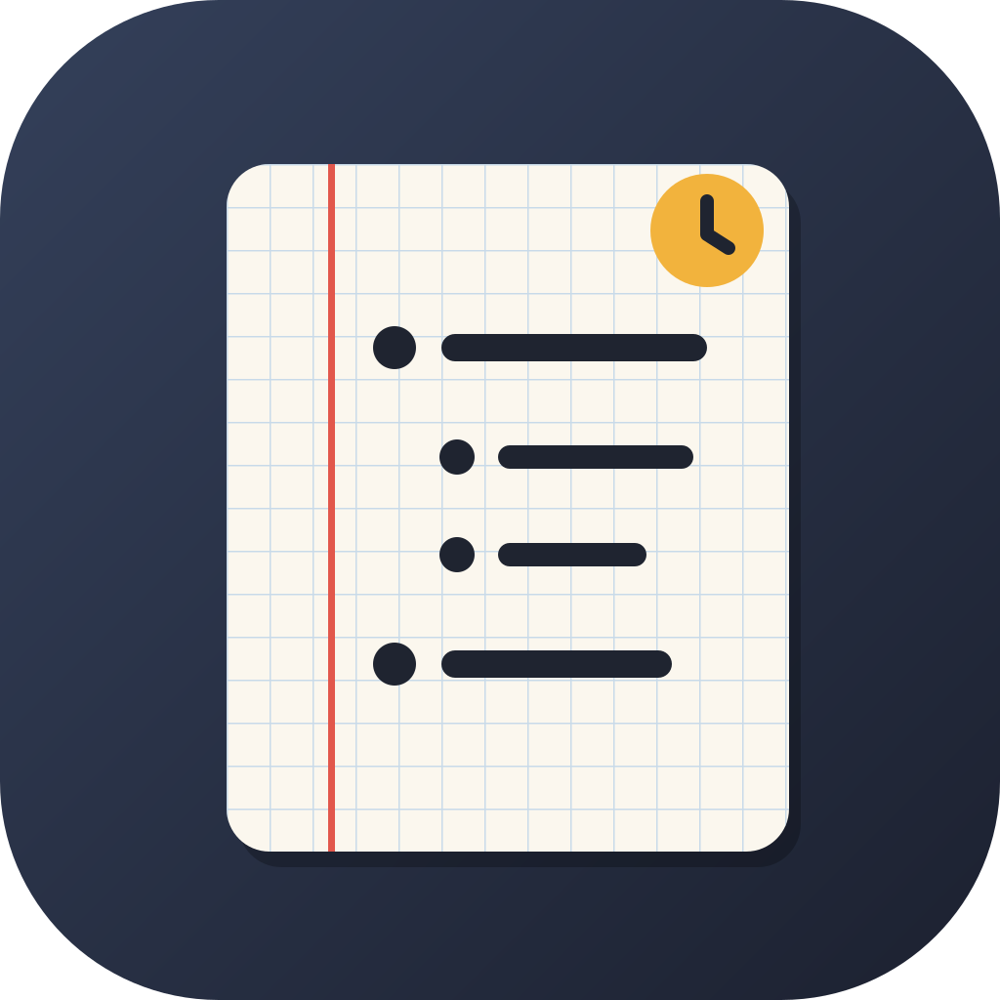
</p>

<h1 align="center">Brulion</h1>

<p align="center">
  <b>Markdown notes that are yours.</b><br>
  A daily journal and outliner like Logseq, plain files like Obsidian, a calendar, reminders
  with real alarms, calculations and tables with formulas. Works offline — on NixOS, Android
  and in the browser. Sync through Syncthing or Nextcloud.
</p>

<p align="center">
  <a href="https://github.com/janusz-bit/brulion/actions/workflows/ci.yml"></a>
  <a href="https://github.com/janusz-bit/brulion/releases"></a>
  <a href="LICENSE"></a>
</p>

<p align="center"><a href="#polski">🇵🇱 Po polsku — niżej</a></p>

<!-- SCREENSHOTS -->
<p align="center">
  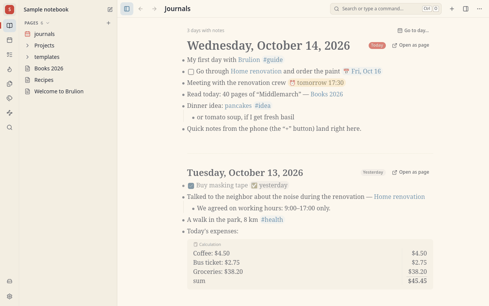
  <br><sub><b>Journal</b> — a page for every day: tasks with dates, reminders, links, tags and calculations</sub>
</p>

<table>
  <tr>
    <td width="50%" valign="top">
      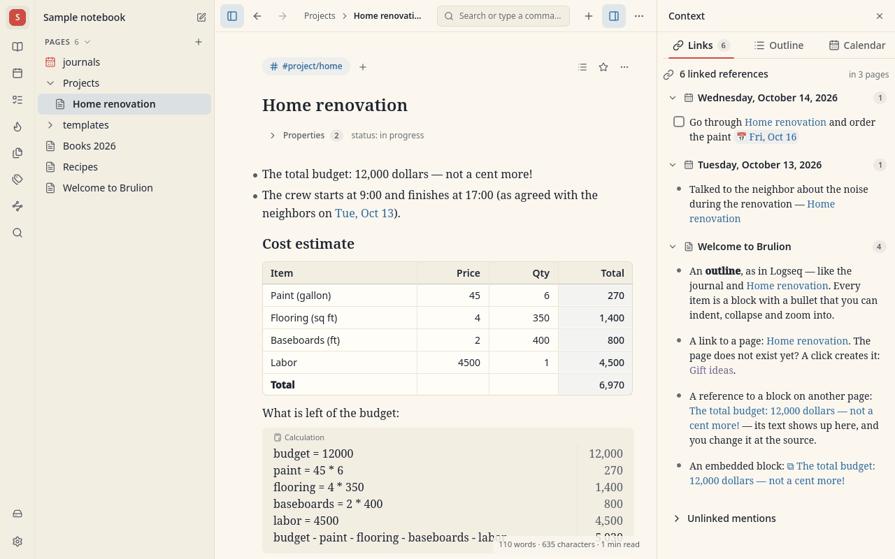
      <br><sub><b>A page and its references</b> — a table with formulas, a calculation block, and beside it everything that links to the page</sub>
    </td>
    <td width="50%" valign="top">
      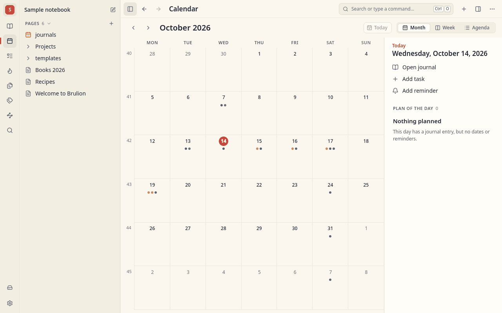
      <br><sub><b>Calendar</b> — month, week or agenda: due dates, reminders, alarms and recurring tasks</sub>
    </td>
  </tr>
  <tr>
    <td width="50%" valign="top">
      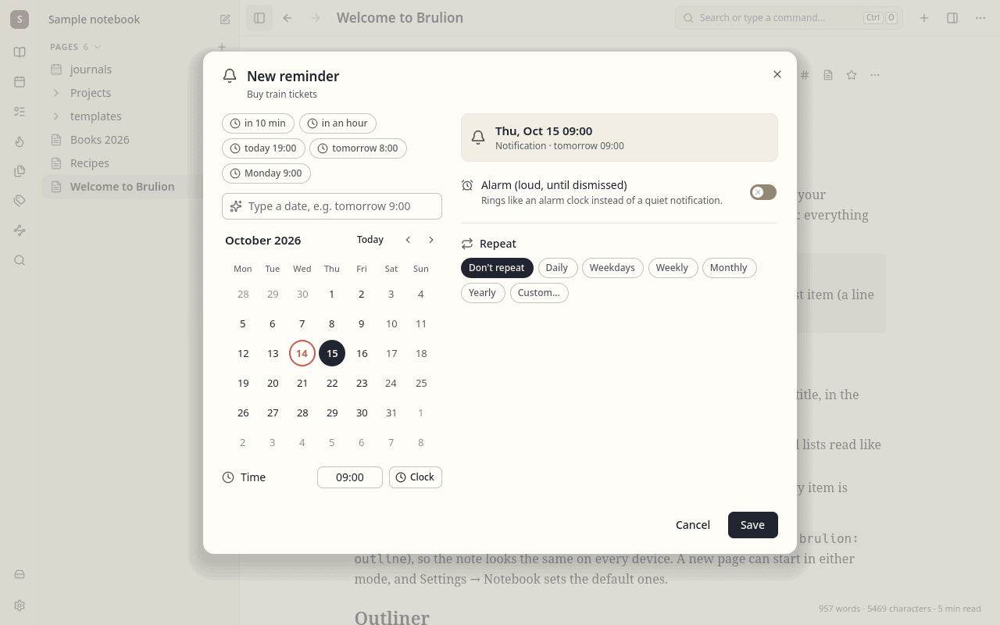
      <br><sub><b>Reminders and alarms</b> — quick dates, dates in plain words (“tomorrow 9:00”), repetition</sub>
    </td>
    <td width="50%" valign="top">
      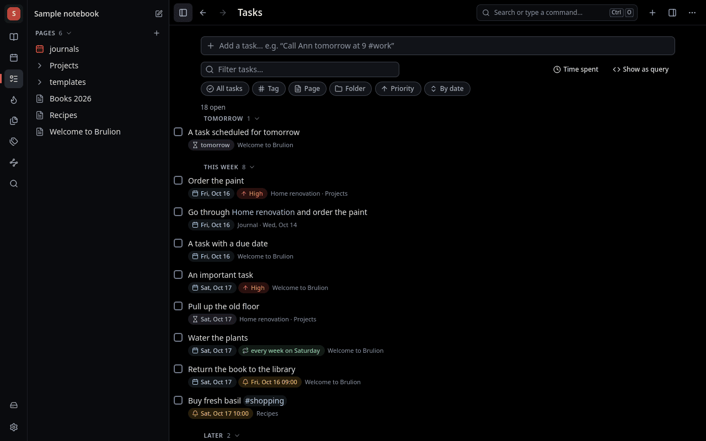
      <br><sub><b>Tasks</b> (dark theme) — every task from your notes, filters and quick add</sub>
    </td>
  </tr>
  <tr>
    <td width="50%" valign="top">
      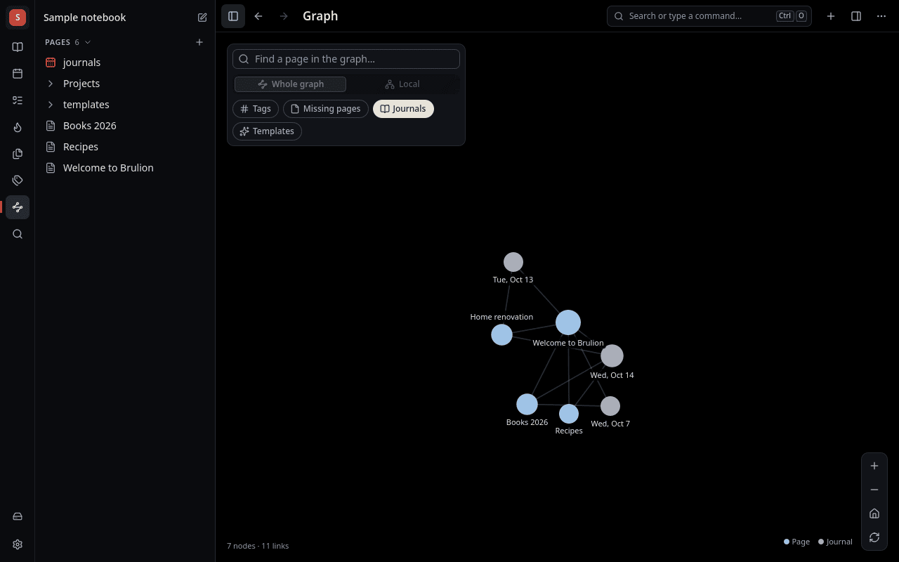
      <br><sub><b>Graph</b> (dark theme) — links between pages and journal days; tags too on request</sub>
    </td>
    <td width="50%" valign="top">
      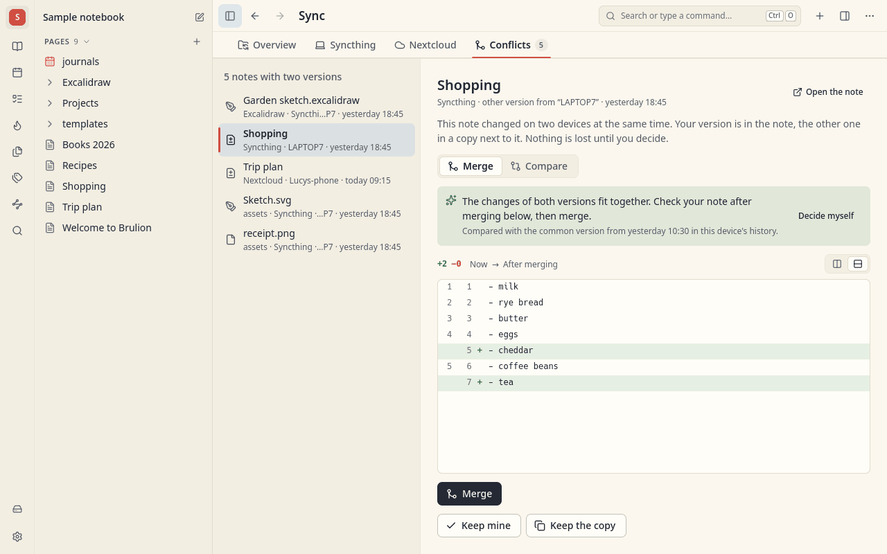
      <br><sub><b>Sync center</b> — a conflict from two devices merged line by line</sub>
    </td>
  </tr>
  <tr>
    <td colspan="2" align="center" valign="top">
      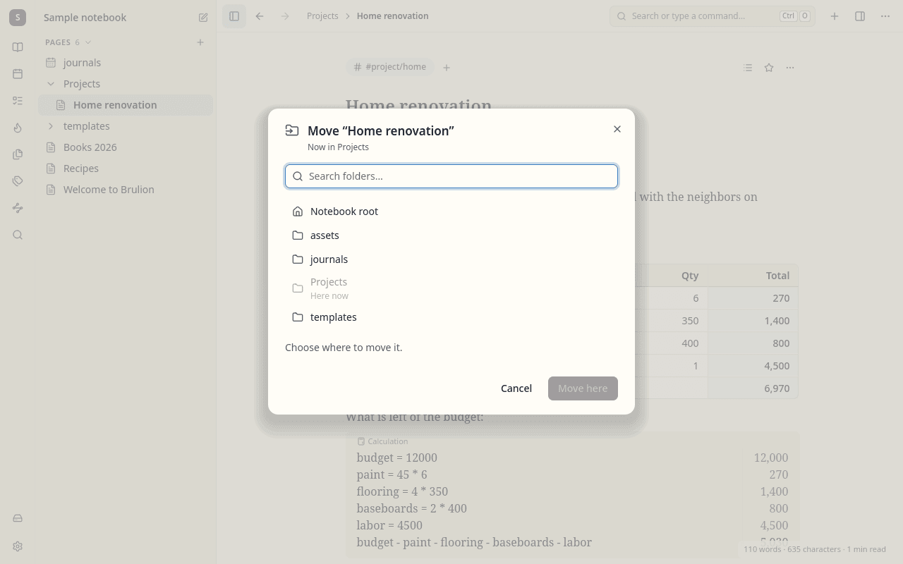
      <br><sub><b>Folders</b> — the tree shows the open page, and “Move to…” moves pages and folders without breaking links</sub>
    </td>
  </tr>
</table>

<p align="center">
  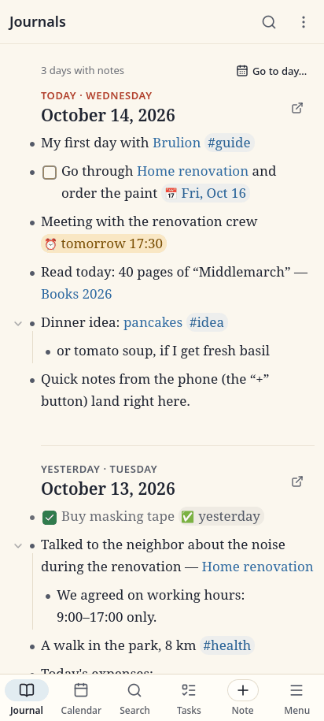
  &nbsp;&nbsp;&nbsp;
  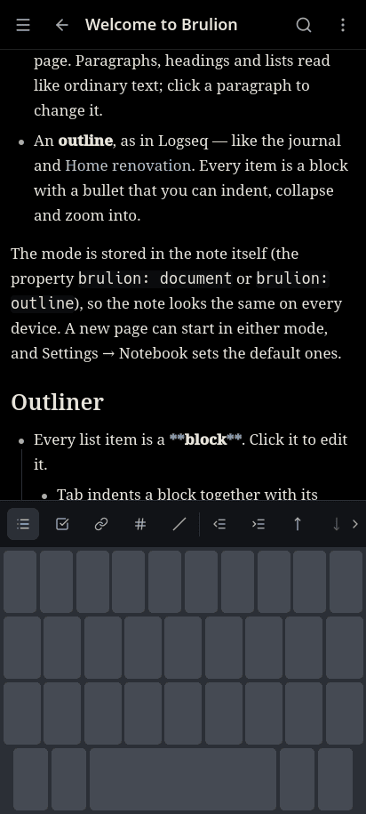
  &nbsp;&nbsp;&nbsp;
  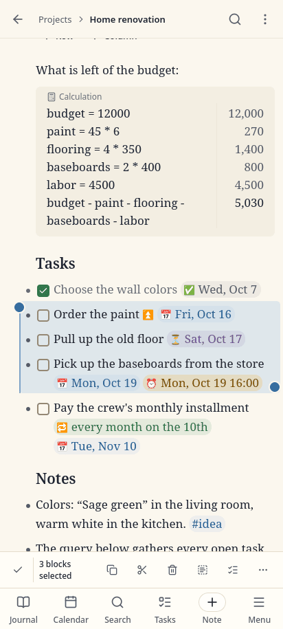
  <br><sub><b>On a phone</b> — the journal with the bottom navigation, editing with the toolbar right above the keyboard (dark theme) and selected blocks with the selection tools</sub>
</p>

## About

**Brulion** (Polish for “rough notebook”) is an offline-first Markdown notes app: Logseq-style
daily journals and block outliner on top of plain Obsidian-compatible `.md` files (every note is
either an Obsidian-like document or a Logseq-like outline, switchable at any time), with a
calendar, reminders and real alarms, calculation blocks and spreadsheet-like table formulas,
live queries, version history, and import/export for Obsidian, Logseq, Notion, Evernote,
Google Keep, Microsoft To Do (import of tasks), Joplin, Simplenote, Roam, Trilium, Bear, HTML and
iCalendar (export also as one
Pandoc Markdown document for Word, LibreOffice, PDF or EPUB).

* Runs on **NixOS/Linux** (flake + NixOS module, AppImage), **Android** 9+ (APK; native exact
  alarms that fire while the app is closed, and a periodic background check — after a Nextcloud
  sync, when set up — that arms reminders added on other devices; text, links and `.md`/`.txt` files shared from other
  apps go to the journal or a new page — the same dialog opens for "Open with → Brulion" on a
  `.md`/`.txt` file on the desktop (Linux: "Open with → Other application"; Brulion never becomes
  the default program), which saves a copy and leaves the file as it is, and for text
  and links shared to the browser version installed as an app), in the **browser** (Qt for WebAssembly,
  works offline) and, as a **test version**, on **Windows** 10/11 x86_64 (a per-user installer
  without admin rights or a portable ZIP; unsigned; reminders as Windows toast notifications with
  Snooze/Done/OK, optional start at sign-in, a calendar with the day's tasks from a click on the
  tray icon — [docs/WINDOWS.md](docs/WINDOWS.md)). On phones the editing toolbar always sits right on the on-screen keyboard
  (Android's IME insets, frame by frame on Android 11+; the browser's visualViewport); with the
  keyboard closed, the bottom navigation comes back and the toolbar sits right on it.
* Sync through **Syncthing** (it's just a folder; conflict copies are detected and merged in
  the app — drawings element by element; an Obsidian vault synced with Syncthing opens as it is, no import needed) or **Nextcloud/WebDAV** (built-in background sync with 3-way merge and a
  mass-deletion guard; folders travel too — empty ones, deletions of emptied ones, and a folder
  or page renamed in the app is moved on the server in one WebDAV MOVE (also when you keep
  typing in it right away), never mistaken for a mass deletion; one renamed on another device or in the Nextcloud web UI is renamed here too,
  recognised by its `oc:fileid` or ETag, so its version history, favourites and folds follow).
* Weekly (ISO week, `2026-W45.md`) and monthly notes (`2026-11.md`) next to the daily ones, with
  their own folders, file names and templates, opened from the calendar's week numbers and month
  title or with `Ctrl+Alt+W` / `Ctrl+Alt+M`; `Ctrl+F` in the journal searches every day at once.
* **Habits**: a block with `habit:: every day` (`mon, fri`, `3 times a week`, or in Polish
  `codziennie`…) is a habit; each day's tick is a `- [x] Name #habit` task in that day's journal
  (also ticked in the journal itself). The Habits view ticks today, shows the streaks, the completion rate and a
  month grid; `brulion-cli habit list` / `habit tick`.
* Two note modes: a **document** (Obsidian-like live preview: paragraphs, headings and plain
  lists, edited in place) or an **outline** (Logseq-like: every bullet is a block). Chosen when
  a page is created and switchable at any time; stored in the note as `brulion: document` /
  `brulion: outline` frontmatter, and notes from Obsidian or Logseq open in the right mode
  without it.
* Tags are links to pages, as in Logseq: `#work` opens the page "work" (created by its first
  content), whose linked references list the tagged blocks; renaming a page renames its tags.
* Folders you can reorganise: move pages, attachments and whole folders ("Move to…" from the
  tree, the More menu, All pages or the palette, a "⋯" button per row on phones, mouse drag and
  drop in the tree, or a "/" in Rename) and every link, tag and query filter keeps pointing at the
  same file — the impact is shown before moving, an ambiguous `[[Home]]` becomes
  `[[Projects/Home]]`, and moving the journals or templates folder updates the notebook's
  settings. A daily note is a file too: a misfiled day is moved or renamed the same way. The tree reveals the
  open page and sorts in Polish order with numbers by value; All pages browses folder by folder.
  In a link `[[Projects/Home]]` each path part is a link of its own (Logseq-like namespaces):
  "Projects" opens that page, or the folder when there is none.
* Copy a link to any block or heading — `((id))`, `[[Page#^id]]`, `[[Page#Heading]]` or an embed
  — from the block menu (a right-click, a long press on the bullet, or "More" on the phone's
  editing toolbar); `Ctrl+Shift+C` copies the reference `((id))`. Following one scrolls to it and
  highlights it.
* Select groups of blocks — bullets or a document's paragraphs, with their children — with
  `Shift+↑/↓`, `Ctrl+A`, Shift+click, a mouse drag or, on phones, a long press (then taps and
  grips); pick single ones with gaps between them (bullets 1, 3 and 5) with Ctrl+click, or with
  taps after "One by one" on phones. Copy, cut or delete them together — indent or move them when
  there are no gaps: the clipboard gets Markdown plus formatted HTML for mail and office apps
  ("Copy as plain text" too). In the journal, blocks of several days can be selected and copied at
  once (each day after its link). For part of several paragraphs, select the whole blocks, or select
  exactly those characters in the Markdown source mode (`Ctrl+E`, More → Markdown source).
* Tasks compatible with Obsidian Tasks and Logseq markers; any status (to do, in progress, done,
  waiting, cancelled, or none) from the checkbox's menu — a right-click or a long press,
  wherever a task is shown — or a `/` command. The same gesture on a date, reminder, 🔁 rule or
  priority opens its menu (move the date, snooze, alarm, change the rule or priority) in notes,
  query results, embeds, tables, Tasks and the calendar — only that token changes, and it can be
  undone; on a `#tag`, a `[[link]]` or a link to a day: open, open in the side panel, copy.
  A task's reminder notification has a **Done** button (Linux, Windows, Android) that completes
  the task without opening the note.
* Android home-screen widgets: today's tasks ("My day": overdue and today) with a quick add —
  day, time and alarm from chips, written to the journal at once, even with the app closed —, a
  calendar with dots and an agenda (timed tasks first), and notes (today's journal, a quick
  note, favourite and recent pages).
* A command line for scripts and AI agents: `brulion-cli` captures, appends to journals, adds
  tasks and reminders, searches, queries and moves pages exactly as the app does (JSON output,
  stable exit codes, every change in the version history, destructive commands behind
  `--allow-destructive`; help and messages in Polish under a Polish locale, else English), and
  `brulion-cli mcp` serves the same commands as MCP tools; see
  [docs/CLI.md](docs/CLI.md). With remote control allowed (off by default: Settings → Application
  → For developers, or `brulion --remote-control`), agents can also drive the running desktop
  app — its state, clicks, typing, shortcuts, screenshots (`brulion-cli app …`,
  `brulion-cli mcp --app-control`).
* Your look (Settings → Appearance): dark (the default, with an OLED-black background), light or system theme, an accent colour (six presets
  or any colour, kept readable), paper or white and blue-grey or OLED-black backgrounds, any
  installed font for the interface, notes and code, line spacing, a compact density on the
  desktop, and which sidebar entries and phone navigation buttons are shown.
* Spell checking of the block being edited, in Polish and English at once: misspelled words
  underlined, corrections, "add to dictionary" and "ignore" from the right-click menu (a tap on
  touch screens); code, links, tags, dates and formulas are skipped. Hunspell with bundled
  dictionaries on the desktop, the system's spell checker on Android.
* Tables sorted from a column's menu (numbers, dates, Polish alphabetical order; the rows
  rewritten in the file, one undo step) and filtered with fields under the header (`> 100`,
  `!text` — nothing written), copied or saved as CSV, and `/Table from CSV…` makes a table of a CSV
  file. A ```` ```chart ```` block (`/Chart`) draws a bar, line or pie chart of the table above it,
  a calc block or a query's results — in the theme's colours, with a text alternative for screen
  readers, as SVG in the HTML export.
* Mermaid diagrams in ```` ```mermaid ```` blocks — flowcharts (with subgraphs and styles),
  sequence diagrams and pie charts — drawn by Brulion's own renderer in the theme's light or dark
  colours, nothing from a note ever executed; a click edits the source with a live preview, the
  HTML export has the diagram as SVG. Other Mermaid types stay their source.
* Handwritten drawings in notes (`/Drawing`): a stylus with pressure (its eraser end erases), a
  highlighter, an eraser, shapes (rectangle, ellipse, diamond, line, arrow, triangles, polygons,
  a star, a block arrow, a speech bubble, a heart, a cloud), text and labels in shapes, lasso or
  rectangle selection (move, resize and rotate by handles, mirror, group, style — fill, lines,
  opacity, corners, arrowheads, text size —, duplicate, recolour, bring to front / send to back, delete),
  colours and widths, plain, lined or squared paper, undo; a light or a
  dark background per drawing, or "Like the app" — it then turns dark and light with the app at
  once, in the editor and in the previews in notes (colours as in Excalidraw's dark mode); fingers
  move and zoom the paper while you draw with a stylus (or draw — "Draw with finger"), a mouse
  draws on the desktop. A drawing is a plain SVG attachment (`![[Drawing ….svg]]`) with an
  embedded Excalidraw scene: Obsidian and browsers show it as a picture (a "Like the app" drawing
  dark in Obsidian's dark theme), excalidraw.com opens it for editing (and Excalidraw drawings
  with shapes and text are edited in Brulion), Syncthing syncs it like any file. Drawings of the
  Obsidian Excalidraw plugin (`*.excalidraw.md`) and `.excalidraw` files are shown in notes and
  edited too, and saved back in their own format — Obsidian still opens them, with the notes on
  the back of the drawing and the links in its texts. **Notes on slides:** "/Drawing on a picture or
  PDF…" puts a picture, a slide or a lecture's PDF pages under a drawing (one drawing per page; on
  Android, Windows and Linux — pictures in the browser), and the backdrop turns dark with dark
  paper.
* **PDF preview.** A PDF embedded in a note (`![[lecture.pdf]]`, also Obsidian's `#page=3`) shows
  a thumbnail of the page; a click opens the app's own PDF viewer: scrolling, zoom (pinch,
  Ctrl+wheel, buttons, fit width), "Page 3 of 12" with a page jump, search ignoring case and
  Polish diacritics (Android 15+), **Open in another app** and **Draw on this page** — notes on
  slides straight from the PDF. In the browser the PDF opens in a new tab.
* English UI by default, Polish available. Natural-language dates in English and Polish.
* **A short intro on the first start**: the language, the look (black by default — easy on the
  eyes and on OLED screens —, dark blue-grey, light or the system's), the permissions reminders
  need on this device (on Android notifications, exact alarms, alarms over the lock screen and,
  only for a folder on the phone's storage, "All files access"; the browser's notifications; the
  tray on the desktop), with a test notification, and the settings of your first notebook (journal
  as an outline or documents, file names, first day of the week, default reminder time). Skip it
  any time; Settings → General runs it again.
* Something not working? Settings → Application → **Event log** shows what the app and the sync
  did (live sync progress and the history of runs are in the sync center); share or save it
  and send it to us — it stays on the device and never contains passwords, tokens or note
  contents.
* Built with C++20 and Qt 6.11 Quick; GUI-free core libraries with thousands of unit tests.

* **The guide inside**: the full user guide is a notebook of its own, "Brulion Documentation" on
  the desktop and Android — switch to it and back with "Switch notebook" (the first letter of the
  notebook's name at the top of the icon bar) or `Ctrl+Shift+B`. It updates with the app and
  keeps your edits. Like the sample notebook it is written in the UI language (English or
  Polish); outside the app the same pages are in the repository
  ([src/app/shell/guide/en](src/app/shell/guide/en), in Polish
  [src/app/shell/guide/pl](src/app/shell/guide/pl)).

The screenshots above show the Polish UI with the bundled sample notebook (`brulion --demo`).

## Install

| Platform | How |
|---|---|
| **NixOS** | flake + the `programs.brulion` module (with autostart in the tray) — [docs/NIXOS.md](docs/NIXOS.md) |
| **Other Linux** | AppImage (x86_64, aarch64) from [Releases](https://github.com/janusz-bit/brulion/releases); updates itself through AppImageUpdate, Gear Lever or AppImageLauncher |
| **Windows** 10/11 (x86_64) — **test version** | the installer `Brulion-<version>-windows-x86_64-setup.exe` (for the current user, no administrator rights) or the portable `brulion-<version>-windows-x86_64.zip` from [Releases](https://github.com/janusz-bit/brulion/releases); the files are not signed (SmartScreen: "More info" → "Run anyway"); reminders as Windows notifications with Snooze/Done/OK, start at sign-in, a calendar with the day's tasks from a click on the tray icon — [docs/WINDOWS.md](docs/WINDOWS.md) |
| **Android** (9+) | Brulion's own F-Droid repository — <https://janusz-bit.github.io/brulion/> (add it in F-Droid with the button or the QR code on that page; updates come through F-Droid) — or the APK file (arm64) from [Releases](https://github.com/janusz-bit/brulion/releases), the same APK with the same signature; a notice in the app with a link to the release also tells you about a new version (it can be turned off in the settings) — [docs/ANDROID.md](docs/ANDROID.md) |
| **Browser** | one file, `brulion-web-<version>.html` from [Releases](https://github.com/janusz-bit/brulion/releases), opened from disk — no server, no internet — [docs/WEB.md](docs/WEB.md); on your own server (works offline after the first visit, installs as an app): `brulion-web-<version>.zip` from Releases or the NixOS module `services.brulion-web` |

On NixOS:

```nix
# the system's flake.nix
inputs.brulion.url = "github:janusz-bit/brulion";

# in modules = [ … ]
brulion.nixosModules.default
{ programs.brulion = { enable = true; autostart = true; }; }
```

Or without installing: `nix run github:janusz-bit/brulion`.

## Development

Build: `nix develop`, then `scripts/dev-build.sh -t .`; the Android APK: `nix build
.#brulion-android` (x86_64-linux hosts, unsigned; sign with `nix run .#brulion-android-sign --
result/*.apk`). Developer docs: [architecture](docs/ARCHITECTURE.md), [Markdown
dialect](docs/SYNTAX.md), [UI](docs/UI.md), [releases](docs/RELEASE.md). License: AGPL-3.0-or-later; icons Lucide (ISC), ZIP miniz (MIT), the stroke
outline of drawings ported from perfect-freehand (MIT, © Stephen Ruiz Ltd), the compression of
Obsidian Excalidraw plugin drawings ported from lz-string (MIT, © 2013 Pieroxy), emoji and
symbol fallback fonts: subsets of Noto Emoji and Noto Sans Math (SIL OFL 1.1, `assets/fonts`); PDF
thumbnails, the PDF viewer and PDF pages of drawing backdrops: Qt PDF (pdfium, BSD-3-Clause; Windows, AppImage), poppler
(GPL-2.0-or-later, compatible with the AGPL; the Nix package), Android's own `PdfRenderer`.

Performance (numbers per platform, budgets, how to benchmark, regression guards): [docs/PERFORMANCE.md](docs/PERFORMANCE.md).

---

## Polski

<p align="center">
  <b>Notatki w Markdownie, które są Twoje.</b><br>
  Dziennik i outliner jak w Logseq, zwykłe pliki jak w Obsidianie, kalendarz, przypomnienia
  z alarmami, obliczenia i tabele z formułami. Działa bez internetu — na NixOS, Androidzie
  i w przeglądarce. Synchronizacja przez Syncthing albo Nextcloud.
</p>

Brulion startuje po angielsku; polski wybierzesz w pierwszym kroku wprowadzenia (albo w
Ustawienia → Ogólne → Język). Zrzuty ekranu powyżej pokazują polski interfejs z dołączonym
przykładowym notatnikiem.

## Dlaczego Brulion?

* **Twoje pliki, zawsze.** Każda notatka to zwykły plik `.md` w folderze. Żadnej bazy danych,
  żadnego konta, żadnej chmury pośrednika. Ten sam folder możesz otworzyć w Obsidianie,
  Logseq czy dowolnym edytorze tekstu.
* **Offline przede wszystkim.** Wszystko działa bez sieci. Synchronizacja dzieje się w tle,
  gdy sieć jest dostępna, i nigdy nie blokuje pisania. Konflikty są scalane automatycznie
  (scalanie trójstronne), a gdy się nie da — obie wersje zostają i dostajesz wygodny widok
  scalania.
* **Dziennik + outliner.** Codzienna strona dziennika, bloki z wcięciami (Tab / Shift+Tab),
  zwijanie, przybliżanie bloku, przenoszenie bloków z dziećmi, odwołania do bloków
  `((…))`, linki `[[…]]`, tagi `#…`, odnośniki zwrotne. Obok dni — notatki tygodniowe (tydzień
  ISO, `2026-W45.md`) i miesięczne (`2026-11.md`) z własnymi szablonami, otwierane z kalendarza
  (numer tygodnia, nazwa miesiąca) albo skrótami `Ctrl+Alt+W` / `Ctrl+Alt+M`. `Ctrl+F` w
  dzienniku szuka we wszystkich dniach naraz. **Nawyki**: punkt z `habit:: codziennie` (albo
  `pn, śr, pt`, `3 razy w tygodniu`) odhaczasz w widoku Nawyki albo w dzienniku (`- [x] Medytacja
  #nawyk`) — z serią, skutecznością i kalendarzem miesiąca. Tagi działają jak linki do stron, jak
  w Logseq: `#praca` otwiera stronę „praca” (tworzoną przy pierwszym wpisie), jej odnośniki
  pokazują bloki z tym tagiem, a zmiana nazwy strony poprawia też tagi. Odnośnik do każdego
  bloku i nagłówka — `((…))`, `[[Strona#^…]]`, `[[Strona#Nagłówek]]` — skopiujesz z menu bloku
  (prawy przycisk myszy, przytrzymanie punktora, na telefonie „Więcej” nad klawiaturą), a
  odwołanie `((…))` także skrótem `Ctrl+Shift+C`; kliknięty przewija do celu i go podświetla.
* **Zaznaczanie i kopiowanie grup bloków.** Kilka punktów listy albo akapitów dokumentu
  zaznaczysz `Shift+↑/↓`, `Ctrl+A`, `Shift`+kliknięciem, przeciągnięciem myszą albo — na
  telefonie — przytrzymaniem palca na tekście (potem stuknięcia i uchwyty). Pojedyncze punkty z
  przerwami między nimi (na przykład 1., 3. i 5.) dobierzesz `Ctrl`+kliknięciem, a na telefonie
  stuknięciami po włączeniu „Pojedynczo” w narzędziach zaznaczenia. Zaznaczone bloki (z dziećmi)
  kopiujesz, wycinasz i usuwasz razem — wcinasz i przenosisz, gdy są zaznaczone bez przerw: w
  schowku są jako Markdown, a w poczcie czy edytorze dokumentów wklejają się sformatowane;
  „Kopiuj jako tekst” daje zwykły tekst z punktorami. W dzienniku zaznaczysz i skopiujesz bloki
  z kilku dni naraz (każdy dzień poprzedzony linkiem do niego). Kawałki kilku akapitów (koniec jednego
  i początek następnego) skopiujesz, zaznaczając całe bloki, albo co do znaku w trybie źródła
  Markdown (`Ctrl+E`, *Więcej* → *Źródło Markdown*).
* **Dokument albo konspekt.** Każda notatka ma swój tryb: **dokument** jak w Obsidianie
  (akapity, nagłówki i zwykłe listy, czytane jak tekst; klikasz i piszesz w miejscu) albo
  **konspekt** jak w Logseq (każdy punkt to blok). Tryb wybierasz przy tworzeniu strony
  i przełączasz w każdej chwili; zapisuje się w notatce jako `brulion: document` /
  `brulion: outline`, a notatki z Obsidiana i Logseq same otwierają się we właściwym trybie.
* **Zadania, kalendarz, przypomnienia.** `- [ ] Zadanie 📅 2026-10-20 ⏰ 2026-10-19 18:00`,
  powtarzanie `🔁 co tydzień`, alarmy `⏰!` (dzwonią jak budzik, aż je wyłączysz albo minie
  ustawiony czas — na Androidzie także przy zamkniętej aplikacji i po restarcie telefonu),
  widok kalendarza i listy zadań. Przypomnienie dopisane na komputerze telefon nastawi sam: co
  15–60 minut Android sprawdza notatki w tle, po synchronizacji z Nextcloud, jeśli jest włączona
  ([docs/ANDROID.md](docs/ANDROID.md#checking-notes-in-the-background)). Status zadania (do zrobienia, w toku, zrobione, oczekujące,
  anulowane albo bez statusu) wybierasz z menu pola wyboru — prawy przycisk myszy lub
  przytrzymanie palcem, wszędzie, gdzie widać zadanie — albo poleceniem `/` w bloku. Tak samo
  na znaczniku daty (📅 ⏳ 🛫 ✅ ➕ ❌) albo ⏰ otwiera się menu do zmiany daty: kalendarz, dziś,
  jutro, dzień / tydzień później, godzinę później, alarm, powtarzanie, priorytet, usunięcie — w
  notatce, w wynikach zapytań, we wstawionych blokach, w tabelach, w widoku zadań i w kalendarzu
  (zmiana trafia do notatki z zadaniem i da się cofnąć). Menu mają też 🔁 (reguła), priorytet,
  link do dnia `[[2026-10-20]]`, `#tag` i `[[link]]` (otwórz, otwórz w panelu bocznym, kopiuj).
  Przycisk **Zrobione** w powiadomieniu przypomnienia przy zadaniu (Linux, Windows, Android)
  oznacza zadanie jako zrobione bez otwierania notatki.
  Przypomnienia, które minęły przy wyłączonym urządzeniu, czekają w dzienniku. Daty wpisujesz
  po polsku: „jutro o 9”, „w piątek 18:00”, „za 2 godziny”.
* **Udostępnij / Otwórz w Brulionie.** Stronę z przeglądarki, tekst albo pliki `.md`/`.txt`
  z innej aplikacji zapiszesz w dzisiejszym dzienniku albo jako nową stronę — w oknie, w którym
  poprawisz tekst i tytuł: na Androidzie przez **Udostępnij → Brulion**
  ([docs/ANDROID.md](docs/ANDROID.md#share--brulion)), na komputerze przez **Otwórz za
  pomocą → Brulion** w menedżerze plików (kopia trafia do notatnika, plik zostaje bez zmian;
  [docs/WINDOWS.md](docs/WINDOWS.md#open-with), [docs/NIXOS.md](docs/NIXOS.md#open-with)),
  a w wersji w przeglądarce zainstalowanej jako aplikacja — tekst i odnośniki
  ([docs/WEB.md](docs/WEB.md#sharing-to-brulion)).
* **Widżety Androida.** Zadania na dziś („Mój dzień”: zaległe i dzisiejsze) z szybkim dodawaniem
  — dzień, godzina i alarm przyciskami, zapis do dziennika od razu, także przy zamkniętej
  aplikacji —, kalendarz z kropkami i agendą (najpierw zadania z godziną) oraz notatki
  (dzisiejszy dziennik, szybka notatka, ulubione i ostatnie strony)
  ([docs/ANDROID.md](docs/ANDROID.md#widgets)).
* **Obliczenia.** Bloki ` ```calc ` liczą jak kalkulator w notatniku (zmienne, procenty,
  jednostki `5 km to mi`, waluty `12 zł + 5 zł`, `suma`), tabele z formułami jak w arkuszu
  (`=sum(above)`, `=[Cena]*[Ilość]`), obliczenia w tekście `` `= 2*21` ``.
* **Tabele i wykresy.** Tabelę sortujesz z menu kolumny (liczby, daty, polski alfabet; wiersze
  przestawione w pliku, Ctrl+Z cofa) i filtrujesz polami pod nagłówkiem (`> 100`, `!tekst` — plik
  się nie zmienia), kopiujesz lub zapisujesz jako CSV, a `/Tabela z CSV…` wstawia tabelę z pliku.
  Blok ` ```chart ` (`/Wykres`) rysuje wykres słupkowy, liniowy albo kołowy z tabeli nad nim, bloku
  `calc` albo wyników zapytania — w kolorach motywu, z opisem dla czytnika ekranu, jako SVG w
  eksporcie HTML.
* **Wzory matematyczne.** LaTeX w notatkach (`$E=mc^2$`, `$$\frac{a}{b}$$`, blok
  ` ```math `) jest od razu rysowany jako wzór — greckie litery, ułamki, pierwiastki,
  macierze, układy równań. Plik zachowuje źródło LaTeX, a eksport HTML pokazuje gotowy wzór.
* **Sprawdzanie pisowni.** Literówki w edytowanym bloku są podkreślone — po polsku i angielsku
  naraz — a prawy przycisk (na telefonie dotknięcie słowa) daje podpowiedzi, „Dodaj do słownika”
  i „Ignoruj”. Kod, linki, tagi, daty i wzory nie są sprawdzane. Na komputerze Hunspell ze
  słownikami w pakiecie, na Androidzie systemowe sprawdzanie pisowni klawiatury.
* **Diagramy Mermaid.** Bloki ` ```mermaid ` — schematy blokowe (`flowchart`/`graph`, z podgrafami
  i stylami), diagramy sekwencji i wykresy kołowe — Brulion rysuje sam, w kolorach motywu jasnego
  i ciemnego, bez uruchamiania czegokolwiek z notatki (notatki z synchronizacji i importów są
  bezpieczne). Kliknięcie pokazuje źródło z podglądem na żywo, `/Diagram` wstawia nowy diagram,
  a eksport HTML zawiera diagram jako SVG. Inne typy Mermaid zostają źródłem.
* **Rysunki.** Polecenie `/Rysunek` (albo *Rysunek* na pasku nad klawiaturą) wstawia do notatki
  rysunek odręczny i otwiera go do rysowania: rysik z naciskiem (drugi koniec rysika ściera),
  zakreślacz, gumka, kształty (prostokąt, elipsa, romb, linia, strzałka), tekst i etykiety
  w kształtach, zaznaczanie lassem (przesuwanie, kopiowanie, kolor, na wierzch i na spód,
  usuwanie), kolory i grubości, papier gładki, w linie albo w kratkę, cofanie. Tło
  rysunku jasne, ciemne albo „jak motyw” — wtedy rysunek ciemnieje i jaśnieje od razu razem z
  motywem, w edytorze i w podglądach w notatkach (kolory jak w ciemnym trybie Excalidraw). Palec
  przesuwa i powiększa kartkę, gdy rysujesz rysikiem (albo rysuje — „Rysuj palcem”), myszką
  rysujesz na komputerze. Rysunek to zwykły plik SVG w załącznikach notatnika (`![[Rysunek ….svg]]`)
  z wbudowaną sceną Excalidraw: Obsidian i przeglądarki pokazują go jako obraz (rysunek „jak
  motyw” ciemny w Obsidianie z ciemnym motywem), excalidraw.com otwiera do edycji (a rysunki
  z excalidraw.com z kształtami i tekstem edytujesz w Brulionie), a Syncthing synchronizuje jak
  każdy plik. Rysunki wtyczki Excalidraw dla Obsidiana (`*.excalidraw.md`) i pliki `.excalidraw`
  Brulion też pokazuje w notatkach i edytuje, a zapisuje je w ich własnym formacie — Obsidian
  otworzy je dalej, z notatkami „z tyłu” rysunku i linkami w tekstach. **Notatki na slajdach:**
  `/Rysunek na obrazie lub PDF` kładzie pod rysunek obraz, slajd albo strony PDF z wykładu (po
  jednym rysunku na stronę; na Androidzie, Windows i Linuksie — w przeglądarce obrazy), a podkład
  ciemnieje razem z ciemną kartką.
* **Podgląd PDF.** PDF osadzony w notatce (`![[wykład.pdf]]`, także `#page=3` jak w Obsidianie)
  pokazuje miniaturę strony; kliknięcie otwiera przeglądarkę PDF w aplikacji: przewijanie,
  powiększanie palcami, `Ctrl` + kółkiem i przyciskami, „Strona 3 z 12” z przejściem do strony,
  szukanie bez polskich znaków i wielkości liter (na Androidzie od wersji 15), **Otwórz w innej
  aplikacji** i **Rysuj na tej stronie** — notatki na slajdach prosto z PDF-a. W przeglądarce PDF
  otwiera się w nowej karcie.
* **Znajdź i zamień.** `Ctrl+F` w otwartej notatce, bez polskich znaków i wielkości liter („zolw”
  znajdzie „ŻÓŁW”), a zamiana — w notatce (jedno `Ctrl+Z`) albo w całym notatniku, z podglądem
  każdego trafienia, odznaczaniem i cofnięciem.
* **Zapytania.** Blok ` ```query ` pokazuje na żywo np. wszystkie otwarte zadania z tagiem
  `#praca` na najbliższy tydzień: `status:open tag:praca due:<=+7d sort:due` (klucze także po
  polsku: `stan:otwarte termin:jutro`).
* **Wprowadzenie przy pierwszym uruchomieniu.** Język, wygląd, uprawnienia potrzebne
  przypomnieniom na tym urządzeniu (na Androidzie powiadomienia, dokładne alarmy, alarmy na
  ekranie blokady i — tylko dla folderu w pamięci telefonu — dostęp do wszystkich plików;
  powiadomienia przeglądarki; zasobnik na komputerze) z powiadomieniem próbnym oraz ustawienia
  pierwszego notatnika (dziennik jako konspekt albo dokumenty, nazwy plików, pierwszy dzień
  tygodnia, domyślna godzina przypomnień). Można je pominąć i uruchomić ponownie w *Ustawienia →
  Ogólne*.
* **Twój wygląd.** Ciemny (domyślnie, z czarnym tłem OLED), jasny albo systemowy motyw; kolor
  akcentu (sześć gotowych albo własny, zawsze czytelny), papierowe lub białe tło, granatowe lub czarne (OLED), dowolna
  czcionka interfejsu, notatek i kodu, odstęp między wierszami, zwarta gęstość na komputerze,
  wybór pozycji paska bocznego i przycisków dolnej nawigacji na telefonie (*Ustawienia → Wygląd*).
* **Import i eksport.** Import z Obsidiana, Logseq, Notion, Evernote, Google Keep, Microsoft To Do
  (zadania: logowanie do Microsoft albo plik z Graph Explorera), Joplin, Simplenote, Roam,
  Trilium, Bear, plików Markdown/TXT, HTML i kalendarzy iCalendar — także na
  telefonie (*Więcej → Importuj notatki*: pliki, ZIP albo cały folder skarbca, z podglądem przed
  zapisem; [docs/IMPORT.md](docs/IMPORT.md) — m.in. jak wyeksportować notatki z Trilium i co się
  z czym zamienia; [docs/ANDROID.md](docs/ANDROID.md#importing-notes-obsidian-logseq-notion)).
  Eksport do ZIP z Markdownem, formatu Obsidiana i Logseq, statycznej strony HTML lub jednego
  pliku HTML, Pandoc Markdown (jeden dokument do zamiany w Word, LibreOffice, PDF albo EPUB),
  JSON, iCalendar, OPML i CSV zadań.
* **Foldery bez psucia linków.** Strony, załączniki i całe foldery przenosisz poleceniem
  „Przenieś do…” (z drzewa, menu „Więcej”, listy stron albo palety; na telefonie przycisk „⋯”
  przy każdym wierszu), przeciągając myszą w drzewie albo wpisując „/” przy zmianie nazwy
  („Archiwum/Dom”). Każdy link, tag i filtr zapytania dalej prowadzi do tej samej strony —
  Brulion pokazuje przed przeniesieniem, ile linków poprawi, a niejednoznaczny `[[Dom]]` zapisze
  jako `[[Projekty/Dom]]`. Dzień dziennika to też plik: źle zapisany przeniesiesz albo zmienisz mu
  nazwę tak samo. Nowy folder zakładasz z „+” przy „Strony”, nowa strona trafia do folderu
  otwartej strony, drzewo samo pokazuje otwartą stronę i sortuje po polsku („Rozdział 2” przed
  „Rozdział 10”), a „Wszystkie strony” przeglądasz folder po folderze. W linku
  `[[Projekty/Dom]]` każda część ścieżki to osobny link: „Projekty” otwiera stronę albo folder
  Projekty.
* **Wiersz poleceń i agenci AI.** `brulion-cli` dopisuje do dziennika, dodaje zadania
  i przypomnienia, szuka i przenosi strony z terminala albo skryptu — dokładnie tak jak
  aplikacja — a `brulion-cli mcp` udostępnia to samo agentom AI (MCP). Na komputerze agent może
  też — gdy mu na to pozwolisz w ustawieniach — sterować działającą aplikacją: zobaczyć, co
  pokazuje, kliknąć, pisać i zrobić zrzut ekranu. Więcej niżej i w [docs/CLI.md](docs/CLI.md).
* **Kompatybilność.** Składnia zadań zgodna z wtyczką Obsidian Tasks, właściwości `klucz::
  wartość` jak w Logseq/Dataview i nagłówek YAML jak w Obsidianie — edytowane w polach panelu
  „Właściwości” bez zmiany reszty nagłówka — szczegóły w [docs/SYNTAX.md](docs/SYNTAX.md).
* **Historia wersji i kosz.** Zanim notatka zostanie nadpisana, jej poprzednia wersja trafia
  do historii na urządzeniu (przy pisaniu najwyżej co 5 minut, zawsze przed zmianami
  z synchronizacji i importu). Każdą wersję możesz porównać i przywrócić, a usunięte strony
  odzyskać z kosza.
* **Usuwanie.** Stronę, załącznik albo folder przeniesiesz do kosza z menu **Więcej**, z drzewka
  (także klawiszem `Delete`), ze „Wszystkich stron” i z palety poleceń, a „Cofnij” w powiadomieniu
  od razu je przywraca. Z kosza znikają na dobre dopiero, gdy o to poprosisz.
* **Kopie zapasowe.** Automatyczne archiwa ZIP notatnika, codziennie albo co tydzień, z limitem
  liczby, na urządzeniu lub we wskazanym folderze. Przywracanie pokazuje najpierw, co się zmieni,
  robi kopię bezpieczeństwa i zostawia zastąpione wersje w historii, a nadmiarowe pliki w koszu.
* **Sprzątanie.** Lista notatek i załączników, do których nie prowadzi żaden link, tag ani
  zapytanie. Wybierasz, co przenieść do kosza: same notatki, same załączniki albo pojedyncze pliki.
* **Na start: przykładowy brulion.** Strona „Witaj w Brulionie” pokazuje wszystkie funkcje na
  żywych przykładach — do klikania, edytowania i psucia.
* **Dokumentacja w środku.** Pełny poradnik to osobny notatnik „Dokumentacja
  Brulionu” (na komputerze i Androidzie): przycisk „Przełącz notatnik” (pierwsza litera nazwy
  notatnika na górze paska ikon) albo `Ctrl+Shift+B` i z powrotem. Aktualizuje się razem z aplikacją, a Twoje zmiany w nim
  zostają. Tak jak przykładowy brulion jest w języku interfejsu (polskim albo angielskim); w
  przeglądarce te same strony są w repozytorium
  ([src/app/shell/guide/pl](src/app/shell/guide/pl), po angielsku
  [src/app/shell/guide/en](src/app/shell/guide/en)).

## Instalacja

| Platforma | Jak |
|---|---|
| **NixOS** | flake + moduł `programs.brulion` (z autostartem w zasobniku) — [docs/NIXOS.md](docs/NIXOS.md) |
| **Inne Linuksy** | AppImage (x86_64, aarch64) z [Wydań](https://github.com/janusz-bit/brulion/releases); aktualizuje się przez AppImageUpdate, Gear Lever albo AppImageLauncher |
| **Windows** 10/11 (x86_64) — **wersja testowa** | instalator `Brulion-<wersja>-windows-x86_64-setup.exe` (dla bieżącego użytkownika, bez uprawnień administratora) albo przenośny `brulion-<wersja>-windows-x86_64.zip` z [Wydań](https://github.com/janusz-bit/brulion/releases); pliki nie są podpisane (SmartScreen: „Więcej informacji” → „Uruchom mimo to”); przypomnienia jako powiadomienia Windows z „Drzemka”/„Zrobione”/„OK”, autostart po zalogowaniu, kalendarz z zadaniami po kliknięciu ikony w zasobniku — [docs/WINDOWS.md](docs/WINDOWS.md) |
| **Android** (9+) | repozytorium F-Droid Brulionu — <https://janusz-bit.github.io/brulion/> (dodaj je w F-Droid przyciskiem albo kodem QR ze strony; aktualizacje przez F-Droid) — albo plik APK (arm64) z [Wydań](https://github.com/janusz-bit/brulion/releases), ten sam APK z tym samym podpisem; o nowej wersji mówi też komunikat w aplikacji z linkiem do wydania (można wyłączyć w ustawieniach) — [docs/ANDROID.md](docs/ANDROID.md) |
| **Przeglądarka** | jeden plik `brulion-web-<wersja>.html` z [Wydań](https://github.com/janusz-bit/brulion/releases), otwierany z dysku — bez serwera i bez internetu — [docs/WEB.md](docs/WEB.md); na własnym serwerze (działa offline po pierwszym otwarciu, instaluje się jako aplikacja): `brulion-web-<wersja>.zip` z Wydań albo moduł `services.brulion-web` |

### NixOS w skrócie

```nix
# flake.nix systemu
inputs.brulion.url = "github:janusz-bit/brulion";

# w modules = [ … ]
brulion.nixosModules.default
{ programs.brulion = { enable = true; autostart = true; }; }
```

Albo bez instalowania: `nix run github:janusz-bit/brulion`.

## Synchronizacja

**Syncthing (polecane do pracy offline):** wskaż w Brulionie folder synchronizowany przez
Syncthing (na Androidzie: Syncthing-Fork, np. `/storage/emulated/0/Brulion`, i nadaj
aplikacji „Dostęp do wszystkich plików”). Brulion zapisuje pliki atomowo, wykrywa kopie
konfliktów Syncthinga (`*.sync-conflict-*`) i pozwala je scalić — notatki wiersz po wierszu,
rysunki element po elemencie („Scal rysunki”). Opcjonalnie pokazuje stan
synchronizacji z API Syncthinga.

**Masz już skarbiec Obsidiana w Syncthingu?** Nie importuj go i nie włączaj dla niego
Nextclouda — po prostu otwórz jego folder jako notatnik na każdym urządzeniu. Obie aplikacje
mogą z niego korzystać na zmianę; folder, format i szablon dziennika oraz folder załączników
Brulion sam przejmie z ustawień Obsidiana (`.obsidian/`). Co działa, co się różni i co Brulion
dopisuje do folderu:
[docs/IMPORT.md](docs/IMPORT.md#obsidian-folder-without-importing).

**Nextcloud (WebDAV):** w *Centrum synchronizacji* (menu *Więcej* ⋮ lub *Ustawienia →
Synchronizacja*) podaj adres serwera, użytkownika i **hasło aplikacji** (Nextcloud →
Ustawienia osobiste → Bezpieczeństwo → „Utwórz nowe hasło aplikacji”) oraz folder (przy
pierwszym koncie proponowany `Notatki`, dla kolejnych notatników ich nazwa); „Testuj
połączenie” wyjaśnia ewentualne błędy. Serwer i konto są wspólne, ale włączenie synchronizacji
i folder na serwerze należą do notatnika: inny notatnik (także dokumentacja) startuje bez
synchronizacji, a folderu, z którym synchronizuje się już inny notatnik na tym urządzeniu,
Brulion nie zapisze. Dwa notatniki, które wersje 0.3.1–0.3.5 połączyły z jednym folderem,
nie synchronizują się wcale (także „Synchronizuj teraz”), dopóki jednemu z nich nie wybierzesz
innego folderu — stan synchronizacji mówi, z którym notatnikiem dzielą folder. „Wyloguj”
wyłącza synchronizację we wszystkich notatnikach, a zapisanie innego serwera lub użytkownika —
w pozostałych. Brulion synchronizuje w tle
(domyślnie co 15 minut), chwilę po zmianach i po powrocie sieci, a na Androidzie przy zamkniętej
aplikacji — przy [sprawdzaniu notatek w tle](docs/ANDROID.md#checking-notes-in-the-background); równoległe dopiski
w dzienniku z dwóch urządzeń scalają się same. Ochrona przed masowym usuwaniem wstrzymuje
kasowanie, jeśli synchronizacja miałaby usunąć dużą część notatek (ponad 25%, co najmniej
10 plików) — dopóki nie potwierdzisz listy. Foldery też się synchronizują: pusty folder pojawia
się na drugim urządzeniu, a usunięty znika — ale tylko wtedy, gdy nie ma w nim nic, co nie
dotarło jeszcze na drugą stronę (folder z nową notatką albo plikiem, którego Brulion nie
synchronizuje, zostaje). Przeniesienie albo zmiana nazwy folderu czy strony to przeniesienie, nie
usunięcie — ochrona przed masowym usuwaniem wtedy nie pyta, a folder albo stronę, którym zmienisz
nazwę w Brulionie, Brulion przenosi na serwerze jednym poleceniem (WebDAV MOVE), bez ponownego
wysyłania plików (także stronę, w której zaraz potem piszesz dalej). Folder albo stronę przemianowane na innym urządzeniu albo w Nextcloudzie
w przeglądarce Brulion przemianowuje też u siebie (rozpoznaje je po identyfikatorze pliku
`oc:fileid`, a bez niego po ETagu), więc historia wersji, ulubione i zwinięte bloki idą za
notatkami, zamiast trafić do kosza z ich starą kopią. Syncthing synchronizuje foldery sam.

W zakładce *Nextcloud* widać na żywo, co robi trwająca synchronizacja (etap, „folder 12 z
ok. 40”, aktualne pliki, czas trwania, ilość danych), ostrzeżenie, gdy serwer przestaje
odpowiadać (po 3 minutach bez odpowiedzi synchronizacja jest przerywana i ponawiana — nigdy nie
„synchronizuje się” w nieskończoność), odliczanie do kolejnej próby oraz **historię ostatnich 20
synchronizacji**: kiedy i dlaczego się zaczęły, ile trwały, co przesłały, z opisem błędów w języku interfejsu.
„Szczegóły” pokazują, na co poszedł czas (łączenie, sprawdzanie plików na serwerze i na
urządzeniu, przesyłanie, zapis), żądania do serwera i pliki, których nie udało się
zsynchronizować.

## Wiersz poleceń i agenci AI

`brulion-cli` (w pakiecie Nix i po `cmake --install`; w AppImage: `Brulion.AppImage cli …`)
czyta i zmienia notatki bez okna aplikacji, tym samym kodem co aplikacja:

```sh
brulion-cli capture "Kupić mleko jutro o 18"          # zadanie z przypomnieniem w dzisiejszym dzienniku
brulion-cli task list --due '<=+7d'                    # otwarte zadania na najbliższy tydzień
brulion-cli task add "Oddać książkę" --due "w piątek"
brulion-cli search zolw                                # znajdzie „żółw”
brulion-cli --format text journal wczoraj              # wczorajszy dziennik, czytelnie
```

Notatnik to `--vault <folder>`, zmienna `BRULION_VAULT` albo bieżący notatnik aplikacji. Wynik to
JSON (dla ludzi: `--format text`), a kod wyjścia mówi, co się stało. Pomoc i komunikaty są po
polsku, gdy system ma polski język (inaczej po angielsku); kody błędów i klucze JSON — zawsze po
angielsku. Zmiany z wiersza poleceń
trafiają do historii wersji urządzenia, na którym działa program (aplikacja na tym samym komputerze
pokazuje je jako „Zastąpiona z wiersza poleceń (agent)”), i nigdy nie nadpisują tego, co właśnie
zapisała aplikacja albo Syncthing. Polecenia, które coś usuwają, przenoszą lub nadpisują,
wymagają `--allow-destructive`, a usunięte strony trafiają do kosza.

**Agenci AI** (np. Hermes, Claude Code) dostają te same polecenia jako narzędzia MCP:
`brulion-cli mcp --vault <folder>` (`--read-only` — tylko czytanie). Agent na innym komputerze,
np. Raspberry Pi, pracuje na folderze notatek udostępnionym przez Syncthing albo klienta Nextcloud;
na serwer wystarczy lekki pakiet `nix build github:janusz-bit/brulion#brulion-cli`. Treść notatek
to dla agenta dane, nie polecenia. `brulion-cli app open <strona>` pokazuje stronę w działającej
aplikacji. **Sterowanie aplikacją** (domyślnie wyłączone: *Ustawienia → Aplikacja → Dla
programistów* albo `brulion --remote-control`): `brulion-cli app state | find | click | type | key
| wait | screenshot …` i narzędzia `brulion-cli mcp --app-control` — dopóki jest włączone, każdy
program Twojego konta może sterować oknem i czytać pokazywane notatki. Szczegóły:
[docs/CLI.md](docs/CLI.md#remote-control), konfiguracja Hermesa:
[docs/NIXOS.md](docs/NIXOS.md#ai-agent-hermes-and-the-command-line), poradnik dla agentów:
[packaging/agent/brulion/SKILL.md](packaging/agent/brulion/SKILL.md).

## Gdy coś nie działa — rejestr zdarzeń

Brulion zapisuje, co robi — zwłaszcza synchronizacja — w **rejestrze zdarzeń**: *Ustawienia →
Aplikacja → Rejestr zdarzeń*, *Ustawienia → Synchronizacja*, przycisk „Rejestr zdarzeń”
w zakładce *Nextcloud* centrum synchronizacji albo paleta poleceń (Ctrl+K, „rejestr”, „logi”).
Wpisy można filtrować (Synchronizacja, Sieć, Notatnik…, tylko ostrzeżenia i błędy) i
przeszukiwać (bez polskich znaków też: „zazolc” znajdzie „Zażółć”); widać też wcześniejsze
uruchomienia aplikacji.

**Jak wysłać nam rejestr:** na telefonie *Udostępnij* (np. do poczty lub komunikatora) albo
*Zapisz w Pobranych*; na komputerze *Zapisz jako…* (pliki leżą też w
`~/.local/state/Brulion/Brulion/logs/brulion.log`, „Otwórz folder”); w przeglądarce *Pobierz*;
wszędzie *Kopiuj*. Gdy synchronizacja sprawia kłopot, włącz najpierw **Szczegółowy rejestr**
(zapisuje też każde żądanie do serwera), powtórz synchronizację i dopiero wtedy wyślij rejestr.

**Co zawiera:** czas, rodzaj i przebieg zdarzeń — adres serwera i nazwę użytkownika
Nextcloud, nazwy i ścieżki notatek, których dotyczą zmiany i błędy, folder notatnika, wersję
aplikacji i systemu. **Czego nie zawiera:** haseł, haseł aplikacji, tokenów, ciasteczek ani
treści notatek — Brulion usuwa je, zanim cokolwiek trafi do rejestru (także z adresów w
rodzaju `https://jan:hasło@…`). Rejestr zostaje na urządzeniu (dwa pliki po 1 MB, 3 MB w
trybie szczegółowym) i nigdy nie jest nigdzie wysyłany — udostępniasz go tylko Ty. *Wyczyść*
usuwa go w całości.

## Skróty klawiszowe

| Skrót | Działanie |
|---|---|
| `Ctrl+K` | paleta poleceń |
| `Ctrl+O` | szybkie przejście do strony |
| `Ctrl+J` | dzisiejszy dziennik |
| `Ctrl+Alt+W` / `Ctrl+Alt+M` | notatka tego tygodnia / miesiąca |
| `Ctrl+N` / `Ctrl+Shift+N` | nowa strona / szybka notatka do dziennika |
| `Ctrl+Shift+B` | dokumentacja Brulionu / powrót do poprzedniego notatnika |
| `Ctrl+Shift+F` | wyszukiwanie |
| `Ctrl+F` / `Ctrl+H` | znajdź w notatce / znajdź i zamień |
| `Alt+←` / `Alt+→` | wstecz / dalej |
| `Ctrl+T` / `Ctrl+W` | nowa karta / zamknij kartę (strona w nowej karcie: środkowy przycisk albo `Ctrl`+kliknięcie na liście stron) |
| `Ctrl+Tab` / `Ctrl+Shift+Tab`, `Ctrl+1`…`Ctrl+9` | następna / poprzednia karta, karta o numerze (9 — ostatnia) |
| `Enter` / `Shift+Enter` | nowy blok (na początku tekstu: pusty blok nad nim, przy zadaniu puste zadanie) / nowa linia w bloku |
| `Tab` / `Shift+Tab` | wcięcie / wysunięcie bloku z dziećmi |
| `Alt+↑` / `Alt+↓` | przeniesienie bloku z dziećmi |
| `Alt+Enter` | otwórz link (część linku) pod kursorem; z `Shift` — w panelu bocznym |
| `Ctrl+Enter` | zmiana statusu zadania po kolei (brak → do zrobienia → w toku → zrobione → brak) |
| `Ctrl+Shift+Enter` | menu statusu zadania (dowolny status albo bez statusu) |
| `Ctrl+.` | zwiń / rozwiń |
| `Shift+↑` / `Shift+↓` | zaznacz bloki (z edytowanego bloku: gdy zaznaczenie tekstu dojdzie do jego brzegu) |
| `Ctrl`+kliknięcie | dobierz blok do zaznaczenia albo go z niego wyjmij (przerwy dozwolone) |
| `Ctrl+A` (dwa razy) | zaznacz tekst bloku, potem wszystkie bloki |
| `Ctrl+C` / `Ctrl+X` / `Ctrl+V` | kopiuj / wytnij / wklej — zaznaczone bloki albo tekst w bloku |
| `Ctrl+Shift+C` | skopiuj odwołanie do bloku `((…))` |
| `Ctrl+Z` / `Ctrl+Y` | cofnij / ponów |
| `Ctrl+E` | tryb źródła Markdown |
| `F2` / `Ctrl+,` | zmiana nazwy strony / ustawienia |
| `/` | menu poleceń (status zadania, przypomnienie, alarm, tabela, obliczenia, zapytanie, obraz…) |

W trybie dokumentu `Tab` / `Shift+Tab` działa tylko na punktach listy, `Enter` na pustym
punkcie kończy listę (w liście zagnieżdżonej: wysuwa punkt o poziom), a `Backspace` na początku
punktu usuwa znacznik listy, jak w Obsidianie.

Na telefonie wcięcia, przenoszenie bloków, zadania, linki, tagi, polecenia, terminy,
przypomnienia i cofanie są w pasku narzędzi, który zawsze leży tuż nad klawiaturą — w
dzienniku i na stronach, także przy przewijaniu, w komórkach tabel (Następna komórka) i w
źródle Markdown; dolna nawigacja chowa się, gdy klawiatura jest otwarta (po jej schowaniu wraca,
a pasek leży tuż nad nią), a okna wysuwane od dołu, menu i
pola formularzy nigdy nie trafiają pod klawiaturę (także w przeglądarce na telefonie). Widoki
bez własnego przycisku (centrum synchronizacji, import i eksport, kosz, sprzątanie, ustawienia) są w menu
*Więcej* (⋮).
Wszystkie skróty: [docs/UI.md](docs/UI.md#keyboard-shortcuts-desktop).

## Dla programistów

C++20 + Qt 6.11 (Qt Quick/QML), CMake, testy QtTest. Logika (parser Markdown, indeks
i wyszukiwarka, kalkulator, daty, synchronizacja, przypomnienia, import/eksport) to
biblioteki bez GUI w `src/core`, wspólne dla Linuksa, Androida i WebAssembly.

```sh
nix develop                      # Qt, CMake, Ninja, ccache, clang-tools
scripts/dev-build.sh -t .        # zbuduj i uruchom wszystkie testy (JOBS=8 — więcej wątków)
./build/src/app/brulion          # uruchom aplikację
./build/src/app/brulion --demo   # … z przykładowym brulionem
```

APK Androida z flake'a (na hoście x86_64-linux, niepodpisany): `nix build .#brulion-android`
(arm64-v8a; `.#brulion-android-x86_64` dla emulatora, `.#brulion-android-aab` z AAB), podpis:
`nix run .#brulion-android-sign -- result/*.apk` — patrz
[docs/ANDROID.md](docs/ANDROID.md#building-with-nix-flake).

Zrzuty ekranu i testy interfejsu działają bez okna (`--screenshot`, `--journey`, skrypty
`tests/app/*/screenshots.sh`) — patrz [docs/UI.md](docs/UI.md#dev-tools-screenshots-and-ui-tests).

Wiersz poleceń (`./build/src/cli/brulion-cli`) i serwer MCP: [docs/CLI.md](docs/CLI.md).

Dokumentacja: [architektura](docs/ARCHITECTURE.md) · [składnia](docs/SYNTAX.md) ·
[szablony](docs/TEMPLATES.md) · [interfejs](docs/UI.md) · [Android](docs/ANDROID.md) · [przeglądarka](docs/WEB.md) ·
[NixOS](docs/NIXOS.md) · [wydania](docs/RELEASE.md). Poprzednia wersja (TypeScript +
Tauri) jest zachowana na gałęzi `archive/web-v1`.

Wydajność (liczby na komputerze, telefonie i w przeglądarce, benchmarki, strażnicy regresji): [docs/PERFORMANCE.md](docs/PERFORMANCE.md).

## Licencja

[AGPL-3.0-or-later](LICENSE). Ikony: [Lucide](https://lucide.dev) (ISC). Kompresja ZIP:
[miniz](https://github.com/richgel999/miniz) (MIT). Kształt linii w rysunkach: algorytm
[perfect-freehand](https://github.com/steveruiz/perfect-freehand) (MIT, © Stephen Ruiz Ltd), przeniesiony
do C++ w `src/core/drawing/stroke.cpp`. Rysunki wtyczki Excalidraw dla Obsidiana: kompresja
[lz-string](https://github.com/pieroxy/lz-string) (MIT, © 2013 Pieroxy), przeniesiona do C++
w `src/core/drawing/lzstring.cpp`. Emoji i symbole tam, gdzie system nie ma
czcionki z nimi (przeglądarka, część Linuksów): fragmenty [Noto Emoji](https://fonts.google.com/noto/specimen/Noto+Emoji)
i Noto Sans Math (SIL OFL 1.1, [assets/fonts](assets/fonts/README.md)). Miniatury i przeglądarka PDF
oraz strony PDF jako podkład rysunku: Qt PDF (pdfium, BSD-3-Clause; Windows, AppImage), [poppler](https://poppler.freedesktop.org)
(GPL-2.0-or-later, zgodna z AGPL; pakiet Nix), a na Androidzie systemowy `PdfRenderer`.
