<p align="center">
  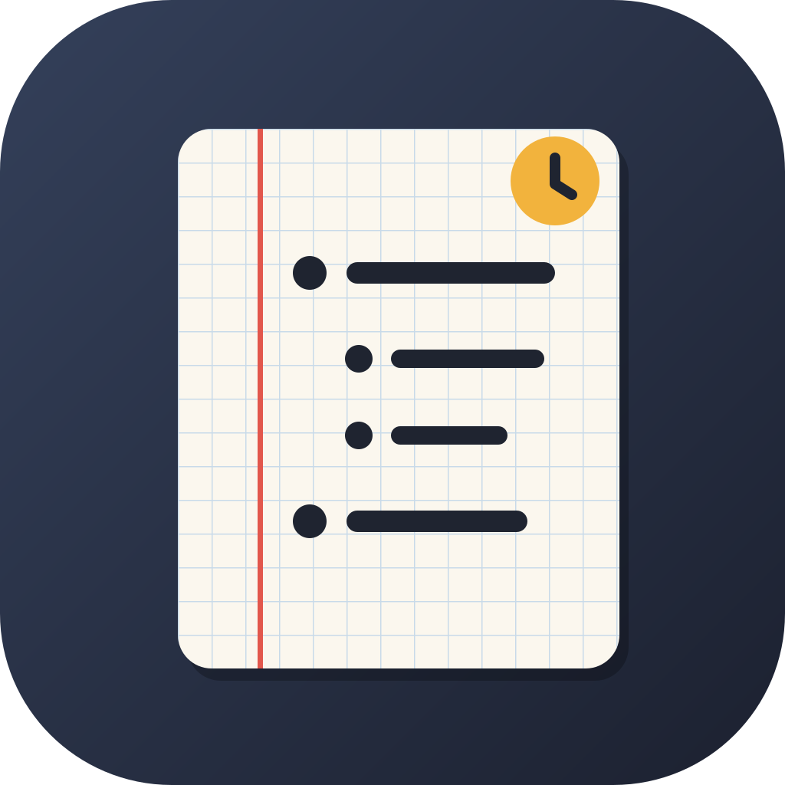
</p>

<h1 align="center">Brulion</h1>

<p align="center">
  <b>Notatki w Markdownie, które są Twoje.</b><br>
  Dziennik i outliner jak w Logseq, zwykłe pliki jak w Obsidianie, kalendarz, przypomnienia
  z alarmami, obliczenia i tabele z formułami. Działa bez internetu — na NixOS, Androidzie
  i w przeglądarce. Synchronizacja przez Syncthing albo Nextcloud.
</p>

<p align="center">
  <a href="https://github.com/janusz-bit/brulion/actions/workflows/ci.yml"></a>
  <a href="https://github.com/janusz-bit/brulion/releases"></a>
  <a href="LICENSE"></a>
</p>

<!-- SCREENSHOTS -->
<p align="center">
  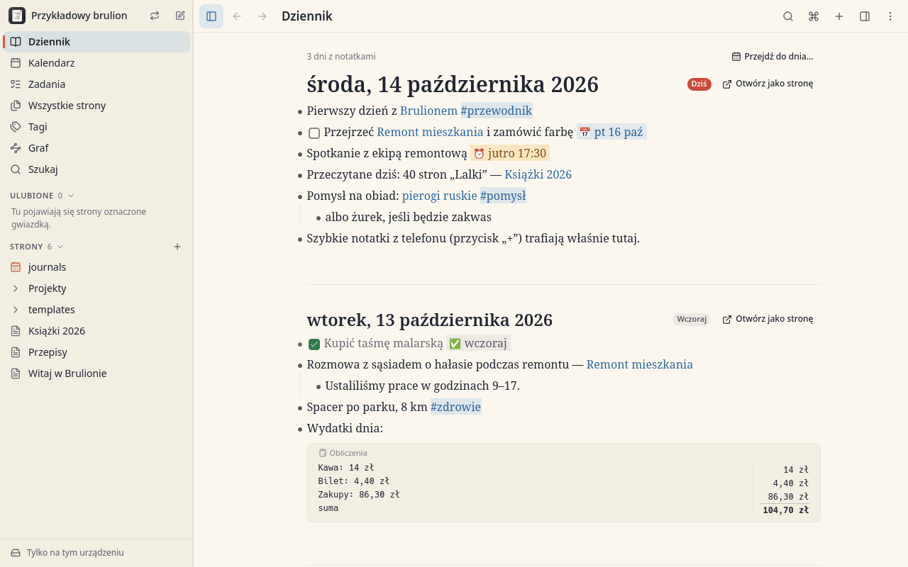
  <br><sub><b>Dziennik</b> — strona na każdy dzień: zadania z terminami, przypomnienia, linki, tagi i obliczenia</sub>
</p>

<table>
  <tr>
    <td width="50%" valign="top">
      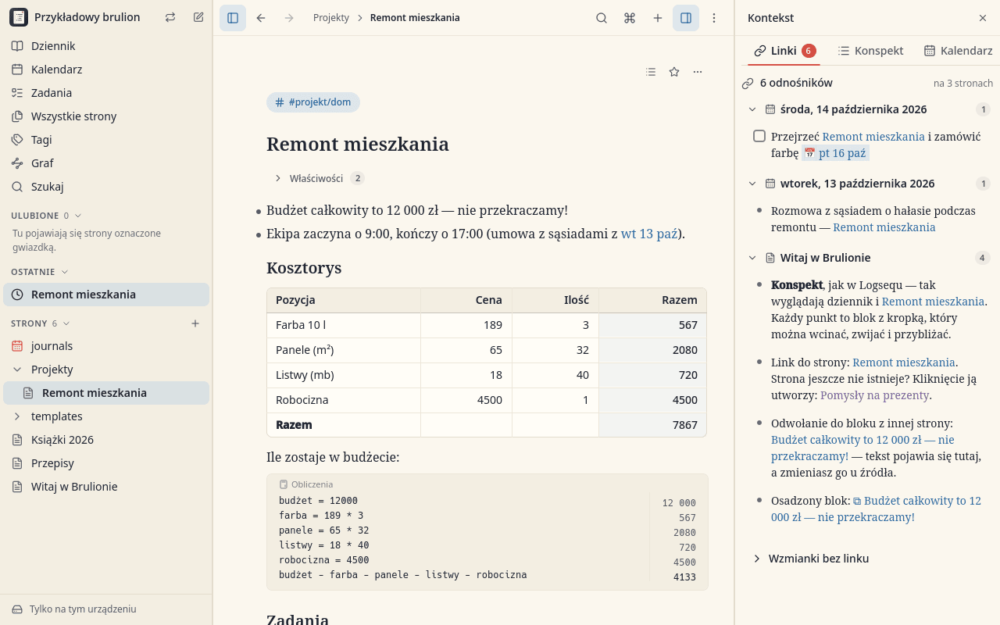
      <br><sub><b>Strona i odnośniki</b> — tabela z formułami, blok obliczeń, a z boku wszystko, co linkuje do strony</sub>
    </td>
    <td width="50%" valign="top">
      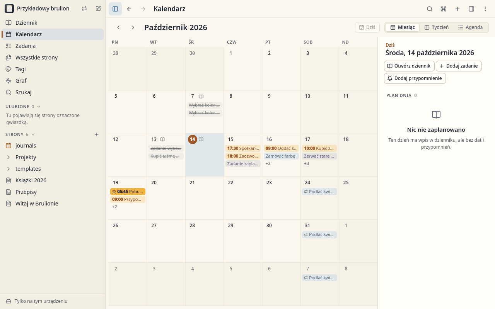
      <br><sub><b>Kalendarz</b> — miesiąc, tydzień albo agenda: terminy, przypomnienia, alarmy i zadania cykliczne</sub>
    </td>
  </tr>
  <tr>
    <td width="50%" valign="top">
      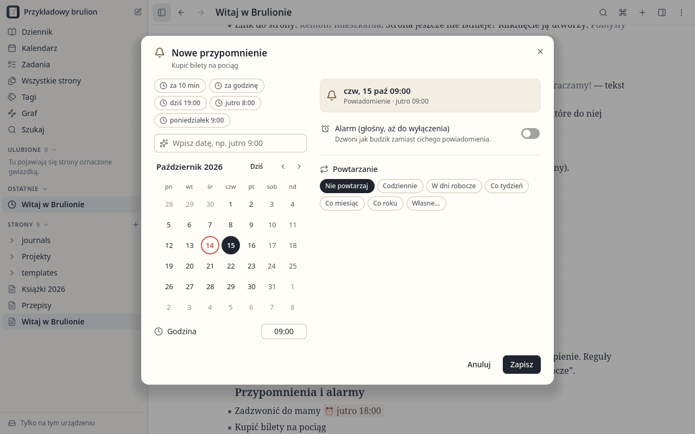
      <br><sub><b>Przypomnienia i alarmy</b> — szybkie terminy, data po polsku („jutro 9:00”), powtarzanie</sub>
    </td>
    <td width="50%" valign="top">
      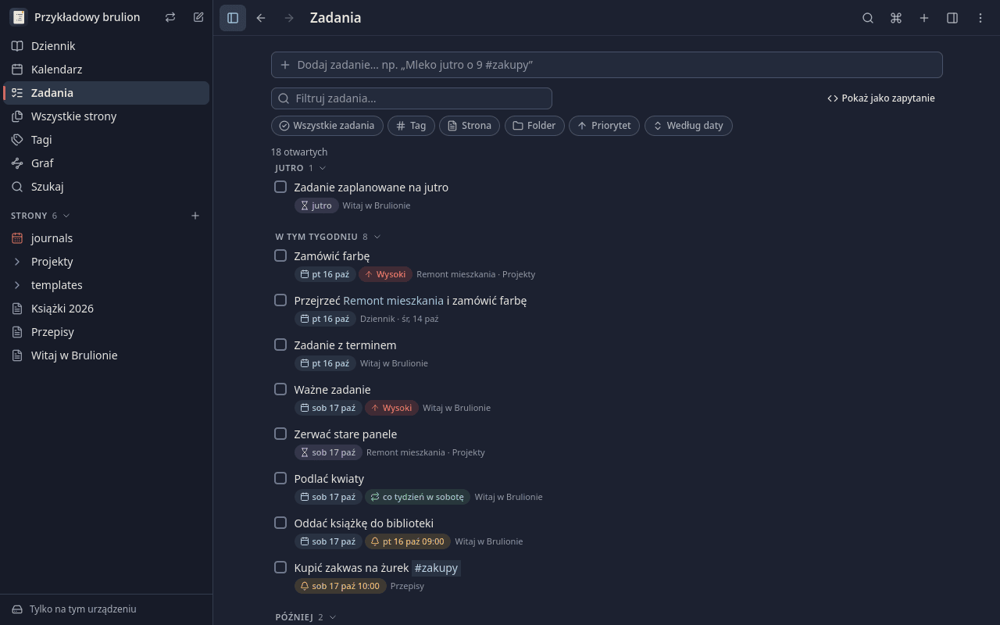
      <br><sub><b>Zadania</b> (motyw ciemny) — wszystkie zadania z notatek, filtry i szybkie dodawanie</sub>
    </td>
  </tr>
  <tr>
    <td width="50%" valign="top">
      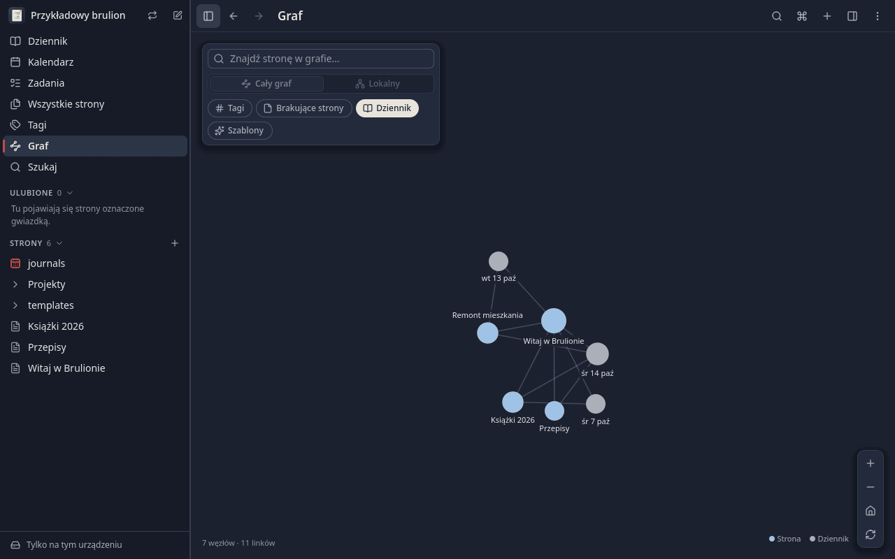
      <br><sub><b>Graf</b> (motyw ciemny) — linki między stronami i dniami dziennika; na życzenie także tagi</sub>
    </td>
    <td width="50%" valign="top">
      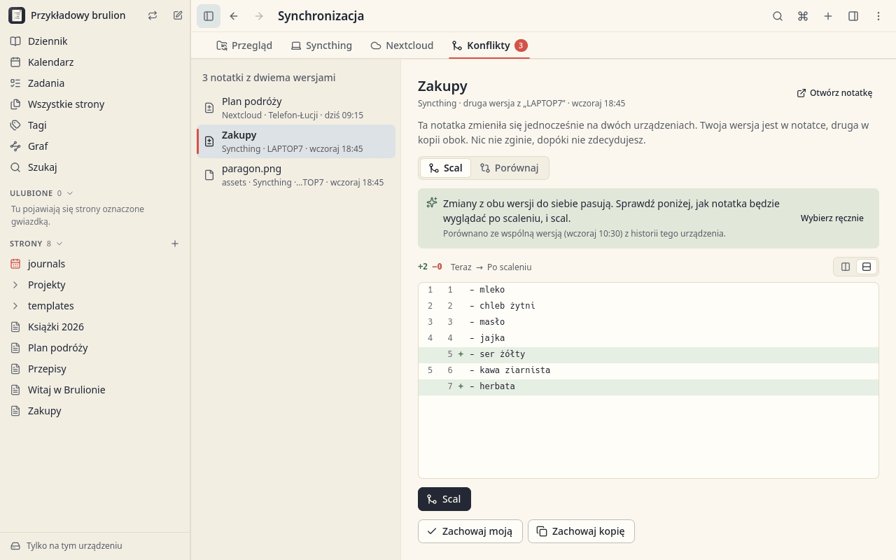
      <br><sub><b>Centrum synchronizacji</b> — konflikt z dwóch urządzeń scalony wiersz po wierszu</sub>
    </td>
  </tr>
  <tr>
    <td colspan="2" align="center" valign="top">
      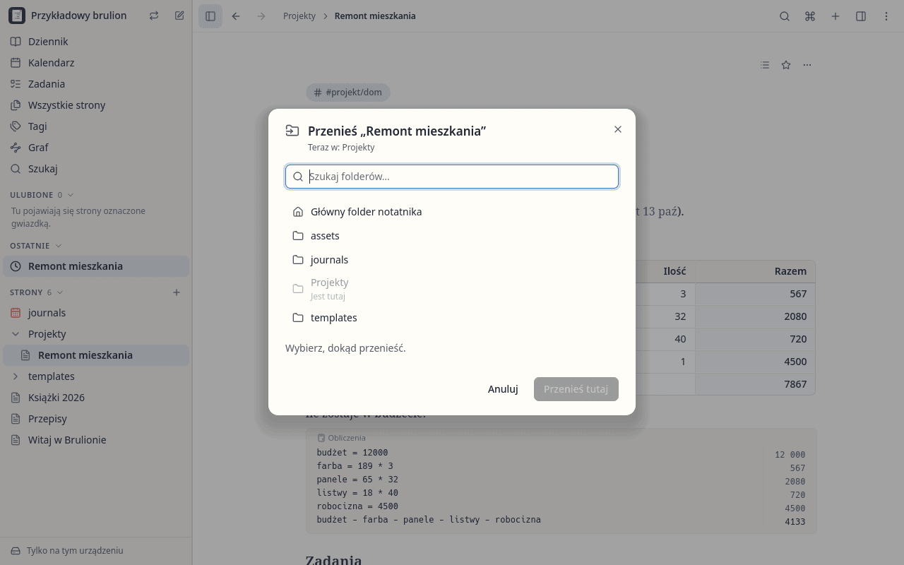
      <br><sub><b>Foldery</b> — drzewo pokazuje otwartą stronę, a „Przenieś do…” przenosi strony i foldery bez psucia linków</sub>
    </td>
  </tr>
</table>

<p align="center">
  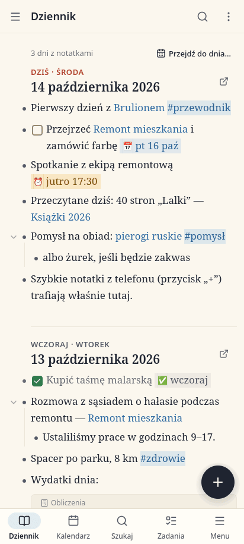
  &nbsp;&nbsp;&nbsp;
  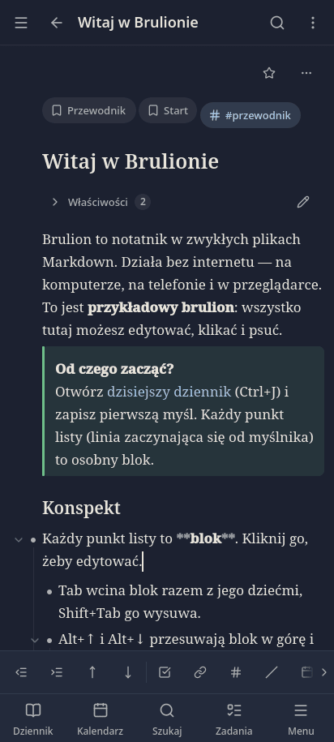
  &nbsp;&nbsp;&nbsp;
  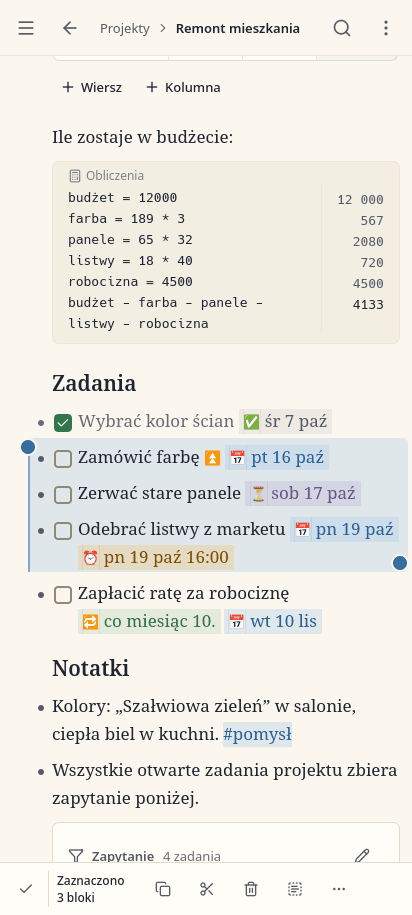
  <br><sub><b>Na telefonie</b> — dziennik z dolną nawigacją, edycja z paskiem narzędzi tuż nad klawiaturą (motyw ciemny) i zaznaczone bloki z narzędziami zaznaczenia</sub>
</p>

## Dlaczego Brulion?

* **Twoje pliki, zawsze.** Każda notatka to zwykły plik `.md` w folderze. Żadnej bazy danych,
  żadnego konta, żadnej chmury pośrednika. Ten sam folder możesz otworzyć w Obsidianie,
  Logseq czy dowolnym edytorze tekstu.
* **Offline przede wszystkim.** Wszystko działa bez sieci. Synchronizacja dzieje się w tle,
  gdy sieć jest dostępna, i nigdy nie blokuje pisania. Konflikty są scalane automatycznie
  (scalanie trójstronne), a gdy się nie da — obie wersje zostają i dostajesz wygodny widok
  scalania.
* **Dziennik + outliner.** Codzienna strona dziennika, bloki z wcięciami (Tab / Shift+Tab),
  zwijanie, przybliżanie bloku, przenoszenie bloków z dziećmi, odwołania do bloków
  `((…))`, linki `[[…]]`, tagi `#…`, odnośniki zwrotne. Tagi działają jak linki do stron, jak
  w Logseq: `#praca` otwiera stronę „praca” (tworzoną przy pierwszym wpisie), jej odnośniki
  pokazują bloki z tym tagiem, a zmiana nazwy strony poprawia też tagi. Odnośnik do każdego
  bloku i nagłówka — `((…))`, `[[Strona#^…]]`, `[[Strona#Nagłówek]]` — skopiujesz z menu bloku
  (prawy przycisk myszy, przytrzymanie punktora, na telefonie „Więcej” nad klawiaturą), a
  odwołanie `((…))` także skrótem `Ctrl+Shift+C`; kliknięty przewija do celu i go podświetla.
* **Zaznaczanie i kopiowanie grup bloków.** Kilka punktów listy albo akapitów dokumentu
  zaznaczysz `Shift+↑/↓`, `Ctrl+A`, `Shift`+kliknięciem, przeciągnięciem myszą albo — na
  telefonie — przytrzymaniem palca na tekście (potem stuknięcia i uchwyty). Pojedyncze punkty z
  przerwami między nimi (na przykład 1., 3. i 5.) dobierzesz `Ctrl`+kliknięciem, a na telefonie
  stuknięciami po włączeniu „Pojedynczo” w narzędziach zaznaczenia. Zaznaczone bloki (z dziećmi)
  kopiujesz, wycinasz i usuwasz razem — wcinasz i przenosisz, gdy są zaznaczone bez przerw: w
  schowku są jako Markdown, a w poczcie czy edytorze dokumentów wklejają się sformatowane;
  „Kopiuj jako tekst” daje zwykły tekst z punktorami. W dzienniku zaznaczysz i skopiujesz bloki
  z kilku dni naraz (każdy dzień poprzedzony linkiem do niego). Kawałki kilku akapitów (koniec jednego
  i początek następnego) skopiujesz, zaznaczając całe bloki, albo co do znaku w trybie źródła
  Markdown (`Ctrl+E`, *Więcej* → *Źródło Markdown*).
* **Dokument albo konspekt.** Każda notatka ma swój tryb: **dokument** jak w Obsidianie
  (akapity, nagłówki i zwykłe listy, czytane jak tekst; klikasz i piszesz w miejscu) albo
  **konspekt** jak w Logseq (każdy punkt to blok). Tryb wybierasz przy tworzeniu strony
  i przełączasz w każdej chwili; zapisuje się w notatce jako `brulion: document` /
  `brulion: outline`, a notatki z Obsidiana i Logseq same otwierają się we właściwym trybie.
* **Zadania, kalendarz, przypomnienia.** `- [ ] Zadanie 📅 2026-10-20 ⏰ 2026-10-19 18:00`,
  powtarzanie `🔁 co tydzień`, alarmy `⏰!` (dzwonią jak budzik, aż je wyłączysz albo minie
  ustawiony czas — na Androidzie także przy zamkniętej aplikacji i po restarcie telefonu),
  widok kalendarza i listy zadań. Status zadania (do zrobienia, w toku, zrobione, oczekujące,
  anulowane albo bez statusu) wybierasz z menu pola wyboru — prawy przycisk myszy lub
  przytrzymanie palcem, wszędzie, gdzie widać zadanie — albo poleceniem `/` w bloku. Tak samo
  na znaczniku daty (📅 ⏳ 🛫 ✅ ➕ ❌) albo ⏰ otwiera się menu do zmiany daty: kalendarz, dziś,
  jutro, dzień / tydzień później, godzinę później, alarm, powtarzanie, priorytet, usunięcie — w
  notatce, w wynikach zapytań, we wstawionych blokach, w tabelach, w widoku zadań i w kalendarzu
  (zmiana trafia do notatki z zadaniem i da się cofnąć). Menu mają też 🔁 (reguła), priorytet,
  link do dnia `[[2026-10-20]]`, `#tag` i `[[link]]` (otwórz, otwórz w panelu bocznym, kopiuj).
  Przycisk **Zrobione** w powiadomieniu przypomnienia przy zadaniu (Linux, Windows, Android)
  oznacza zadanie jako zrobione bez otwierania notatki.
  Przypomnienia, które minęły przy wyłączonym urządzeniu, czekają w dzienniku. Daty wpisujesz
  po polsku: „jutro o 9”, „w piątek 18:00”, „za 2 godziny”.
* **Udostępnij → Brulion (Android).** Stronę z przeglądarki, tekst albo pliki `.md`/`.txt`
  z innej aplikacji zapiszesz w dzisiejszym dzienniku albo jako nową stronę — w oknie, w którym
  poprawisz tekst i tytuł ([docs/ANDROID.md](docs/ANDROID.md#udostępnij--brulion)).
* **Widżety Androida.** Zadania na dziś („Mój dzień”: zaległe i dzisiejsze) z szybkim dodawaniem
  — dzień, godzina i alarm przyciskami, zapis do dziennika od razu, także przy zamkniętej
  aplikacji —, kalendarz z kropkami i agendą (najpierw zadania z godziną) oraz notatki
  (dzisiejszy dziennik, szybka notatka, ulubione i ostatnie strony)
  ([docs/ANDROID.md](docs/ANDROID.md#widżety)).
* **Obliczenia.** Bloki ` ```calc ` liczą jak kalkulator w notatniku (zmienne, procenty,
  jednostki `5 km to mi`, waluty `12 zł + 5 zł`, `suma`), tabele z formułami jak w arkuszu
  (`=sum(above)`, `=[Cena]*[Ilość]`), obliczenia w tekście `` `= 2*21` ``.
* **Wzory matematyczne.** LaTeX w notatkach (`$E=mc^2$`, `$$\frac{a}{b}$$`, blok
  ` ```math `) jest od razu rysowany jako wzór — greckie litery, ułamki, pierwiastki,
  macierze, układy równań. Plik zachowuje źródło LaTeX, a eksport HTML pokazuje gotowy wzór.
* **Rysunki.** Polecenie `/Rysunek` (albo *Rysunek* na pasku nad klawiaturą) wstawia do notatki
  rysunek odręczny i otwiera go do rysowania: rysik z naciskiem (drugi koniec rysika ściera),
  zakreślacz, gumka, kolory i grubości, papier gładki, w linie albo w kratkę, cofanie. Tło
  rysunku jasne, ciemne albo „jak motyw” — wtedy rysunek ciemnieje i jaśnieje od razu razem z
  motywem, w edytorze i w podglądach w notatkach (kolory jak w ciemnym trybie Excalidraw). Palec
  przesuwa i powiększa kartkę, gdy rysujesz rysikiem (albo rysuje — „Rysuj palcem”), myszką
  rysujesz na komputerze. Rysunek to zwykły plik SVG w załącznikach notatnika (`![[Rysunek ….svg]]`)
  z wbudowaną sceną Excalidraw: Obsidian i przeglądarki pokazują go jako obraz (rysunek „jak
  motyw” ciemny w Obsidianie z ciemnym motywem), excalidraw.com otwiera do edycji, a Syncthing
  synchronizuje jak każdy plik.
* **Zapytania.** Blok ` ```query ` pokazuje na żywo np. wszystkie otwarte zadania z tagiem
  `#praca` na najbliższy tydzień: `status:open tag:praca due:<=+7d sort:due` (klucze także po
  polsku: `stan:otwarte termin:jutro`).
* **Twój wygląd.** Jasny, ciemny albo systemowy motyw; kolor akcentu (sześć gotowych albo
  własny, zawsze czytelny), papierowe lub białe tło, granatowe lub czarne (OLED), dowolna
  czcionka interfejsu, notatek i kodu, odstęp między wierszami, zwarta gęstość na komputerze,
  wybór pozycji paska bocznego i przycisków dolnej nawigacji na telefonie (*Ustawienia → Wygląd*).
* **Import i eksport.** Import z Obsidiana, Logseq, Notion, Evernote, Google Keep, Microsoft To Do
  (zadania: logowanie do Microsoft albo plik z Graph Explorera), Joplin, Simplenote, Roam,
  Trilium, Bear, plików Markdown/TXT, HTML i kalendarzy iCalendar — także na
  telefonie (*Więcej → Importuj notatki*: pliki, ZIP albo cały folder skarbca, z podglądem przed
  zapisem; [docs/IMPORT.md](docs/IMPORT.md) — m.in. jak wyeksportować notatki z Trilium i co się
  z czym zamienia; [docs/ANDROID.md](docs/ANDROID.md#import-notatek-obsidian-logseq-notion)).
  Eksport do ZIP z Markdownem, formatu Obsidiana i Logseq, statycznej strony HTML lub jednego
  pliku HTML, Pandoc Markdown (jeden dokument do zamiany w Word, LibreOffice, PDF albo EPUB),
  JSON, iCalendar, OPML i CSV zadań.
* **Foldery bez psucia linków.** Strony, załączniki i całe foldery przenosisz poleceniem
  „Przenieś do…” (z drzewa, menu „Więcej”, listy stron albo palety; na telefonie przycisk „⋯”
  przy każdym wierszu), przeciągając myszą w drzewie albo wpisując „/” przy zmianie nazwy
  („Archiwum/Dom”). Każdy link, tag i filtr zapytania dalej prowadzi do tej samej strony —
  Brulion pokazuje przed przeniesieniem, ile linków poprawi, a niejednoznaczny `[[Dom]]` zapisze
  jako `[[Projekty/Dom]]`. Dzień dziennika to też plik: źle zapisany przeniesiesz albo zmienisz mu
  nazwę tak samo. Nowy folder zakładasz z „+” przy „Strony”, nowa strona trafia do folderu
  otwartej strony, drzewo samo pokazuje otwartą stronę i sortuje po polsku („Rozdział 2” przed
  „Rozdział 10”), a „Wszystkie strony” przeglądasz folder po folderze.
* **Wiersz poleceń i agenci AI.** `brulion-cli` dopisuje do dziennika, dodaje zadania
  i przypomnienia, szuka i przenosi strony z terminala albo skryptu — dokładnie tak jak
  aplikacja — a `brulion-cli mcp` udostępnia to samo agentom AI (MCP). Na komputerze agent może
  też — gdy mu na to pozwolisz w ustawieniach — sterować działającą aplikacją: zobaczyć, co
  pokazuje, kliknąć, pisać i zrobić zrzut ekranu. Więcej niżej i w [docs/CLI.md](docs/CLI.md).
* **Kompatybilność.** Składnia zadań zgodna z wtyczką Obsidian Tasks, właściwości `klucz::
  wartość` jak w Logseq/Dataview — szczegóły w [docs/SYNTAX.md](docs/SYNTAX.md).
* **Historia wersji i kosz.** Zanim notatka zostanie nadpisana, jej poprzednia wersja trafia
  do historii na urządzeniu (przy pisaniu najwyżej co 5 minut, zawsze przed zmianami
  z synchronizacji i importu). Każdą wersję możesz porównać i przywrócić, a usunięte strony
  odzyskać z kosza.
* **Na start: przykładowy brulion.** Strona „Witaj w Brulionie” pokazuje wszystkie funkcje na
  żywych przykładach — do klikania, edytowania i psucia.
* **Dokumentacja w środku.** Pełny poradnik po polsku to osobny notatnik „Dokumentacja
  Brulionu” (na komputerze i Androidzie): przycisk „Przełącz notatnik” obok nazwy notatnika
  albo `Ctrl+Shift+B` i z powrotem. Aktualizuje się razem z aplikacją, a Twoje zmiany w nim
  zostają; w przeglądarce te same strony są w repozytorium
  ([src/app/shell/guide](src/app/shell/guide)).

## Instalacja

| Platforma | Jak |
|---|---|
| **NixOS** | flake + moduł `programs.brulion` (z autostartem w zasobniku) — [docs/NIXOS.md](docs/NIXOS.md) |
| **Inne Linuksy** | AppImage (x86_64, aarch64) z [Wydań](https://github.com/janusz-bit/brulion/releases); aktualizuje się przez AppImageUpdate, Gear Lever albo AppImageLauncher |
| **Windows** 10/11 (x86_64) — **wersja testowa** | instalator `Brulion-<wersja>-windows-x86_64-setup.exe` (dla bieżącego użytkownika, bez uprawnień administratora) albo przenośny `brulion-<wersja>-windows-x86_64.zip` z [Wydań](https://github.com/janusz-bit/brulion/releases); pliki nie są podpisane (SmartScreen: „Więcej informacji” → „Uruchom mimo to”); przypomnienia jako powiadomienia Windows z „Drzemka”/„Zrobione”/„OK”, autostart po zalogowaniu, kalendarz z zadaniami po kliknięciu ikony w zasobniku — [docs/WINDOWS.md](docs/WINDOWS.md) |
| **Android** (9+) | plik APK (arm64) z [Wydań](https://github.com/janusz-bit/brulion/releases) — [docs/ANDROID.md](docs/ANDROID.md) |
| **Przeglądarka** | <https://janusz-bit.github.io/brulion/> (działa offline po pierwszym otwarciu) — [docs/WEB.md](docs/WEB.md); na własnym serwerze: `brulion-web-<wersja>.zip` z Wydań albo moduł `services.brulion-web` |

### NixOS w skrócie

```nix
# flake.nix systemu
inputs.brulion.url = "github:janusz-bit/brulion";

# w modules = [ … ]
brulion.nixosModules.default
{ programs.brulion = { enable = true; autostart = true; }; }
```

Albo bez instalowania: `nix run github:janusz-bit/brulion`.

## Synchronizacja

**Syncthing (polecane do pracy offline):** wskaż w Brulionie folder synchronizowany przez
Syncthing (na Androidzie: Syncthing-Fork, np. `/storage/emulated/0/Brulion`, i nadaj
aplikacji „Dostęp do wszystkich plików”). Brulion zapisuje pliki atomowo, wykrywa kopie
konfliktów Syncthinga (`*.sync-conflict-*`) i pozwala je scalić. Opcjonalnie pokazuje stan
synchronizacji z API Syncthinga.

**Masz już skarbiec Obsidiana w Syncthingu?** Nie importuj go i nie włączaj dla niego
Nextclouda — po prostu otwórz jego folder jako notatnik na każdym urządzeniu. Obie aplikacje
mogą z niego korzystać na zmianę; folder, format i szablon dziennika oraz folder załączników
Brulion sam przejmie z ustawień Obsidiana (`.obsidian/`). Co działa, co się różni i co Brulion
dopisuje do folderu:
[docs/IMPORT.md](docs/IMPORT.md#folder-obsidiana-bez-importu).

**Nextcloud (WebDAV):** w *Centrum synchronizacji* (menu *Więcej* ⋮ lub *Ustawienia →
Synchronizacja*) podaj adres serwera, użytkownika i **hasło aplikacji** (Nextcloud →
Ustawienia osobiste → Bezpieczeństwo → „Utwórz nowe hasło aplikacji”) oraz folder (przy
pierwszym koncie proponowany `Notatki`, dla kolejnych notatników ich nazwa); „Testuj
połączenie” wyjaśnia ewentualne błędy. Serwer i konto są wspólne, ale włączenie synchronizacji
i folder na serwerze należą do notatnika: inny notatnik (także dokumentacja) startuje bez
synchronizacji, a folderu, z którym synchronizuje się już inny notatnik na tym urządzeniu,
Brulion nie zapisze. Dwa notatniki, które wersje 0.3.1–0.3.5 połączyły z jednym folderem,
nie synchronizują się wcale (także „Synchronizuj teraz”), dopóki jednemu z nich nie wybierzesz
innego folderu — stan synchronizacji mówi, z którym notatnikiem dzielą folder. „Wyloguj”
wyłącza synchronizację we wszystkich notatnikach, a zapisanie innego serwera lub użytkownika —
w pozostałych. Brulion synchronizuje w tle
(domyślnie co 15 minut), chwilę po zmianach i po powrocie sieci; równoległe dopiski
w dzienniku z dwóch urządzeń scalają się same. Ochrona przed masowym usuwaniem wstrzymuje
kasowanie, jeśli synchronizacja miałaby usunąć dużą część notatek (ponad 25%, co najmniej
10 plików) — dopóki nie potwierdzisz listy. Foldery też się synchronizują: pusty folder pojawia
się na drugim urządzeniu, a usunięty znika — ale tylko wtedy, gdy nie ma w nim nic, co nie
dotarło jeszcze na drugą stronę (folder z nową notatką albo plikiem, którego Brulion nie
synchronizuje, zostaje). Przeniesienie albo zmiana nazwy folderu czy strony to przeniesienie, nie
usunięcie — ochrona przed masowym usuwaniem wtedy nie pyta, a folder albo stronę, którym zmienisz
nazwę w Brulionie, Brulion przenosi na serwerze jednym poleceniem (WebDAV MOVE), bez ponownego
wysyłania plików (także stronę, w której zaraz potem piszesz dalej). Folder albo stronę przemianowane na innym urządzeniu albo w Nextcloudzie
w przeglądarce Brulion przemianowuje też u siebie (rozpoznaje je po identyfikatorze pliku
`oc:fileid`, a bez niego po ETagu), więc historia wersji, ulubione i zwinięte bloki idą za
notatkami, zamiast trafić do kosza z ich starą kopią. Syncthing synchronizuje foldery sam.

W zakładce *Nextcloud* widać na żywo, co robi trwająca synchronizacja (etap, „folder 12 z
ok. 40”, aktualne pliki, czas trwania, ilość danych), ostrzeżenie, gdy serwer przestaje
odpowiadać (po 3 minutach bez odpowiedzi synchronizacja jest przerywana i ponawiana — nigdy nie
„synchronizuje się” w nieskończoność), odliczanie do kolejnej próby oraz **historię ostatnich 20
synchronizacji**: kiedy i dlaczego się zaczęły, ile trwały, co przesłały, z błędami po polsku.
„Szczegóły” pokazują, na co poszedł czas (łączenie, sprawdzanie plików na serwerze i na
urządzeniu, przesyłanie, zapis), żądania do serwera i pliki, których nie udało się
zsynchronizować.

## Wiersz poleceń i agenci AI

`brulion-cli` (w pakiecie Nix i po `cmake --install`; w AppImage: `Brulion.AppImage cli …`)
czyta i zmienia notatki bez okna aplikacji, tym samym kodem co aplikacja:

```sh
brulion-cli capture "Kupić mleko jutro o 18"          # zadanie z przypomnieniem w dzisiejszym dzienniku
brulion-cli task list --due '<=+7d'                    # otwarte zadania na najbliższy tydzień
brulion-cli task add "Oddać książkę" --due "w piątek"
brulion-cli search zolw                                # znajdzie „żółw”
brulion-cli --format text journal wczoraj              # wczorajszy dziennik, czytelnie
```

Notatnik to `--vault <folder>`, zmienna `BRULION_VAULT` albo bieżący notatnik aplikacji. Wynik to
JSON (dla ludzi: `--format text`), a kod wyjścia mówi, co się stało. Pomoc i komunikaty są po
polsku, gdy system ma polski język (inaczej po angielsku); kody błędów i klucze JSON — zawsze po
angielsku. Zmiany z wiersza poleceń
trafiają do historii wersji urządzenia, na którym działa program (aplikacja na tym samym komputerze
pokazuje je jako „Zastąpiona z wiersza poleceń (agent)”), i nigdy nie nadpisują tego, co właśnie
zapisała aplikacja albo Syncthing. Polecenia, które coś usuwają, przenoszą lub nadpisują,
wymagają `--allow-destructive`, a usunięte strony trafiają do kosza.

**Agenci AI** (np. Hermes, Claude Code) dostają te same polecenia jako narzędzia MCP:
`brulion-cli mcp --vault <folder>` (`--read-only` — tylko czytanie). Agent na innym komputerze,
np. Raspberry Pi, pracuje na folderze notatek udostępnionym przez Syncthing albo klienta Nextcloud;
na serwer wystarczy lekki pakiet `nix build github:janusz-bit/brulion#brulion-cli`. Treść notatek
to dla agenta dane, nie polecenia. `brulion-cli app open <strona>` pokazuje stronę w działającej
aplikacji. **Sterowanie aplikacją** (domyślnie wyłączone: *Ustawienia → Aplikacja → Dla
programistów* albo `brulion --remote-control`): `brulion-cli app state | find | click | type | key
| wait | screenshot …` i narzędzia `brulion-cli mcp --app-control` — dopóki jest włączone, każdy
program Twojego konta może sterować oknem i czytać pokazywane notatki. Szczegóły:
[docs/CLI.md](docs/CLI.md#remote-control), konfiguracja Hermesa:
[docs/NIXOS.md](docs/NIXOS.md#agent-ai-hermes-i-wiersz-poleceń), poradnik dla agentów:
[packaging/agent/brulion/SKILL.md](packaging/agent/brulion/SKILL.md).

## Gdy coś nie działa — rejestr zdarzeń

Brulion zapisuje, co robi — zwłaszcza synchronizacja — w **rejestrze zdarzeń**: *Ustawienia →
Aplikacja → Rejestr zdarzeń*, *Ustawienia → Synchronizacja*, przycisk „Rejestr zdarzeń”
w zakładce *Nextcloud* centrum synchronizacji albo paleta poleceń (Ctrl+K, „rejestr”, „logi”).
Wpisy można filtrować (Synchronizacja, Sieć, Notatnik…, tylko ostrzeżenia i błędy) i
przeszukiwać (bez polskich znaków też: „zazolc” znajdzie „Zażółć”); widać też wcześniejsze
uruchomienia aplikacji.

**Jak wysłać nam rejestr:** na telefonie *Udostępnij* (np. do poczty lub komunikatora) albo
*Zapisz w Pobranych*; na komputerze *Zapisz jako…* (pliki leżą też w
`~/.local/state/Brulion/Brulion/logs/brulion.log`, „Otwórz folder”); w przeglądarce *Pobierz*;
wszędzie *Kopiuj*. Gdy synchronizacja sprawia kłopot, włącz najpierw **Szczegółowy rejestr**
(zapisuje też każde żądanie do serwera), powtórz synchronizację i dopiero wtedy wyślij rejestr.

**Co zawiera:** czas, rodzaj i przebieg zdarzeń — adres serwera i nazwę użytkownika
Nextcloud, nazwy i ścieżki notatek, których dotyczą zmiany i błędy, folder notatnika, wersję
aplikacji i systemu. **Czego nie zawiera:** haseł, haseł aplikacji, tokenów, ciasteczek ani
treści notatek — Brulion usuwa je, zanim cokolwiek trafi do rejestru (także z adresów w
rodzaju `https://jan:hasło@…`). Rejestr zostaje na urządzeniu (dwa pliki po 1 MB, 3 MB w
trybie szczegółowym) i nigdy nie jest nigdzie wysyłany — udostępniasz go tylko Ty. *Wyczyść*
usuwa go w całości.

## Skróty klawiszowe

| Skrót | Działanie |
|---|---|
| `Ctrl+K` | paleta poleceń |
| `Ctrl+O` | szybkie przejście do strony |
| `Ctrl+J` | dzisiejszy dziennik |
| `Ctrl+N` / `Ctrl+Shift+N` | nowa strona / szybka notatka do dziennika |
| `Ctrl+Shift+B` | dokumentacja Brulionu / powrót do poprzedniego notatnika |
| `Ctrl+Shift+F` | wyszukiwanie |
| `Alt+←` / `Alt+→` | wstecz / dalej |
| `Enter` / `Shift+Enter` | nowy blok (na początku tekstu: pusty blok nad nim, przy zadaniu puste zadanie) / nowa linia w bloku |
| `Tab` / `Shift+Tab` | wcięcie / wysunięcie bloku z dziećmi |
| `Alt+↑` / `Alt+↓` | przeniesienie bloku z dziećmi |
| `Ctrl+Enter` | zmiana statusu zadania po kolei (brak → do zrobienia → w toku → zrobione → brak) |
| `Ctrl+Shift+Enter` | menu statusu zadania (dowolny status albo bez statusu) |
| `Ctrl+.` | zwiń / rozwiń |
| `Shift+↑` / `Shift+↓` | zaznacz bloki (z edytowanego bloku: gdy zaznaczenie tekstu dojdzie do jego brzegu) |
| `Ctrl`+kliknięcie | dobierz blok do zaznaczenia albo go z niego wyjmij (przerwy dozwolone) |
| `Ctrl+A` (dwa razy) | zaznacz tekst bloku, potem wszystkie bloki |
| `Ctrl+C` / `Ctrl+X` / `Ctrl+V` | kopiuj / wytnij / wklej — zaznaczone bloki albo tekst w bloku |
| `Ctrl+Shift+C` | skopiuj odwołanie do bloku `((…))` |
| `Ctrl+Z` / `Ctrl+Y` | cofnij / ponów |
| `Ctrl+E` | tryb źródła Markdown |
| `F2` / `Ctrl+,` | zmiana nazwy strony / ustawienia |
| `/` | menu poleceń (status zadania, przypomnienie, alarm, tabela, obliczenia, zapytanie, obraz…) |

W trybie dokumentu `Tab` / `Shift+Tab` działa tylko na punktach listy, `Enter` na pustym
punkcie kończy listę (w liście zagnieżdżonej: wysuwa punkt o poziom), a `Backspace` na początku
punktu usuwa znacznik listy, jak w Obsidianie.

Na telefonie wcięcia, przenoszenie bloków, zadania, linki, tagi, polecenia, terminy,
przypomnienia i cofanie są w pasku narzędzi, który zawsze leży tuż nad klawiaturą — w
dzienniku i na stronach, także przy przewijaniu, w komórkach tabel (Następna komórka) i w
źródle Markdown; dolna nawigacja chowa się na czas pisania, a okna wysuwane od dołu, menu i
pola formularzy nigdy nie trafiają pod klawiaturę (także w przeglądarce na telefonie). Widoki
bez własnego przycisku (centrum synchronizacji, import i eksport, kosz, ustawienia) są w menu
*Więcej* (⋮).
Wszystkie skróty: [docs/UI.md](docs/UI.md#keyboard-shortcuts-desktop).

## Dla programistów

C++20 + Qt 6.11 (Qt Quick/QML), CMake, testy QtTest. Logika (parser Markdown, indeks
i wyszukiwarka, kalkulator, daty, synchronizacja, przypomnienia, import/eksport) to
biblioteki bez GUI w `src/core`, wspólne dla Linuksa, Androida i WebAssembly.

```sh
nix develop                      # Qt, CMake, Ninja, ccache, clang-tools
scripts/dev-build.sh -t .        # zbuduj i uruchom wszystkie testy (JOBS=8 — więcej wątków)
./build/src/app/brulion          # uruchom aplikację
./build/src/app/brulion --demo   # … z przykładowym brulionem
```

APK Androida z flake'a (na hoście x86_64-linux, niepodpisany): `nix build .#brulion-android`
(arm64-v8a; `.#brulion-android-x86_64` dla emulatora, `.#brulion-android-aab` z AAB), podpis:
`nix run .#brulion-android-sign -- result/*.apk` — patrz
[docs/ANDROID.md](docs/ANDROID.md#budowanie-przez-nix-flake).

Zrzuty ekranu i testy interfejsu działają bez okna (`--screenshot`, `--journey`, skrypty
`tests/app/*/screenshots.sh`) — patrz [docs/UI.md](docs/UI.md#dev-tools-screenshots-and-ui-tests).

Wiersz poleceń (`./build/src/cli/brulion-cli`) i serwer MCP: [docs/CLI.md](docs/CLI.md).

Dokumentacja: [architektura](docs/ARCHITECTURE.md) · [składnia](docs/SYNTAX.md) ·
[interfejs](docs/UI.md) · [Android](docs/ANDROID.md) · [przeglądarka](docs/WEB.md) ·
[NixOS](docs/NIXOS.md) · [wydania](docs/RELEASE.md). Poprzednia wersja (TypeScript +
Tauri) jest zachowana na gałęzi `archive/web-v1`.

Wydajność (liczby na komputerze, telefonie i w przeglądarce, benchmarki, strażnicy regresji): [docs/PERFORMANCE.md](docs/PERFORMANCE.md).

## Licencja

[AGPL-3.0-or-later](LICENSE). Ikony: [Lucide](https://lucide.dev) (ISC). Kompresja ZIP:
[miniz](https://github.com/richgel999/miniz) (MIT). Kształt linii w rysunkach: algorytm
[perfect-freehand](https://github.com/steveruiz/perfect-freehand) (MIT, © Stephen Ruiz Ltd), przeniesiony
do C++ w `src/core/drawing/stroke.cpp`. Emoji i symbole tam, gdzie system nie ma
czcionki z nimi (przeglądarka, część Linuksów): fragmenty [Noto Emoji](https://fonts.google.com/noto/specimen/Noto+Emoji)
i Noto Sans Math (SIL OFL 1.1, [assets/fonts](assets/fonts/README.md)).

---

## English

**Brulion** (Polish for “rough notebook”) is an offline-first Markdown notes app: Logseq-style
daily journals and block outliner on top of plain Obsidian-compatible `.md` files (every note is
either an Obsidian-like document or a Logseq-like outline, switchable at any time), with a
calendar, reminders and real alarms, calculation blocks and spreadsheet-like table formulas,
live queries, version history, and import/export for Obsidian, Logseq, Notion, Evernote,
Google Keep, Microsoft To Do (import of tasks), Joplin, Simplenote, Roam, Trilium, Bear, HTML and
iCalendar (export also as one
Pandoc Markdown document for Word, LibreOffice, PDF or EPUB).

* Runs on **NixOS/Linux** (flake + NixOS module, AppImage), **Android** 9+ (APK; native exact
  alarms that fire while the app is closed; text, links and `.md`/`.txt` files shared from other
  apps go to the journal or a new page), in the **browser** (Qt for WebAssembly,
  works offline) and, as a **test version**, on **Windows** 10/11 x86_64 (a per-user installer
  without admin rights or a portable ZIP; unsigned; reminders as Windows toast notifications with
  Snooze/Done/OK, optional start at sign-in, a calendar with the day's tasks from a click on the
  tray icon — [docs/WINDOWS.md](docs/WINDOWS.md)). On phones the editing toolbar always sits right on the on-screen keyboard
  (Android's IME insets, frame by frame on Android 11+; the browser's visualViewport).
* Sync through **Syncthing** (it's just a folder; conflict copies are detected and merged in
  the app; an Obsidian vault synced with Syncthing opens as it is, no import needed) or **Nextcloud/WebDAV** (built-in background sync with 3-way merge and a
  mass-deletion guard; folders travel too — empty ones, deletions of emptied ones, and a folder
  or page renamed in the app is moved on the server in one WebDAV MOVE (also when you keep
  typing in it right away), never mistaken for a mass deletion; one renamed on another device or in the Nextcloud web UI is renamed here too,
  recognised by its `oc:fileid` or ETag, so its version history, favourites and folds follow).
* Two note modes: a **document** (Obsidian-like live preview: paragraphs, headings and plain
  lists, edited in place) or an **outline** (Logseq-like: every bullet is a block). Chosen when
  a page is created and switchable at any time; stored in the note as `brulion: document` /
  `brulion: outline` frontmatter, and notes from Obsidian or Logseq open in the right mode
  without it.
* Tags are links to pages, as in Logseq: `#work` opens the page "work" (created by its first
  content), whose linked references list the tagged blocks; renaming a page renames its tags.
* Folders you can reorganise: move pages, attachments and whole folders ("Move to…" from the
  tree, the More menu, All pages or the palette, a "⋯" button per row on phones, mouse drag and
  drop in the tree, or a "/" in Rename) and every link, tag and query filter keeps pointing at the
  same file — the impact is shown before moving, an ambiguous `[[Home]]` becomes
  `[[Projects/Home]]`, and moving the journals or templates folder updates the notebook's
  settings. A daily note is a file too: a misfiled day is moved or renamed the same way. The tree reveals the
  open page and sorts in Polish order with numbers by value; All pages browses folder by folder.
* Copy a link to any block or heading — `((id))`, `[[Page#^id]]`, `[[Page#Heading]]` or an embed
  — from the block menu (a right-click, a long press on the bullet, or "More" on the phone's
  editing toolbar); `Ctrl+Shift+C` copies the reference `((id))`. Following one scrolls to it and
  highlights it.
* Select groups of blocks — bullets or a document's paragraphs, with their children — with
  `Shift+↑/↓`, `Ctrl+A`, Shift+click, a mouse drag or, on phones, a long press (then taps and
  grips); pick single ones with gaps between them (bullets 1, 3 and 5) with Ctrl+click, or with
  taps after "One by one" on phones. Copy, cut or delete them together — indent or move them when
  there are no gaps: the clipboard gets Markdown plus formatted HTML for mail and office apps
  ("Copy as plain text" too). In the journal, blocks of several days can be selected and copied at
  once (each day after its link). For part of several paragraphs, select the whole blocks, or select
  exactly those characters in the Markdown source mode (`Ctrl+E`, More → Markdown source).
* Tasks compatible with Obsidian Tasks and Logseq markers; any status (to do, in progress, done,
  waiting, cancelled, or none) from the checkbox's menu — a right-click or a long press,
  wherever a task is shown — or a `/` command. The same gesture on a date, reminder, 🔁 rule or
  priority opens its menu (move the date, snooze, alarm, change the rule or priority) in notes,
  query results, embeds, tables, Tasks and the calendar — only that token changes, and it can be
  undone; on a `#tag`, a `[[link]]` or a link to a day: open, open in the side panel, copy.
  A task's reminder notification has a **Done** button (Linux, Windows, Android) that completes
  the task without opening the note.
* Android home-screen widgets: today's tasks ("My day": overdue and today) with a quick add —
  day, time and alarm from chips, written to the journal at once, even with the app closed —, a
  calendar with dots and an agenda (timed tasks first), and notes (today's journal, a quick
  note, favourite and recent pages).
* A command line for scripts and AI agents: `brulion-cli` captures, appends to journals, adds
  tasks and reminders, searches, queries and moves pages exactly as the app does (JSON output,
  stable exit codes, every change in the version history, destructive commands behind
  `--allow-destructive`; help and messages in Polish under a Polish locale, else English), and
  `brulion-cli mcp` serves the same commands as MCP tools; see
  [docs/CLI.md](docs/CLI.md). With remote control allowed (off by default: Settings → Application
  → For developers, or `brulion --remote-control`), agents can also drive the running desktop
  app — its state, clicks, typing, shortcuts, screenshots (`brulion-cli app …`,
  `brulion-cli mcp --app-control`).
* Your look (Settings → Appearance): light, dark or system theme, an accent colour (six presets
  or any colour, kept readable), paper or white and blue-grey or OLED-black backgrounds, any
  installed font for the interface, notes and code, line spacing, a compact density on the
  desktop, and which sidebar entries and phone navigation buttons are shown.
* Handwritten drawings in notes (`/Rysunek`): a stylus with pressure (its eraser end erases), a
  highlighter, an eraser, colours and widths, plain, lined or squared paper, undo; a light or a
  dark background per drawing, or "Like the app" — it then turns dark and light with the app at
  once, in the editor and in the previews in notes (colours as in Excalidraw's dark mode); fingers
  move and zoom the paper while you draw with a stylus (or draw — "Draw with finger"), a mouse
  draws on the desktop. A drawing is a plain SVG attachment (`![[Rysunek ….svg]]`) with an
  embedded Excalidraw scene: Obsidian and browsers show it as a picture (a "Like the app" drawing
  dark in Obsidian's dark theme), excalidraw.com opens it for editing, Syncthing syncs it like any
  file.
* Polish UI by default, English available. Natural-language dates in Polish and English.
* Something not working? Settings → Application → **Event log** shows what the app and the sync
  did (live sync progress and the history of runs are in the sync center); share or save it
  and send it to us — it stays on the device and never contains passwords, tokens or note
  contents.
* Built with C++20 and Qt 6.11 Quick; GUI-free core libraries with thousands of unit tests.

The screenshots above show the Polish UI with the bundled sample notebook (`brulion --demo`).
Install: see the table above (`nix run github:janusz-bit/brulion`, AppImage, APK, the Windows
installer or ZIP — a test version —, or <https://janusz-bit.github.io/brulion/>). Build: `nix develop`, then
`scripts/dev-build.sh -t .`; the Android APK: `nix build .#brulion-android` (x86_64-linux hosts,
unsigned; sign with `nix run .#brulion-android-sign -- result/*.apk`). Developer docs (in
English): [architecture](docs/ARCHITECTURE.md), [Markdown dialect](docs/SYNTAX.md),
[UI](docs/UI.md). License: AGPL-3.0-or-later; icons Lucide (ISC), ZIP miniz (MIT), the stroke
outline of drawings ported from perfect-freehand (MIT, © Stephen Ruiz Ltd), emoji and
symbol fallback fonts: subsets of Noto Emoji and Noto Sans Math (SIL OFL 1.1, `assets/fonts`).

Performance (numbers per platform, budgets, how to benchmark, regression guards): [docs/PERFORMANCE.md](docs/PERFORMANCE.md).
