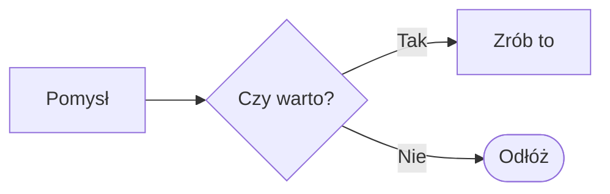

# Brulion Markdown dialect (developer spec)

Brulion stores every note as a plain UTF-8 `.md` file. The dialect is CommonMark + GFM
plus a small set of extensions chosen to be **compatible with Obsidian (incl. the Tasks
plugin) and readable by Logseq**. Anything Brulion writes must stay readable as plain
Markdown in any other editor.

This file is the single source of truth for parsers, renderers, importers and exporters.
Contributors: a change of what `markdown::parseNote()` returns for any input needs a bump of
`markdown::ParserVersion` (`src/core/markdown/parse.h`) — devices keep parsed notes in their index
cache (docs/ARCHITECTURE.md); `tst_markdown_model`'s golden digest fails until you do.

---

## 1. Vault layout

```
<vault>/
  journals/2026-10-14.md     daily notes (folder + file-name format configurable)
  journals/2026-W45.md       weekly notes (ISO week; own folder, format, template)
  journals/2026-11.md        monthly notes (likewise)
  <any>/<folders>/Page.md    pages; folders act as namespaces ("Projekty/Dom")
  assets/                    attachments (images, pdf, ...)
  templates/                 templates (journal.md / weekly.md / monthly.md = templates for new
                             daily / weekly / monthly notes)
  .brulion/config.json       vault settings shared between devices (synced)
  .trash/                    deleted files (restorable)
```

* **Page title** = file base name without `.md` (`Projekty/Dom.md` → title `Dom`,
  full name `Projekty/Dom`). Frontmatter `aliases:` adds extra link names.
* **Letter case**: names that differ only in case (`dom.md` / `Dom.md`, `projekty/` /
  `Projekty/`) are one page / folder — on case-insensitive storage (Android shared storage, FAT,
  macOS) they are one file, and links do not tell them apart. Brulion never creates such a twin:
  a new page with that name opens the existing one, a rename to it is refused, an imported page
  gets ` 2`, and new files go into the folder as it is spelled.
* **Folders** are created with their names sanitised like page titles (`a:b?` → `a b`, per
  segment) and as the vault spells existing ones (`projekty/Nowy` goes into `Projekty/`); a name
  the vault would hide — a leading `.` or one of the ignored folders below (`logseq`,
  `node_modules`, …), also once sanitised (`logseq?`) — is refused ("A folder named “…” would be
  hidden"). Nothing is ever moved into an ignored folder.
* **Moving and renaming** (pages — daily notes too: they are files —, attachments, folders —
  "Move to…", drag and drop, a `/` in
  a name typed in the Rename dialog is a path from the vault root; in a page title edited in place
  it is sanitised like the other characters a file name cannot have, `TCP/IP` → `TCP IP.md`):
  refused onto a name that exists (also in another letter case) and into the item itself, and a
  folder name the vault would hide (also once sanitised: `logseq?`); every link and tag keeps its
  target (§2 "Rewriting on rename and move"). Renaming or moving a special folder of
  `.brulion/config.json` (`journalsFolder`, `templatesFolder`, `attachmentsFolder`,
  `newPagesFolder`, `weeklyFolder`, `monthlyFolder`), a folder holding one, or the
  `journalTemplate` / `weeklyTemplate` / `monthlyTemplate` file updates those keys in the same
  operation.
* Device-local state (sync bookkeeping, merge bases, history snapshots, caches) is **never**
  stored inside the vault — it lives in the app data directory on the device (`QStandardPaths::AppDataLocation`). This keeps Syncthing /
  Nextcloud from syncing machine-specific data.
* Ignored when indexing: `.brulion/`, `.trash/`, `.git/`, `.obsidian/`, `logseq/`,
  `.stfolder`, `.stversions/`, `node_modules/`, temp files (`~syncthing~*.tmp`,
  `.syncthing.*.tmp`, `.~lock.*#`, `*.part`). Syncthing conflict copies
  (`Name.sync-conflict-20261014-101010-ABCDEF.md`) are **not** indexed as pages but are
  surfaced in the Sync Center as conflicts to merge (conflict copies of drawings,
  `Rysunek.sync-conflict-….svg`, element by element: §2 "Two versions").

### `.brulion/config.json`

```json
{
  "version": 1,
  "journalsFolder": "journals",
  "journalFileFormat": "yyyy-MM-dd",
  "newPagesFolder": "",
  "attachmentsFolder": "assets",
  "templatesFolder": "templates",
  "journalTemplate": "templates/journal.md",
  "defaultReminderTime": "09:00",
  "weekStartsOn": 1,
  "journalMode": "outline",
  "pageMode": "document",
  "weeklyFolder": "journals",
  "weeklyFileFormat": "yyyy-'W'ww",
  "weeklyTemplate": "templates/weekly.md",
  "monthlyFolder": "journals",
  "monthlyFileFormat": "yyyy-MM",
  "monthlyTemplate": "templates/monthly.md"
}
```
`journalFileFormat` uses Qt `QDate` format strings (`yyyy-MM-dd`, `dd.MM.yyyy`, …).
`journalMode` / `pageMode` (`"outline"` | `"document"`) are the note modes of daily notes and of
pages the content does not decide (§4 "Note mode"). Missing keys and invalid values fall back
to these defaults; unknown keys are kept when Brulion saves the file. When the file is missing
and the folder is an Obsidian vault (`.obsidian/`), `journalsFolder`, `journalFileFormat`
(converted from moment.js), `journalTemplate`, `templatesFolder` and `attachmentsFolder` default
to Obsidian's settings (`daily-notes.json`, `templates.json`, `app.json`; docs/IMPORT.md "Obsidian folder without importing") — in memory, until the settings are saved. `weeklyFolder` /
`monthlyFolder` missing from the file follow `journalsFolder` (also one taken from Obsidian).

### Weekly and monthly notes

Periodic pages next to the daily ones (`src/core/periodic/periodic.h`, creating them:
`notebook/periodicnotes.h`): one note per **ISO week** and one per **month**, each with its own
folder, file name format and template. They are ordinary pages (the page's note mode rules,
`pageMode` by default), not journal pages: the journal stream, `journalDate` and `date:` queries
do not list them; cleaning up never proposes them or their templates.

* **ISO weeks**: Monday to Sunday; week 1 holds the year's first Thursday, so the week-year can
  differ from the calendar year at both ends — 2027-01-01 is in `2026-W53`, 2024-12-30 in
  `2025-W01`; a year has 52 or 53 weeks (53 when it starts on a Thursday, or a leap year on a
  Wednesday). `weekStartsOn` does not change them (the calendar's week numbers name the ISO week of
  each row's middle day).
* **`weeklyFileFormat`** (default `yyyy-'W'ww` → `2026-W45`, Obsidian Periodic Notes' ISO
  `GGGG-[W]WW`): Brulion's own small format, as Qt has no week tokens — `yyyy` the ISO week-year,
  `yy` its last two digits, `ww` the week with a leading zero, `w` without, text in single quotes
  literal (`''` a quote), other non-letters literal, `/` a subfolder (`yyyy/'W'ww` →
  `2026/W45.md`). A letter outside quotes that is no token, no year or no week, an unclosed quote,
  a name that would hide itself (`.`) or leave the folder: unusable (a warning; the default is used).
* **`monthlyFileFormat`** (default `yyyy-MM` → `2026-11`): a Qt `QDate` format of the month's 1st
  that names the month alone — no day (`yyyy-MM-dd` is refused: it would name a daily note). Month
  names are written in English (`MMMM yyyy` → `November 2026`) and read in English or Polish, also
  in the nominative (`listopad 2026`, `listopada 2026`).
* **Reading names back**: a Markdown file inside the period's folder (letter case aside, not in a
  subfolder unless the format has one) whose name formats back to itself, letter case aside —
  `2026-W54`, `2027-W53` (2027 has 52 weeks), `2026-W5` with `ww`, `2026-13` are no periodic notes.
  An existing note under another spelling of the folder (`Journals/`) is used, never a second one.
* **Creating**: opening a week or month never writes; the editor creates the note with its first
  change from `weeklyTemplate` / `monthlyTemplate` (§12: `{{date}}` the period's first day,
  `{{end}}` its last), like a day without a note. `brulion-cli week append` / `month append`
  create it from the template too.
* **Phrases** (`periodic::parsePeriodPhrase`, the command line, the app): "ten tydzień",
  "przyszły / następny tydzień", "zeszły / poprzedni tydzień", "w przyszłym miesiącu", "this week",
  "next month", "last week"; `2026-W45`, `W45`, `tydzień 45 [2026]`, `week 45`; `2026-11`,
  `11.2026`, `listopad [2026]`, `Nov 2026`; the vault's own file name; else any date the natural
  date parser (§8) reads as a whole — its week or month ("jutro", "15 października", "za 2 tygodnie").

---

## 2. Links and references

| Syntax | Meaning |
|---|---|
| `[[Page]]` | link to page |
| `[[Folder/Page]]` | link to a page in a folder; each path part is a link of its own (below, "Path parts") |
| `[[Page\|Alias]]` | link with display text |
| `[[Page#Heading]]` | link to heading |
| `[[Page#Parent#Heading]]` | Obsidian heading path: the heading under that parent (below) |
| `[[Page#^abc123]]` | link to block with id `abc123` in Page |
| `[[#^abc123]]` / `[[#Heading]]` | same-page link |
| `![[Page]]`, `![[Page#Heading]]`, `![[Page#^id]]` | embed (transclusion) |
| `![[photo.png]]`, `![[doc.pdf]]` | attachment embed |
| `![[doc.pdf#page=3]]`, `[[doc.pdf#page=3]]` | a PDF's page: its thumbnail / the PDF viewer at that page (Obsidian) |
| `((abc123))` | Logseq-style block reference — resolves the id **vault-wide** |
| `!((abc123))` | block embed |
| `[text](url)`, `[text](relative/path.md)`, `<https://..>`, bare `https://...` | standard links |
| `#tag`, `#[[Strona]]`, `#Projekty/Dom` | a tag — also a link to the page it names (§3 "Tags as page links") |

**Link resolution** (`target` → file): 1) exact vault path (with or without `.md`,
case-insensitive); 2) path relative to the linking file's folder; 3) unique base-name
match (case-insensitive, Unicode NFC); if several, the one with the shortest path, then
alphabetical; 4) frontmatter `aliases`. Unresolved links point to a page that will be
created on click (in `newPagesFolder`).

**Path parts** (rendering only; the Markdown and the file never change). Folders
act as namespaces, as in Logseq: in rendered text a wiki link without display text whose target
is a path — `[[Firma/Adam Nowak]]`, `[[Projekty/Dom/Kuchnia]]` — shows each path part as a link of
its own, the parts separated by the `/` as written (spaces kept) in a muted colour; the separator
is no link (a click on it edits the block). The last part (with its `› Heading` / `› block text`)
is the link itself and opens the page as before (`page:` URL). Part *k* of *n* (1 ≤ *k* < *n*)
names the first *k* parts as written (`Projekty/Dom` in `[[Projekty/Dom/Kuchnia]]`) and opens, in
this order (`VaultIndex::resolveLinkPart()`, the same resolver for the part's colour and its click):
1. the page beside the folder that holds the link's own page at that depth — when the whole link
   resolves to a note whose path ends with the link's parts (a path suffix or a relative path:
   `[[Firma/Adam]]` → `Klienci/Firma/Adam.md` gives the folder `Klienci/Firma` and its page
   `Klienci/Firma.md`);
2. the page the prefix names as a link written in that note (path, relative path, title, alias;
   an attachment does not count) — `[[Firma]]`;
3. a folder: the one of step 1, else the prefix from the vault root, else relative to the note's
   folder. A folder counts when a note lies in it or below (an empty folder or one with only
   attachments does not); it opens in **All pages** with its path (the folder browser);
4. nothing yet: a click creates the page as an unresolved `[[prefix]]` would (in `newPagesFolder`),
   and the part has the unresolved colour.

Not split (one link as before): a link with display text (`[[Firma/Adam|Adam]]`), a single name,
a target starting with `/`, `./` or `../`, with a `.` / `..` or an empty or blank part
(`[[A//B]]`, `[[A/ /B]]`), a trailing `/`, a backslash, a URL or a Windows drive, an attachment
(the last part with a real file extension: `[[assets/plan.png]]`; `[[Raporty/2026.10]]` and
`[[Firma/Adam.md]]` split), more than 16 parts, a link shown by another name (a day of the
journal by its date), embeds, Markdown links and tags (`#Projekty/Dom` keeps its sub-tags).
Exports (HTML, Pandoc, the clipboard's HTML) and `brulion-cli` keep one link. In the app a parent
part is a `part:<k>:<target>` URL (`markdown::linkPartUrl()`); copying it ("Copy link") gives
`[[Page]]` by its shortest target, a folder's path with a trailing `/` (what a `path:` query
filter takes: quoted when it is not one token — a space, a comma, a quote —, `"Projekty/Zażółć
gęślą/"`, `«…»` when it holds a `"`) or `[[prefix]]` of a page not written yet.

**Rewriting on rename and move** (`VaultIndex::planRelocation()`): before files move, every link
that the move can affect — wiki links, embeds and Markdown links to the moved files or to files of
the same name, the links of the moved notes themselves — is resolved as it is and as it will be
with the files at their new paths. A link whose file would change is rewritten so that it keeps
naming the same file; only its target changes (`|alias`, `#Heading`, `#^id`, `!` stay):
* a link to a moved file as before: a bare name keeps the bare new name (`[[Old]]` →
  `[[New]]`), a path-qualified link gets the new path (`[[Projekty/Dom]]` → `[[Archiwum/Dom]]`;
  a rename in place keeps the written folder prefix, `[[../b/Old]]` → `[[../b/New]]`), a
  Markdown link the new vault path (`[x](Projekty/Mój%20dom.md)`);
* **Markdown links and pictures** (`[x](…)`, ``) whose written path names the file
  exactly — relative to the linking note's folder or from the vault root, read in the order links
  resolve (an explicit `./` / `../` path relative to the note; one starting with `/` from the
  root; any other first from the root, then from the note's folder; in a note at the vault root
  the two readings are one: relative) — keep naming it exactly, as Obsidian, GitHub and any
  Markdown viewer read them, even where Brulion would still find the file by a path suffix or its
  name: a relative path stays relative, also when the linking note itself moves
  (`[x](../Zakupy.md)` in `Projekty/Plan.md` → `[x](../../Zakupy.md)` once Projekty is
  `Archiwum/Projekty`), a vault path stays a vault path (with its leading `/`):
  `[x](Projekty/Remont%20mieszkania.md)` → `[x](Archiwum/Projekty/Remont%20mieszkania.md)` when
  the folder Projekty moves to Archiwum/Projekty. `./` (unless the path climbs with `../`), the
  extension as written (also none), `#fragment`, the title and `<…>` stay, and so does the
  percent-encoding as written (spaces as `%20`, letters beyond ASCII as `%C5%BC` when the link
  had them so, in lower case when it did). A relative path that Brulion would read from the vault
  root as another file gets `./`. Links that named their file otherwise (a path suffix
  `[x](Stare/Dom.md)`, a base name, an alias) and wiki links follow the rules above;
* when that name would reach another file — or a link to a file that did not move would now
  reach a moved one (a page moved to a shallower folder takes `[[Dom]]` over) — the **shortest
  unique path**: `[[Projekty/Dom]]` (the title, then longer path suffixes, then the vault path;
  `VaultIndex::linkTarget()`, also what `[[` completion inserts for a duplicate name);
* tags the same way (they resolve like links at the vault root): `#dom` → `#Projekty/Dom`,
  `#Projekty/Dom` → `#Archiwum/Dom`, `#[[…]]`, `tags::` and frontmatter items in their form.
* the filters of ```` ```query ```` blocks (§10) that name a moved file or a renamed tag, in every
  note (`findQueryNames()` / `retargetQueryNames()`: any spelling of the key, negated, each value
  of a comma list, never in comments, phrases or outside the fence): `tag:` / `#tag` exactly that
  tag as tags are (sub-tags stay); `ref:` / `[[…]]` like a link written in the query's note;
  `page:` (no `*`, not `this`) when it would no longer match exactly the page it matched (it
  matches a title, alias, path or link target): a value naming the moved page is written as a
  link to it would be or, when another page answers to that name too, as the shortest form naming
  only the moved page (the title, longer path suffixes, the path without, then with `.md`:
  `page:Dom` → `page:Mieszkanie.md` when Dom.md becomes Mieszkanie.md next to
  Archiwum/Mieszkanie.md), and a value naming a page that stays is qualified the same way when a
  moved page would answer to it too (`page:Mieszkanie` → `page:Archiwum/Mieszkanie`); a value that
  matched several pages (two pages titled Dom) or none stays as written; `path:` (no
  `*`) when every file it matched moved by one folder change (`path:Projekty/` →
  `path:Archiwum/Projekty/`; a prefix that also matches a file that stays is left, and so is one
  whose new prefix would match other files too — a page moved into a folder with other pages
  keeps `path:Skrzynka/`). The new value
  keeps the written form (`[[…]]`, quotes) or goes into `[[…]]` when it holds a blank or a comma
  (`tag:[[Mój dom]]`). They count as links (`ref:`, `page:`, `path:`) and tags (`tag:`) in the
  rename and move dialogs.
Links that were unresolved stay so. Each rewritten note is written once (one history step).
Attachments inside a moved folder are covered too (`![[Projekty/plan.png]]`,
``).

**Pictures:** an attachment whose extension is `.png`, `.jpg`, `.jpeg`, `.gif`, `.webp`, `.svg`,
`.bmp`, `.avif` or `.ico` (any case; `paths::pictureExtensions()`, the one list the editor, the
picture view, the file dialog and the HTML export share) is embedded as a picture; any other
attachment as a file. Whether the app can draw it depends on the device's image decoders (WebP
and AVIF are often missing): the picture view then names the format instead of a load error.

**PDFs:** an attachment named `.pdf` (any case; `paths::isPdfPath`) is embedded as the thumbnail of
its first page — `![[wykład.pdf#page=3]]` (Obsidian's syntax; also ``)
the third page's; `#height=400` (Obsidian's embed height) and other `key=value` pairs, joined with
`&`, are accepted and ignored; a page that is no number, 0 or beyond the end shows page 1
(`markdown::pdfFragmentPage`). A click on it, or a link `[[wykład.pdf]]` / `[[wykład.pdf#page=3]]`,
opens the PDF viewer at that page (docs/UI.md "PDF viewer"); where no PDF renderer is built in (the
browser) the PDF opens in a new browser tab. PDFs are ordinary attachments otherwise: moves and
renames rewrite their links like any other file's. A drawing made on a page of a PDF ("Draw on this
page") is embedded as a block of its own right after the block embedding the PDF.

**Drawings:** a drawing is an ordinary SVG attachment, embedded like any picture
(`![[Drawing 2026-10-27 14.32.svg]]`; "/Drawing" creates `Drawing <yyyy-MM-dd HH.mm>.svg` — in a
Polish UI `Rysunek <yyyy-MM-dd HH.mm>.svg` — in `attachmentsFolder`, a free name `… 2.svg` when taken), that carries its editable data inside: an
**Excalidraw scene embedded the way excalidraw.com's "Export → SVG → Embed scene" writes it** (core
module `drawing`, `drawing/excalidraw.h`):

```
<svg version="1.1" xmlns="http://www.w3.org/2000/svg" viewBox="0 0 W H" width="W" height="H">
<!-- svg-source:excalidraw -->
<metadata><!-- payload-type:application/vnd.excalidraw+json --><!-- payload-version:2 --><!-- payload-start -->BASE64<!-- payload-end --></metadata>
<style>@media (prefers-color-scheme: dark){.p{fill:#121212}.r{stroke:#323a45}.k0{fill:#caced8}.h0{fill-opacity:0.5}}</style>
<rect … fill="#ffffff" class="p"/> <path …lines or grid… class="r"/> <path d="…" fill="#1f2430" class="k0"/> …
</svg>
```

BASE64 (one line) is base64 of the Latin-1 bytes of `{"version":"1","encoding":"bstring",
"compressed":true,"encoded":"…"}`, whose `encoded` holds the zlib-compressed scene JSON, one
character per byte; the scene is `{"type":"excalidraw","version":2,"source","elements","appState",
"files"}`, every stroke a `freedraw` element (`x`, `y`, `points` relative to them, `pressures`,
`simulatePressure`, `strokeColor`, `strokeWidth`, `opacity`; a highlighter stroke has
`customData.brulionTool: "highlighter"`), shapes, lines, arrows, text and pictures Excalidraw's
`rectangle`, `ellipse`, `diamond`, `line`, `arrow`, `text` and `image` elements (below), the paper
`appState.viewBackgroundColor`, the pattern
`appState.brulionBackground` (`lines`, `grid`; none: plain — Excalidraw ignores it) and the light
or dark paper `appState.brulionTheme` (`light`, `dark`; none: as the app's theme, the default —
Excalidraw ignores it too, its own `appState.theme` is never exported). The picture
covers the elements plus a 16 px margin at one scene unit a pixel (an empty drawing: 320 × 180), on
the paper — freehand lines as filled outlines (perfect-freehand's, as Excalidraw draws them),
shapes, lines and arrows as paths, text as `<text>` (one per line, `xml:space="preserve"`, the
text escaped), pictures as `<image>` (only base64 PNG, JPEG, GIF, WebP and SVG data URLs from the
scene's `files`; anything else a grey placeholder), rotated ones in `<g transform="rotate(…)">`:
every program shows the file as a picture (Obsidian, Logseq, browsers, file managers),
excalidraw.com opens it as a drawing again, Brulion's editor (docs/UI.md "Drawing editor") edits
it. Brulion reads payload versions 1 and 2, compressed or not, and `.excalidraw` JSON. An SVG is a
drawing when its first 4 KB name the payload type (`looksLikeExcalidrawSvg`); one without the scene
is a picture only. The picture may also be another program's: excalidraw.com's own "Embed scene"
export, and an imported Trilium canvas — Trilium's picture of it, byte for byte, with the scene
(and the pictures pasted into the canvas, in its `files`) inserted right after the root's start
tag (`drawing::svgWithScene`); Brulion shows and edits such a drawing as its own and writes its
own picture (`toSvg`) when it saves an edit.

*Elements (Elementy rysunku; `drawing.h` Stroke, `geometry.h`, `edit.h`):* Brulion draws and edits
freehand lines (also rotated or filled), rectangles, ellipses, diamonds, lines (also curved or
closed), arrows (with their heads: arrow, triangle, bar, dot/circle, diamond and their outlines;
elbow arrows too), text (free, and labels of shapes and arrows: `containerId`, the shape's
`boundElements`) and pictures (`image` with its `files` entry; a missing file shows a placeholder,
still movable and deletable; mirrored by its `scale`: `[-1, 1]`, `[1, -1]`, as Excalidraw flips one).
The editor's polygons (triangle, star, heart, cloud…: `drawing::PolygonKind`) are no kind of their
own but closed lines: `type: "line"`, `polygon: true`, `roundness: null`, the last point equal to the
first (Excalidraw's own condition for a polygon), and curved outlines are many short sides, so every
program that reads Excalidraw shows and edits them as drawn. A closed line with roundness curves
through each corner once.

*Labels in polygons (`excalidraw.h` polygonLabelGroup, `edit.h` holdsLabel):*
Excalidraw binds text only to rectangles, ellipses, diamonds and arrows — a text whose `containerId`
names a line, or a line listing a text in its `boundElements`, is turned into that line's bound text
there, which it cannot lay out. So a polygon's label (a closed line of three corners or more) is
stored as a **free text grouped with its polygon**: `containerId: null`, `customData:
{"brulionLabel": true}`, centred (`textAlign: "center"`, `verticalAlign: "middle"`, the polygon's
`angle`), and the innermost group `brulion-label-<polygon id>` shared by the two alone (their other
`groupIds` the same), the polygon's `boundElements` not naming the text:

```json
{"id":"P","type":"line","polygon":true,"groupIds":["brulion-label-P"],"boundElements":null,…}
{"id":"T","type":"text","containerId":null,"groupIds":["brulion-label-P"],
 "customData":{"brulionLabel":true},"text":"Gwiazdka","textAlign":"center",…}
```

excalidraw.com shows the text where Brulion put it and moves, copies and deletes it with the
polygon (a group); Brulion reads such a pair — a marked text and one closed line, alone in their
innermost group — as the polygon and its label (the group is no group in the editor: "Ungroup"
does not see it) and writes it back so; a copy made in excalidraw.com (new ids, a new group) is
recognised too and its group renamed to `brulion-label-<id>`. A marked text in a group of more
elements, or ungrouped, is a free text (the mark is dropped when Brulion next writes it). The label
is wrapped to the polygon's room: the widest band across it, 40 % of its height, between 30 % and
70 % of the way down (a triangle's lower half, a callout's body), less 2 × 5 — centred there; a
label that does not fit stretches the polygon from its top left, as a shape grows. A scene with any other element — a frame, a magic frame, an embedded
web page (`embeddable`, `iframe`), a kind Brulion does not know, an element with a coordinate
farther than 10⁶ scene units from the origin on either axis (`drawing::CoordinateLimit`) or with
broken numbers — is shown, never written (read-only); a drawing whose only such elements were
deleted is editable. Everything is drawn clean: Excalidraw's `roughness` (hand-drawn look) is kept
in the file but not drawn; hachure, cross-hatch and zigzag fills are drawn as clean parallel lines
(−41°, 4 × the stroke's width apart; cross-hatch also at +49°) — at most 2000 of them a shape
(a bigger one gets them further apart) and 200 000 a drawing (the hatched fills beyond them are
drawn solid: `drawing::MaxHatchLines`, `DrawingHatchLines`), so a small file of huge hatched shapes
never turns into millions of lines; dashed and dotted outlines as
Excalidraw's dash patterns; rounded corners as Excalidraw rounds them. Text is drawn in the app's
fonts — Excalidraw's monospace families (3 Cascadia, 8 Comic Shanns) in the monospace one, all
others in the UI font, at the element's `fontSize` and `lineHeight` — so text from excalidraw.com
may run slightly past its box; Brulion never re-wraps text it did not edit (a text opened in the
editor and closed unchanged stays as it is). In the dark theme
pictures keep their colours.

*Writing elements:* an element Brulion did not change is written back exactly as it was read
(`version` unchanged); a changed one gets `version + 1`, a new `versionNonce` and `updated` (as
Excalidraw does) and its modelled fields written over what was read — fields Brulion does not model
(`customData`, `link`, `frameId`, `seed`, `roughness`, …) stay. New elements are written as
excalidraw.com writes them, with `roughness: 0` (clean in excalidraw.com too): rectangles with
`roundness {type: 3}` (adaptive), other shapes sharp, lines and arrows with `roundness {type: 2}`,
arrows with `endArrowhead: "arrow"`, never bound to shapes (`startBinding`/`endBinding` null), text
in `fontFamily: 2` (Helvetica: sans in both apps) with `lineHeight: 1.15`, labels centred
(`textAlign: "center"`, `verticalAlign: "middle"`, wrapped as Excalidraw wraps them —
getBoundTextMaxWidth: a rectangle's width, an ellipse's `round(width / 2 · √2)`, a diamond's
`round(width / 2)`, less 2 × 5 —, the shape grown to hold them as Excalidraw grows it,
computeContainerDimensionForBoundText),
`groupIds: []`, no `index`. Elements are written in their drawing order; Excalidraw's fractional
`index` values are kept while they still rise in that order, and left out of every element once
Brulion reordered elements (Excalidraw makes new ones when it opens the scene). `files` keeps only
the pictures that image elements use. Moving an element moves its label and the ends of arrows
bound to it (an elbow arrow keeps its right angles; Brulion does not re-route it); deleting one
removes its label and unbinds its arrows; groups (`groupIds`) are selected, copied and reordered
as a whole; locked elements — and the labels of locked shapes — are never selected, moved, erased
or edited. Elements and fields Brulion does
not model are written back as they were; deleted elements are dropped (as Excalidraw's own export
does).
A scene beyond 32 MB (decompressed) or with more than 500 000 JSON arrays and objects (every point
of a stroke is one — some thirty pages of dense handwriting) is not read (`drawing::MaxSceneBytes`,
`MaxSceneContainers`): a small synced file must never inflate into gigabytes; it shows as a drawing
that cannot be read.

*Two versions (Dwie wersje rysunku; `drawing/merge.h`):* a drawing is never merged line by line
(the payload is one line both devices change; glued halves are a broken file). Two versions are
merged element by element, by the element's `id` (one without an id by its content) and `version`
(every editor raises it with each change): against the version both had — the editor's last load
or save when another device's version arrives, the merge base Nextcloud's sync keeps — elements
new on either side are kept (this device's on top), changed ones take the changed side, erased
ones go; with no common version — a conflict copy Syncthing or Nextcloud left, merged in the sync
center ("Merge drawings") — a union: every element of both, the higher `version` of one both have,
the original's order, paper, pattern and theme (elements erased on one device only come back);
an Obsidian plugin file there keeps the original's Markdown around the scene, so a copy whose
notes (frontmatter, the back of the card, links, embedded files, a text entry edited by hand)
would be lost stays next to the merged drawing until the user removes it.
Nextcloud keeps both versions (a conflict copy) of a drawing it cannot merge: an element Brulion
does not edit, a scene that cannot be read, no common version (two drawings made apart under one
name), an element whose content changed with the same `version` (an edit by hand).

*The paper's colour (Background colour…):* any `appState.viewBackgroundColor`; Brulion writes the chosen one
as `#rrggbb`, in light-theme terms. On it the lines and the grid are `#c9d3e0` multiplied into the
colour, channel by channel (`c × rule / 255`; white paper keeps `#c9d3e0`), on a dark colour the
mirror image (`255 − (255 − c) × rule / 255`). A merge treats it as it treats the pattern and the
theme: ours when the base is known and ours changed it, else theirs.

*Light and dark (Light background / Dark background):* colours are stored as drawn, in light-theme terms, whatever
the paper (as Excalidraw does). The dark paper shows them through **Excalidraw's dark mode
mapping** (`drawing/palette.h`, a port of `applyDarkModeFilter`: the CSS filter `invert(93%)
hue-rotate(180deg)` applied to each colour, channels rounded as JavaScript's `Math.round`, the
alpha kept): white paper `#ffffff` → `#121212`, the ink `#1f2430` → `#caced8`, the lines `#c9d3e0`
→ `#323a45`, blue `#2f6fdd` → `#6198f7`. Highlighter strokes keep their colour (mapped, a pastel
would sink into the dark paper: `#ffd43b` → `#5f3a00`, 1.9:1) at 1.25 × their opacity (40 % → 50 %,
at most 100 %). The picture in the file follows the choice: `light` — the colours as drawn; `dark`
— the dark colours in the attributes (every program shows it dark); none (as the app) — the light
attributes plus one `<style>` right after `</metadata>` holding nothing but an `@media
(prefers-color-scheme: dark)` block with the dark colours by class (`p` the paper, `r` the rules,
`k<n>` one per colour filled with ink — pen strokes, text, filled arrowheads — in first-use order,
`s<n>` one per colour stroked — outlines, hatch lines —, `f<n>` one per shape fill colour, `h<n>`
one per highlighter opacity), so a browser
shows it dark when its viewer prefers dark — or, in an ``, when the page's own colour scheme
is dark (Chromium applies the `color-scheme` the `` uses: Obsidian 1.14 on the desktop shows
it dark in its dark theme even on a light system, light in its light theme). Only hex colours and
numbers of Brulion's own formatting go into the CSS, never text from a scene; Qt's SVG renderer
ignores such a style sheet (it applies media rules only for a medium it is given and drops a style
sheet with a media feature query), so it draws the light picture.

*Clipboard (`drawing/clipboard.h`):* the drawing editor copies elements as Excalidraw does
— text on the clipboard, the JSON `{"type":"excalidraw/clipboard","elements":[…],"files":{…}}` (the
elements as a scene stores them, bindings to elements not copied dropped, a polygon's label as
above; `files` the pictures they show) —, so excalidraw.com pastes a selection copied in Brulion and
Brulion pastes one copied there. It pastes that, Excalidraw's `excalidraw-api/clipboard` and a whole
scene (`{"type":"excalidraw",…}`, a `.excalidraw` file's text): the elements it draws get new ids,
seeds and groups (bindings and labels kept among them), lose a locked state and a frame membership,
and are placed with their middle at the mouse pointer (else the middle of the view); elements it
does not draw (frames, embedded pages, unknown kinds, beyond the coordinate limit, broken) are left
out — the editor says how many —, as deleted ones; 20 000 elements at most. Plain text is pasted as
a new text (at most 20 000 characters). A clipboard's JSON is read within the scene's limits.

*Backdrop (`drawing/backdrop.h`):* a drawing may lie on a picture, an exported slide or a
PDF page — lecture notes on slides. The backdrop is an ordinary Excalidraw **`image` element at
index 0, `locked: true`**, marked by `customData.brulionBackdrop`, with its raster in `files`:

```
{"id":"…","type":"image","x":0,"y":0,"width":1200,"height":675,"locked":true,"fileId":"<sha1>",
 "status":"saved","scale":[1,1],"crop":null,"strokeColor":"transparent",…,
 "customData":{"brulionBackdrop":{"path":"Załączniki/Fizyka – wykład 3.pdf","page":3}}}
files: {"<sha1>": {"mimeType":"image/png","id":"<sha1>","dataURL":"data:image/png;base64,…",…}}
```

`path` is the source file's vault path (relative, `/`; one that is absolute or leaves the vault
reads as none) and `page` its PDF page (1-based; `0` a picture) — provenance and "Another PDF
page…", never needed to show the drawing: the raster travels in the file (`fileId` the SHA-1 of its
bytes, as Excalidraw's own), so every device and every other program shows the slide, also where
no PDF renderer exists. It is a PNG or a JPEG (the smaller; PNG when see-through) of at most
2400 px a side (2 px a scene unit) and 4 MB, its long side 1200 scene units, at (0, 0). Only the
element at index 0 counts: the same marker anywhere else, or an unlocked one, is an ordinary
picture (an excalidraw.com user who unlocked and moved it up) — consistent and lossless. Brulion
never selects, moves or erases it; reordering keeps it at the bottom; a merge puts a backdrop new
on one side at the bottom (the leading locked elements), and of two backdrops each side set of its
own keeps the one set last (`updated`; a tie: theirs) — never one hidden under the other. Adding
one never makes a file Brulion cannot read again (`drawingfile.h readsBack()`: a scene full of
pictures is refused one more, a merge beyond the limits is left to a conflict copy). The picture has the raster too (an
`<image>` under the ink: the file is self-contained, as excalidraw.com's "Embed scene" export, so
the raster is in the file twice, the scene's copy deflated and base64-encoded twice more: a slide
of 150–500 KB makes a drawing of about 0.5–1.7 MB, the largest backdrop one of about 15 MB). In the
dark the
backdrop is shown **"document dark"**, through Excalidraw's dark filter per pixel (as a PDF
reader's night mode), so the ink mapped light stays readable on it; ordinary pictures keep their
colours. In the file: none (as the app) — no `<style>` at all (a browser that turned only the ink
light would lose it on the light slide); `dark` — the dark raster the app made in the picture
(the scene keeps the original); a writer without that raster (Nextcloud's merge, an import,
`brulion-cli`) writes the light picture, the scene still says `dark`, and Brulion's next save
writes it dark. A drawing made on a picture starts `light`, one on a PDF page as the app.

*Other drawing files (`drawing/drawingfile.h`):* Brulion's drawing editor
also edits **`.excalidraw` scene files** (excalidraw.com's "Save to disk", the Obsidian plugin's
compatibility mode, Logseq's Excalidraw plugin: the scene's JSON, `{` first, `"excalidraw"` within
its first 4 KB) — written back as Excalidraw's serializeAsJSON writes them, JSON with two spaces,
`type`, `version`, `source`, `elements`, `appState`, `files` in that order (so `"type":
"excalidraw"` opens the file however large the scene) and a line break at the end; erased elements
simply leave the file (the plugin reloads a changed `.excalidraw` file whole) — and **drawings of the
Obsidian Excalidraw plugin** (`Szkic.excalidraw.md`, `drawing/excalidrawmd.h`): Markdown whose
frontmatter has the key `excalidraw-plugin` (`parsed` or `raw`; any file name — the plugin's
setting without `.excalidraw` in the name too), with the scene in a code block under `## Drawing`:

````
---
excalidraw-plugin: parsed
tags: [excalidraw]
---
==⚠  Switch to EXCALIDRAW VIEW … ⚠== …
(the back of the card: any Markdown)
# Excalidraw Data
## Text Elements
Zażółć gęślą jaźń ^Zt8xQw1a

## Element Links
Rr5Kd9mq: [[Plan ogrodu]]

## Embedded Files
a1b2c3d4e5f60718: [[Pasted Image 20261028143205.png]]

%%
## Drawing
```compressed-json
N4KAkARALgngDgUwgLgAQQQDwMYEMA2AlgCYBOuA7hADTgQBuCpAzoQPYB2KqATLZMzYBXUtiRoIACyhQ4zZAHoFAc…
```
%%
````

`compressed-json`: the scene (`JSON.stringify(scene, null, "\t")`) as **LZ-String**'s
`compressToBase64` (`drawing/lzstring.h`, our own port of lz-string 1.5, MIT, tested against its
own vectors) in lines of 256 characters with an empty line between; `json`: the scene itself,
tab-indented; the plugin's oldest form — the scene's JSON on one line under `# Drawing`, no code
block — is shown, never written. The block is found as the plugin finds it (the first `# Drawing` /
`## Drawing` heading whose first backtick opens the block; compressed when a
"```compressed-json" block is anywhere), CRLF files too. The plugin reads a text element's text
from its `## Text Elements` entry (`raw text ^id`, its Markdown with links) before the scene's.
Brulion rewrites **only** the block — in the file's own encoding and line breaks — and the
entries of text elements whose text it changed (their new text, also the element's `rawText`; a
link in such a text becomes plain text) or removed (the entry goes); a text only moved,
recoloured, reordered or carried by its shape keeps its entry and `rawText` — its links and
transclusions — as the file has them (compared by the text it shows, `originalText`, never by
`version`); a new text element gets no entry (the plugin adds it with its own id). Every other byte stays as it was: frontmatter, the warning line,
the back of the card, `## Element Links`, `## Embedded Files`, `%%` markers, `# Markdown Images`.
Elements read from the file and erased in Brulion are written as deleted ones (`isDeleted: true`,
`version + 1`, `updated`: the plugin showing the drawing while the file changes removes only such
elements); the file's deleted elements are kept. Pictures the plugin keeps in their own files
(`## Embedded Files`: `<fileId>: [[Obraz.png]]`, also with `|alias` or an SVG's colour map after it;
`files` in its scene is usually `{}`; `drawing::embeddedFiles`) are shown — their links resolved as
the file's own links, the picture (PNG, JPEG, GIF, WebP, SVG) put into the drawing only to show it
(marked `brulionEmbedded`), never written into the scene: the plugin keeps reading it from its file;
the section's LaTeX, web addresses and Mermaid stay placeholders, as a picture that is missing. The
HTML and Pandoc exports show such a drawing — embedded, linked as `![[Szkic.excalidraw]]`, and as its
own page — as a picture: the plugin's export beside it when there is one (`Szkic.excalidraw.svg` /
`.png`), else the SVG Brulion makes of it, its embedded pictures in it (`Szkic.excalidraw.svg` in the
export; never the plugin's Markdown). Frames and embedded pages
make the drawing read-only, as in any scene (its preview: the plugin's export beside it —
`Szkic.excalidraw.svg` / `.png`, also `Szkic.svg` / `.png` — when there is one, else its elements
with a dashed grey box for each of those). A `.md` file is such a drawing only by the key (a note
quoting a `## Drawing` block is a note). The index keeps such a file a page (its text entries
searchable, the tag `excalidraw` lists the drawings); opened as a page it shows its drawing (the
picture view: "Edit drawing", "Show as text"), never the block editor. Brulion creates new
drawings as SVG only. Sync (Nextcloud) never merges such a file line by line: changed on both
devices, it is merged element by element as any drawing ("Two versions" above) — the Markdown
around the scene (frontmatter, the back of the card, text entries) the server's, or this device's
when only this device changed it; changed on both sides, both versions are kept (a conflict copy);
a side whose text is still the last synced one (a new ETag only: a client uploaded the same bytes
again) is no change there — the other side's version wins. (`.excalidraw` files sync as binary
files: a conflict copy, merged in the sync center.)

*Embeds of drawings:* `![[Szkic.excalidraw]]` (the link resolves to `Szkic.excalidraw` or, when
there is none, the note `Szkic.excalidraw.md`), `![[Szkic.excalidraw.md]]` and a page embed
`![[Plan]]` that resolves to a plugin drawing are shown as the drawing (its preview in the app's
theme; a click opens the drawing editor) — not as a transclusion of the plugin's Markdown.
`![[x.excalidraw.md]]` naming a note that is no drawing is a file chip. Exports (HTML, Pandoc,
Logseq ZIP) still embed such a drawing as a page.

**Pictures from the internet:** a Markdown picture whose destination is an `http:` / `https:` URL
with a host — ``, ``,
also the embed `![[https://example.com/kot.jpg]]` (`webpicture::isWebUrl`) — is a picture whatever
its URL ends with (`` says so). Other schemes (``, `data:`) stay text. The file
keeps the URL; nothing is written for showing it. The editor shows such a picture only from the
device's cache, fetched when the user allows it — "Show" on that picture, or the device setting
"Show pictures from the internet without asking" (off by default: opening a synced or imported
note contacts no server). Without asking, a picture is fetched only from a host of the internet:
loopback, private-use, shared (100.64.0.0/10: carrier NAT, Tailscale), link-local, site-local and
unspecified IP addresses, and the names of a home network by their form — one label (`localhost`,
`nas`) or a suffix such as `.local`, `.lan`, `.home.arpa`, `.internal`, `.fritz.box`
(`webpicture::isPrivateHost`; other names are not resolved) — wait for "Show", as does a picture fetched
so already this session and dropped from the cache since; turning the setting off cancels the
fetches it started. The fetch: http(s) only, every redirect checked (`webpicture::redirectAllowed`:
never https → http, never from a host of the internet to a private one), no cookies, a generic
`User-Agent: Mozilla/5.0` and `Accept-Language: *` (in the browser neither: the browser sends its
own, and a page may send other sites only such "simple" requests without a CORS preflight; the
browser follows redirects itself), at most 20 MB, a 30 s stall limit, and the
bytes must be a picture by their signature (PNG, JPEG, GIF, WebP, BMP, ICO, AVIF, SVG —
`webpicture::sniffFormat`); the cache keeps up to 200 MB, the least recently used dropped first
(a file shown is marked used by its modification time, at most once an hour). In the browser the
cache is in the tab's memory: up to 50 MB, gone with the tab (docs/WEB.md). Its format is the one
found in the bytes (an SVG served from a URL without `.svg` is drawn as one).
**"Save to notebook"** stores the picture as an attachment (`attachmentsFolder`, named after the URL's last path segment with the extension of its real
format: `kot.png` for a PNG served as `kot.jpg`) and points every picture of that URL on the page
at it (`retargetWebPicture`, one undo step): `` — exactly the destination the
parser read is replaced (`markdown::markdownDestination`; one written with backslash escapes as a
whole), the alt text, a title (also one naming the URL or holding `](`) and `<…>` stay, blanks,
parentheses, `%`, `#`, `<` and `>` of the path percent-encoded (`assets/Mój%20kot.png`, letters as
they are); `![[https://…|alias]]` → `![[assets/kot.png|alias]]`. A picture is counted as stored only
when a note changed (nothing is left in the attachments folder otherwise). Links
`[x](https://…)`, bare URLs, code and blocks that show no pictures (code fences, formulas, tables,
HTML) are never fetched or touched. A pasted picture address alone (`https://…/kot.jpg`, by its
form: an http(s) URL whose path ends with a picture extension) stays the bare URL it is until the
user chooses "Save to notebook" (docs/UI.md). Exports: the HTML (`html-site`, `html-single`) and
Pandoc ones show every such picture — `` and `![[url|alt]]` alike — as `` /
`` with the URL as written ("Keep addresses", the default) or, with "Include copies", a copy
the app takes from the device's cache, fetching the missing ones first: `assets/web/<name>` in the
site's and Pandoc's ZIP (a free name: `kot 2.jpg`), a `data:` URI in the single HTML file; a picture
that cannot be fetched keeps its URL (named in the export's warnings), and so does one of this
device or its private network not in the cache (the export never asks those hosts) and every one
past 256 MB of copies in all. The other exports keep the
notes' text, URLs included, as written.

**Display:** a link naming a daily note — `[[2026-10-13]]` or the vault's `journalFileFormat`,
without an alias — is shown as a readable date in the UI language (`wt 13 paź`, `Tue, Oct 13`;
with the year when it is not the current one). The file keeps `[[2026-10-13]]`. A
`[[Page#^id]]` without an alias shows "Page › " and the first 60 characters of the block's text,
like `((id))` does: the block with that id on that page (Obsidian ids are the page's own: another
page may have the same one), else, moved away, the block the link now leads to (below); the id
itself while the block is unknown. Both show the block's current text, in table cells too: an edit
of a block on the same page shows at once.

### Headings and blocks in links

**Heading fragments** (`markdown::headingFragment`, `src/core/markdown/linkformat.h`): what
`[[Page#…]]` names a heading by — its line as shown: inline markup removed (`**`, `*`, `~~`,
`==`, backticks; a wiki link by its alias, else its target; a Markdown link by its label; `#tag`
and `#[[tag]]` by their name), a trailing ` ^id` dropped, the characters that split or end a wiki
link or that Obsidian drops from heading links replaced by a space (`#`, `|`, `^`, `:`, `[`, `]`,
`\`, `%%` — a comment's text stays), whitespace (tabs, no-break spaces) collapsed, NFC. Letters,
Polish ones too, digits, emoji and other punctuation stay: "Plan: **wrzesień** #praca" →
`Plan wrzesień praca`, "C# i C++" → `C i C++`, "Q&A: test" → `Q&A test`. Obsidian writes the same
fragment for headings without inline markup or links; for those it keeps the markup in its own
links, so a fragment Brulion copied from such a heading may not scroll in Obsidian (the page
opens).

**Matching** (`markdown::findHeading` — one matcher for following links, `![[Page#Heading]]`
embeds and copying): the fragment and every heading are compared by key — headingFragment, then
case and diacritics folded (`[[Page#zazolc gesla]]` finds "Zażółć **gęślą**"):
1. the first heading whose key is the whole fragment's (a fragment written by hand with a `#` of
   the heading's own text: `[[Page#C# i C++]]`);
2. an Obsidian heading path `[[Page#A#B#C]]`: the first heading `C` whose enclosing headings
   (earlier headings of a lower level, Logseq "- ## …" items included) contain `A` and `B` in that
   order — levels may be skipped;
3. else the first heading matching the last segment.

**Following** a link to a block or heading scrolls to it, selects it and flashes it, also when it
is on the page already shown (`[[#Heading]]`, `[[#^id]]`, a link naming the current page — again
on every click; in the journal stream the stream scrolls to it). In a query result a same-page
link names the result's own page. A `[[Page#^id]]` whose block is no longer on that page opens the
page holding the id now (vault-wide block ids, like `((id))`). A heading or block that is nowhere:
the page opens at its top and the editor says so. "Nowhere" is decided on the complete index
(right after opening a notebook it is still being built: it is completed first). The HTML export
finds headings by the same matcher (sections of `![[Page#Heading]]`, anchors of links).

**Copied links** — the block menu's "Copy link", the command palette, Ctrl+Shift+C,
the side panel's outline (docs/UI.md "The block editor"; `PageController::copyLink`,
`markdown::formatReference`):

| Command | Writes |
|---|---|
| Block reference (Ctrl+Shift+C) | `((id))` |
| Link to block | `[[Page#^id]]` |
| Link to heading | `[[Page#Heading]]`; a heading name the page has twice: the shortest unique heading path `[[Page#Parent#Heading]]`, else `[[Page#^id]]` |
| Embed | `!((id))`; on a heading its section `![[Page#Heading]]` (same fallbacks, `![[Page#^id]]`) |
| Copy link to page | `[[Page]]` |

* `Page` is the same in every copied link — the editor's, the page menu's and the folder tree's
  "Copy link", `brulion-cli block link` (`notebook::pageLinkTarget`): the page's title, or, when
  the title leads to another page (the same name in another folder), the shortest unique path
  `VaultIndex::linkTarget()` gives (`[[Projekty/Dom]]`, not `[[Archiwum/2025/Projekty/Dom]]`; what
  `[[` completion and moves write too); a daily note is named by its file name
  (`[[2026-10-22#^abc123]]`), also when a page elsewhere has that name.
* The block kinds use the block's `^id` or its Logseq `id::` (a UUID, as it is); a block without
  one gets a generated id (§4 "Block id": placement, 6 characters `[a-z0-9]`, never one any block
  of the vault has, also a block without text) as one undoable edit. Heading and page links change
  nothing. A heading link breaks when the heading's text changes (as in Obsidian); `((id))`
  survives that and moving the block to another page.
* The documentation notebook gets no new ids (its pages are brought up to date by new versions
  only while unchanged); its heading and page links, and blocks with an id, are copied.

## 3. Tags

`#tag`, `#nested/tag`, `#[[tag with spaces]]`. Tag body: Unicode letters/digits, `_`,
`-`, `/`; must contain at least one non-digit (`#1` is not a tag); must be preceded by
start of line, whitespace or `(`. Never recognised inside code spans, fenced code,
formulas (§11), URLs or link targets. A heading `# Title` is not a tag. Frontmatter
`tags: [a, b]` or `tags: a, b` also tags the page. Tags compare case-insensitively; display
keeps the first-seen casing.

### Tags as page links

A tag names a page, as in Logseq: `#praca` is a link to the page "praca" and every tag feature
keeps working (counts, the tag list and overview, `tag:` queries with sub-tags, colours). This
covers `#tag`, `#[[multi word]]`, `#a/b`, the items of `tags::` / `tag::` properties and of the
frontmatter's `tags:`.

* **Resolution** — like `[[tag]]` written at the vault root, so one tag always means one page
  wherever it is written: 1) exact vault path (± `.md`): `#Projekty/Dom` is `Projekty/Dom.md`,
  Logseq's namespace tag `#a/b` is `a/b.md`; 2) base name (also a path suffix: `#Stare/Dom`),
  shortest path, then alphabetical; 3) frontmatter / Logseq aliases (`#Janek` opens "Jan
  Kowalski"). Notes only: a tag never names an attachment, and a file that is no note does not
  hide one (with a `TODO` file at the root `#todo` names `Projekty/TODO.md`). Case-insensitive
  and NFC, **not** diacritic-insensitive (`#zolw` ≠ `Żółw`) — exactly like links. Unlike
  `[[dom]]` there is no "relative to the linking file" step: with duplicate base names `#dom`
  names the shortest path everywhere, `#Archiwum/Dom` the other one.
* **Click** — a tag opens its page. A page that does not exist yet opens empty and is created by
  its first content, where a link's would be (`newPagesFolder`; `#praca/raporty` →
  `praca/raporty.md`, a folder; a date-like tag `#2026-10-13` opens that day's journal), named as
  the tag was first written. The tag overview (the pages and blocks carrying the tag, sub-tags,
  "Tasks with this tag") stays one tap away. In Tasks a click on a tag filters the list;
  Ctrl+click opens the page; a long press or right-click opens the tag's menu (Filter by tag,
  Open tag page, Tag overview, Open in side panel, Copy tag — `#tag`, or `#[[tag with
  spaces]]`), as in the editor, where the tag's menu has "Tasks with this tag" instead.
* **Nested tags** (rendering only; the Markdown never changes) — every path part of a nested tag
  is a link of its own inside one chip: in `#praca/raporty` a click on `#praca` opens the tag
  `praca` (as a tag written `#praca` would, also in Tasks' filter and the tag's menu), on `raporty`
  the whole tag `praca/raporty`; in `#a/b/c` the middle part opens `a/b`. The `/` is no link (a
  click on it edits the block). A tag splits by the rules of a link's path parts (§2 "Path parts":
  `#[[Projekty/Dom/plan.png]]` or a blank part stay one link); Alt+Enter on the edited text
  follows the part under the caret.
* **References** — a page's "Linked references" list the blocks that link to it *and* the blocks tagged
  with a tag naming it (one row per block), and pages tagged as a whole (frontmatter `tags:`,
  leading `tags::`) as a group marked "whole page"; self-references are excluded. Exactly the
  tag: sub-tags (`#praca/raporty` under "praca") are pages of their own (chips in the page
  header). A page that exists only as a tag still lists them, and the unresolved `[[links]]` with
  its name.
* **Rename** — renaming a page rewrites the tags that name it (counted in the confirmation):
  `#old` → `#New` or `#[[New name]]`, `#[[old]]` keeps the bracket form, `tags:: old` and
  frontmatter items in place (byte-preserving; a YAML value that would read differently is
  rewritten as a list). Only tags that name this page change (with a duplicate name, `#dom` or
  `#Stare/Dom` naming the other page stays). Sub-tags are not renamed; an alias tag (`#Janek`)
  still names the page. A folder rename rewrites path-qualified tags (`#Projekty/Dom` →
  `#Archiwum/Dom`); a move keeps `#Dom` while it still names the page and writes the shortest path
  that does (`#Projekty/Dom`) when it would not (§2 "Rewriting on rename and move"). The `tag:`
  filters of ```` ```query ```` blocks follow the same way — exactly the tag, `tag:old/x` stays
  (§2).
* **Queries** — `tag:` stays tags-only; `ref:` also matches tags naming the page (§10).
* **Graph** — a tag naming a page is an edge to it; "#tag" nodes remain only for tags that name
  no page. Unresolved tags are never "missing pages" (hex colours, issue numbers…).
* **Writing** — `#` completion offers tags and pages; a name that is no simple tag body is
  written `#[[C++]]`, `#[[Jan Kowalski]]` (`markdown::tagSyntax`).
* **Other apps** — Logseq reads tags the same way (the Logseq export writes
  `#[[Projekty/Dom]]` when the page has another name there); Obsidian keeps tags and pages
  separate (its export leaves tags unchanged). The HTML and Pandoc exports link a tag to the
  page it names when that page is exported.

## 4. Blocks and outline

* Every **list item** is a block. Nesting by indentation (tab = one level; for spaces the
  child must be indented past the parent's marker). Markers: `-`, `*`, `+`, `1.`, `1)`.
* Outside lists, each paragraph, heading, fenced code, table, blockquote/callout, `---`
  rule is a top-level block (depth 0). A display formula between two lines that are only `$$`
  stays in one block whatever its lines start with (§11).
* **Fenced code**: three or more backticks or tildes at any indentation (also as the text of a
  list item); a backtick fence's info string has no backtick. The block ends at the first line
  with the same character, at least as many of them and nothing else but spaces and tabs (a
  no-break space makes it a code line). Without one it runs to the end of its container: the
  page, a quote, or a list item up to the next line indented no deeper than its marker. A longer
  outer fence (````` ```` `````) holds ```` ``` ```` lines as code. A code block's id is a standalone
  `^id` line after its closing fence (in a list item also `id::`).
* **Block id**: ` ^abc-123` (caret + `[A-Za-z0-9-]+`) at the end of a block's first or last
  line (Obsidian style; Brulion writes it at the end of the first line for list items and
  at the end of the last line for paragraphs). Generated ids are 6 chars `[a-z0-9]`.
* **Block properties** (Logseq/Dataview style): lines `key:: value` directly in the block
  (continuation lines of a list item, or lines of a paragraph). Keys `[A-Za-z0-9_-]+`
  (lower-cased). Values: raw string; comma-separated values that are all `[[links]]` or
  `#tags` are parsed as lists. Logseq's `id:: <uuid>` property is treated as the block id.
* **Page properties**: YAML frontmatter at the very start (`---` … `---`), or `key:: value`
  lines at the very top of the file before any other block (Logseq style).

### Editing page properties

The properties panel and the page header edit page properties as typed fields
(`markdown/pageprops.h`); every edit changes only the lines of the one property and is one undo
step. Obsidian and Logseq read the result as they read hand-written properties.

**Types** are never stored — they are read from the value: `true`/`false` → *checkbox*; a number
→ *number*; `YYYY-MM-DD` (a valid date) → *date*; `YYYY-MM-DD[T ]HH:mm[:ss]` → *date and time*; a
list (also `[]`, also unquoted `[[Page]]` items) → *list*; `tags`/`tag` → *tags*, `aliases`/`alias`
→ *aliases* (any case); a map or a list of maps / longer nested lists → *other* (read-only); any
other string (also a quoted `"12"`) → *text*. In `key:: value` lines the same, but strictly: `3,5`
or `1 200` stay text, `[[2026-10-28]]` is a date, comma lists of `[[links]]` / `#tags` are lists.
An empty value takes the type its key has most often elsewhere in the notebook. What a person
types into a number field may use a decimal comma and spaces between thousands (`3,5`, `1 200`);
it is written in the plain form (`3.5`, `1200`).

**Written forms** (YAML): a text is quoted when another YAML reader could read it differently
(`"yes"`, `"12"`, `"[[Dom]]"`, `"a: b"`, `"#x"`); a text of several lines becomes a `|-` block
scalar; numbers plain; checkboxes `true`/`false`; dates `2026-10-28`; new date-and-time values
`2026-10-28T09:30` (an existing one keeps its separator — `T` or a space — and its seconds); an
empty value `key:`, an empty list `key: []`; tags are written without `#`.

**Rules for YAML frontmatter** (each edit is verified by parsing the result — the body after the
block byte-identical, every other key unchanged, the edited key reads back as intended — and
refused otherwise, nothing written):

* the first entry of the key is replaced in place, later duplicates are dropped (a duplicate is
  never added); the **key part** of the line (`"klucz: z dwukropkiem":`, `key :`) and a trailing
  `# comment` of a one-line value stay as written, and so do indented `# comment` lines under a
  value written on its key line (unless the new value is a block scalar, which would read them as
  its text); new lines take the entry's line ending;
* a value committed as it was is not rewritten: a text equal to the stored one once its ends are
  trimmed (as a field trims what is typed) keeps its form — a `|` block scalar its last line
  break, a quoted `" a "` its quotes;
* **lists keep their style**: a block list keeps its indentation and dash spacing, and items that
  did not change keep their lines verbatim (quotes, comments); a flow list `[a, b]` stays one flow
  line (items with `,[]{}` quoted); a scalar list (`tags: a, b`) or a new key becomes a block list
  in the frontmatter's own indentation (two spaces when it has none);
* a new key goes before the closing delimiter (the line ending of the line above it); a page
  without frontmatter gets `---` / the key / `---` in front (after a BOM, the note's line ending);
* removing the last key removes the block (unless the body would then start a frontmatter of its
  own); renaming changes only the key part of the entry's first line;
* `brulion` (the note mode) is never added, renamed to or listed — the header's mode toggle
  stands for it; a key equal to another one (case-insensitive) is refused, and adding a key the
  page has already (in either block, in any case) is refused too — adding never overwrites a
  value;
* frontmatter that is not a mapping (plain text between `---` lines), whose keys are not at the
  start of their lines (an indented mapping) or that does not parse back is shown read-only.

**Rules for `key:: value` lines**: only the value (or the key) of the line changes; new keys go
after the last property line; removing the last one also removes the blank lines after the block
— unless the page would then start with a frontmatter of its own (a `---` line, as a rule, right
after them): then the blank lines stay, or one empty line stands in for the block. A value that
reads the same is not rewritten (`ilosc:: 1.50` set to 1.5, `done:: TRUE` set to true). Keys must
be `[A-Za-z0-9_-]+` (a `źródło::` line would be no property). A list is links and tags: its items
stay as written (`[[A]]`, `#b`), any other item becomes `[[item]]` (a text `a, b` made a list is
`[[a]], [[b]]`); tags and aliases keep `#` when the line used it, an item with a comma is written
`[[a, b]]`; a date written `[[2026-10-28]]` stays a link.

**Page header**: adding a tag or an alias puts it into the property holding them (YAML `tags` /
`tag` resp. `aliases` / `alias`, else the `key::` lines), creating `tags` / `aliases` where new
properties go; removing one takes it out of every property holding it and removes a property
whose list becomes empty.

### Page icon and cover

A page's icon and cover are page properties (`markdown/pagelook.h`), in the keys that Obsidian's
Iconize and Banners plugins and Logseq read, so they travel with the file and show in those apps:

```yaml
---
icon: 🚀                       # or an app icon: LiBookOpen
banner: "![[assets/góry.jpg]]" # or https://example.com/góry.jpg
banner_y: 0.3                  # 0 top … 1 bottom (default 0.5)
---
```

or in Logseq style `icon:: 🚀`, `banner:: ![[assets/góry.jpg]]`.

* **Icon** — `icon`, else `banner_icon` (the Banners plugin's; a key whose value is no icon is
  skipped): an **emoji** — at most two grapheme clusters, at most 32 UTF-16 units, no letters, no
  blanks or control characters, at least one character from U+2000 on (`🚀`, `❤️`, `👨‍👩‍👧`,
  `🇵🇱`, `1️⃣`, `★`; not `1`, `-`, `dom`) — or **one of the app's icons** written as Iconize writes
  Lucide icons: `Li` + the name in Pascal case (`LiBookOpen` = `book-open`; a run of digits is a word
  of its own: `LiHeading1` = `heading-1`). Other icon packs (`FasHome`, `RiHome…`), words and links
  are no icon: shown nowhere, kept as written; so is a Lucide icon this build has no picture for.
  Quotes around a Logseq value are dropped.
* **Cover** — `banner`: `![[file]]` (Banners' own form), `[[file]]`, `[[file|alias]]` (alias and a
  fragment dropped), `` / `` (percent-encoding decoded), a bare
  path (`assets/a.png`) — resolved like any link to a file of the notebook — or an `http:` /
  `https:` URL with a host (also inside ``): a picture from the internet, shown only through
  the web-picture path of §2 ("Pictures from the internet": from the device's cache, fetched when
  the user allows it, never by QML). An unquoted YAML `[[file]]` (a nested list) is read by its first
  item. Other schemes (`javascript:`, `data:`, `file:`), several links, text around the picture or a
  line break are no cover. **`banner_y`**: a number 0 … 1 (also text, a decimal comma allowed) — the
  part of the picture shown when it is taller than the cover's band; anything else is ½.
* **Writing** (the page menu's "Add icon…" / "Change icon…" and "Add cover…" / "Change cover…", the header): through the page-property
  edits above, so only the edited key's line changes (a new key goes where new properties go: the
  frontmatter, or the `key::` lines of a Logseq page). An emoji is written as it is, an app icon as
  `LiBookOpen`; a cover as `"![[link]]"` (YAML quotes it: a `!` would start a tag) with the shortest
  link to the file, as `[[` completion writes one, or as the URL; the position with two decimals.
  Removing the icon removes `icon` and `banner_icon`; removing the cover `banner` and `banner_y`. A
  file whose name no wiki link can hold (`]]`, `|`, `#`) is refused.
* **Where it shows** (docs/UI.md "Page icon and cover"): the icon before the page's title, in the
  sidebar's tree, favourites and recent pages, All pages, the quick switcher, and in front of links
  to the page in rendered text (`InlineRenderer`: an emoji as text; an app icon as an anchor named
  `brulion-icon:<name>` over three no-break spaces, drawn by the app — the exports and the clipboard's HTML do
  not show it); the cover as a band at the top of the page. Block properties `icon::` are no page
  icon.

### Note mode

Every note is shown in one of two modes; the Markdown is the same in both:

* **outline** (*konspekt*, Logseq-like) — the block editor: a bullet per block, Tab indents,
  folding, zoom, guide lines;
* **document** (*dokument*, Obsidian-like live preview) — a continuous formatted document:
  paragraphs and headings without bullets, lists drawn as ordinary Markdown lists; clicking a
  block edits its Markdown in place.

An explicit choice is stored in the note itself — portable and synced — as the frontmatter key
`brulion`, following the Obsidian plugin convention (like Kanban's `kanban-plugin: board`):

```yaml
---
brulion: document   # or: outline
---
```

**Resolution** (`markdown::resolveNoteMode`, first match wins):

1. the frontmatter key `brulion` (lower-case key) with the value `document` or `outline`
   (case-insensitive, may be quoted); any other value is ignored;
2. daily notes → `journalMode` of `.brulion/config.json` (default `outline`);
3. other pages → their content: the note's top-level blocks as defined above (YAML
   frontmatter and Logseq page properties do not count; headings, code, tables, quotes… count
   as non-list blocks; nested list items are part of their top-level item). With **at least
   two** such blocks: **≥ 70 %** list items → outline, **≤ 30 %** → document;
4. otherwise (empty, a single block, more than 30 % but less than 70 % list items) →
   `pageMode` (default `document`).

So imported Logseq pages (bullets only) open as outlines and Obsidian notes (headings and
paragraphs) as documents without anything being written.

**Writing.** The key is written only on an explicit choice: by the new-page dialog when the chosen
mode differs from what the resolution gives for the initial content (template), and by every
mode switch (`markdown::setNoteModeKey`). A switch changes nothing but that one entry: an
existing `brulion:` entry is replaced in place (keeping its line ending; duplicates are dropped),
a missing one is appended before the closing `---`, and a note without frontmatter gets
`---` / `brulion: …` / `---` in front (after a BOM, with the note's line ending). Other keys,
comments, their order, line endings and the body stay byte-for-byte. Removing the key (no UI
offers it) also removes a frontmatter block that holds nothing else afterwards. Frontmatter that
cannot be edited safely (malformed YAML, a `brulion` key that is not on a line of its own at
the start of the line, e.g. in an indented mapping, or YAML that is no mapping at all — a list,
a single value, or plain text between a first `---` and a later one used as horizontal rules) is
left unchanged — a second `brulion` entry is never added, because other YAML readers refuse
duplicate keys. Obsidian and Logseq show `brulion` as an ordinary page property.

## 5. Tasks (Obsidian Tasks compatible)

A list item starting with a checkbox:

| Checkbox | Status |
|---|---|
| `- [ ]` | `todo` |
| `- [/]` | `doing` |
| `- [x]` / `- [X]` | `done` |
| `- [-]` | `cancelled` |
| `- [>]` | `deferred` |

Logseq markers are also tasks: `- TODO`/`- LATER` → todo, `- DOING`/`- NOW` → doing,
`- DONE` → done, `- CANCELED`/`- CANCELLED` → cancelled, `- WAITING` → deferred.
Logseq priorities `[#A]`/`[#B]`/`[#C]` map to high/medium/low.

Metadata tokens anywhere on the task's first line, outside code spans and formulas (Obsidian
Tasks signifiers); dates are `YYYY-MM-DD`, Brulion additionally allows an optional ` HH:mm`
after due/scheduled/start:

| Token | Field |
|---|---|
| `📅 2026-10-15` | due (deadline) |
| `⏳ 2026-10-15` | scheduled |
| `🛫 2026-10-15` | start |
| `➕ 2026-10-14` | created |
| `✅ 2026-10-14` | done date |
| `❌ 2026-10-14` | cancelled date |
| `🔁 every week` | recurrence (see §7) |
| `🔺` `⏫` `🔼` `🔽` `⏬` | priority highest / high / medium / low / lowest |

Logseq planning lines inside the block are understood too:
`SCHEDULED: <2026-10-15 Thu 10:00 .+1w>` and `DEADLINE: <2026-10-20 Tue>` (repeaters
`+1d`, `++1w`, `.+1m`, `+1y` → recurrence).

**Completing a recurring task** inserts the next occurrence as a new task line directly
above the completed one (dates shifted by the rule), exactly like Obsidian Tasks, and the
completed line gets `✅ <today>`.

### Habits

Recurring points of the day (`src/core/habits`, writing a check: `notebook/habitchecks.h`), kept as
plain Markdown that Obsidian and Logseq read as ordinary blocks and tasks: a habit is **defined**
once, and each day's **check** is a task in that day's daily note — so it syncs and merges like any
note, and a tick in the journal itself counts.

**Definition** — a block (list item or paragraph) with the property `habit::` (or `nawyk::`); its
text is the habit's name. A page whose page properties (YAML frontmatter or leading `key:: value`
lines) have `habit` is a habit named by its title. Anywhere in the notebook; Brulion's "Add habit"
appends to the page holding the first habit, else creates `Nawyki.md` (`Habits.md` in English)
where new pages go.

```markdown
- Medytacja
  habit:: codziennie
- Bieganie #zdrowie
  habit:: pn, śr, pt
  start:: 2026-10-05
- Czytanie
  habit:: 3 razy w tygodniu
```

* **Name**: the block's first line with tags dropped and `[[links]]` as their labels (alias, else
  the target's last part); compared case-insensitively (NFC, case folded, spaces collapsed — not
  diacritic-insensitive). A name defined twice: the first definition (by path, then document
  order) counts, the other is shown as a problem. A block without a name defines nothing.
* **Schedule** (the property's value; Polish or English, diacritics optional; the recurrence parser
  of §7 where it fits):

  | Written | Due |
  |---|---|
  | empty, `codziennie`, `daily`, `every day`, `co 2 dni`, `every 3 days` | every (n-th) day from the start |
  | `pn, śr, pt`, `poniedziałek i czwartek`, `mon, fri`, `w dni robocze`, `every weekday`, `co tydzień w poniedziałek, piątek`, `every 2 weeks on Monday` | those weekdays (of every n-th week, counted from the start's week) |
  | `co miesiąc 15.`, `every month on the 15th`, `co miesiąc ostatniego` | that day of the month (31 → the month's last day) |
  | `3 razy w tygodniu`, `3x w tygodniu`, `3/tydz`, `3 dni w tygodniu`, `raz w miesiącu`, `dwa razy w miesiącu`, `5 razy na 2 tygodnie`, `3 times a week`, `twice a month`, `3x/week`; also `co tydzień` / `every week` / `co miesiąc` / `every year` (= once per period, any day) | at least N days in every week (by `weekStartsOn`), month or year — or block of n periods counted from the start's |

  Not understood (`co drugi wtorek`, `8 razy w tygodniu`, `every month on the 2nd Tuesday`): the
  habit is listed with a problem and has no statistics. `when done` / `po wykonaniu` is ignored.
* `start::` (or `od::`): the first day counted (`2026-10-05`, `[[2026-10-05]]`, a YAML date);
  without it, the habit's first recorded day (a check of any state), else today.

**Check** — in a daily note, a task tagged `#nawyk` or `#habit` (the block's own tags) whose name
(the same rule as above) is the habit's; a Logseq keyword task counts too:

```markdown
- [x] Medytacja #nawyk ✅ 2026-11-03
- [-] Bieganie #nawyk ❌ 2026-11-03
- DONE Czytanie #habit
```

| Task | The day |
|---|---|
| `[x]`, `DONE` | done |
| `[-]`, `CANCELLED` | skipped — excused: neither done nor missed, the streak goes on |
| `[ ]`, `[/]`, `[>]`, `TODO` … | not done (open) |

Several checks of one habit on one day (also in two notes of one day): done wins over skipped over
open. Checks on other pages, untagged tasks and blocks that define a habit are no checks. A journal
template may list the habits as `- [ ] Medytacja #nawyk` lines: each day starts with them open.

**What Brulion writes** (the Habits view, `brulion-cli habit set`): the day's first check of the
habit gets the status (§5 `setTaskStatus`: `✅ today` / `❌ today`, a Logseq keyword stays one);
without one, a new line `- [x] Name #nawyk ✅ today` (`#habit` when notes are written in English; a
page habit as `[[Name]]`) goes right after the note's last check of any habit, with its
indentation, else as the note's last block (a template's empty last bullet is filled); the daily
note is created from the journal template only then. "Not done" sets the day's done and skipped
checks back to `[ ]` and writes nothing when there is none. Every other byte stays.

**Counting** (local calendar days — no times, no time zones, so DST and year boundaries change
nothing; at most the last 3660 days):

* Days, weekdays, month days: each due day from the start to today is done, skipped, missed (a
  due day before today without a done or skipped check — also a day **without a daily note**) or,
  today, pending (not done yet: it does not break the streak). The current streak counts the due
  days done in a row up to today, skipped ones passed over; extra days done off the schedule are
  shown but not counted. Completion rate = due days done / (done + missed).
* N times per period: a period is met with N days done (each skipped day needs one fewer; all
  skipped: excused), missed when it ended with fewer, and today's period is pending until met.
  The start's period, when the habit starts inside it, counts only when met. Streaks count
  periods met in a row; the rate is periods met / (met + missed).

### Dependencies (Obsidian Tasks `🆔` / `⛔`)

| Token | Meaning |
|---|---|
| `🆔 abc123` | the task's id: one or more of `[A-Za-z0-9_-]` (case-sensitive; the first `🆔` of the line counts) |
| `⛔ abc123` / `⛔ abc123,def456` | the task waits for the tasks with those ids (blanks around commas allowed; several `⛔` tokens add up) |

* A task is **blocked** while it is not done or cancelled and one of the tasks it depends on —
  every task in the notebook carrying that `🆔` (an id written twice: all of them) — is not done
  or cancelled (todo, doing and deferred tasks block). The task itself is left out (`🆔 a ⛔ a`
  blocks nothing).
* A task is **blocking** while it has a `🆔`, is not done or cancelled, and a task that is not done
  or cancelled waits for it.
* An id no task carries does not block; it is flagged (the `⛔` chip shows `⛔ id?`, the Tasks view
  "Missing dependency"). A **cycle** (`A ⛔ b`, `B ⛔ a`, or longer, through tasks that are not done or
  cancelled) is flagged too ("Dependency cycle"); both tasks stay blocked until one of them is
  done or cancelled. Only direct dependencies decide blocking, so a cycle never loops.
* An id stops at the first other character: `🆔 zadanie-ąę` is the id `zadanie-` followed by text.
* Brulion writes them in Obsidian Tasks' order: description, `🆔`, `⛔`, priority, `🔁`, dates — a
  new `🆔` before the first metadata token of the line (at its end, before a block id, when it has
  none), a new `⛔ id` right after the `🆔` (or where it would go), a further id appended to an
  existing `⛔` as `,id`. Generated ids are 6 characters `[a-z0-9]` unused in the notebook.
* The editor, query results and Tasks show `⛔` as a chip per id with the text of the task it waits
  for (red while it is open), a link to that task. Queries filter with `is:blocked` /
  `is:blocking` (§10).

### Subtasks

A task's **progress** "3/5" counts the tasks among its descendants (child list items at any depth,
also below a child that is no task): done ones over all but the cancelled ones — a cancelled
subtask is neither done nor waiting. Without subtasks (or only cancelled ones) no counter is shown.
The counter follows the parent's own page (no index needed) and is shown after its text in the
editor, query results and Tasks.

The Tasks view lists a task's subtasks under it (indented, in the note's order, also the done ones)
in the task's section; a subtask nested deeper follows its nearest task. A subtask that belongs to
an earlier section than the one its task is shown in (overdue under a task for next week, open under
a done one) is listed on its own in its section, so it is never hidden below a later date. Filters
apply to subtasks as to any task: a subtask that does not match is not shown, and a matching one
whose task does not match is listed on its own. A task's subtasks fold in the list (a view state:
nothing is written into the note, unlike a folded block's `collapsed:: true`).

### Time tracking and status history (Logseq `:LOGBOOK:`)

A task's time is kept in a Logseq `:LOGBOOK:` drawer — continuation lines of its list item, read
and written exactly as Logseq does:

```
- DOING Napisać raport
  :LOGBOOK:
  CLOCK: [2026-11-03 Tue 10:00:00]--[2026-11-03 Tue 10:25:00] =>  00:25:00
  CLOCK: [2026-11-03 Tue 11:00:00]
  State "DOING"      from "TODO"       [2026-11-03 Tue 11:00]
  :END:
```

* `CLOCK: [start]` alone is a **running** clock; `--[end] =>  HH:MM:SS` closes it. Times are local
  wall-clock time (never converted through UTC; no time zone stored); the day name is written in
  English and ignored when read (org mode's `[2026-11-03 wt. 10:00]` and a time without seconds
  read too). The elapsed time is measured between the two local times, so a clock across a
  daylight-saving change counts the hours that really passed; the written `=>` duration is read
  only when the timestamps give none (the end before the start: an hour repeated when the clocks
  go back). A line that does not read (bad date, end before start without `=>`) is ignored;
  only the last clock without an end runs.
* Totals: overlapping entries of one task count once; a running clock counts up to now in views
  that show live totals (the summaries), and its chip names its start ("⏱ 25 min + from 10:00").
  Summaries split entries at local midnight (a day of 23 or 25 hours on a daylight-saving change).
* One clock runs at a time: starting one (the task menu, the palette, `brulion-cli task start`)
  stops the running one first. The clock is in the file, so it survives a restart and syncs.
* A new drawer goes after the task's first line and the planning / `key:: value` lines right after
  it, indented like its continuation lines (Logseq: a tab outline keeps its tab). Drawer lines are
  not part of the block's text (they are hidden when rendered).
* **Status history** (the setting "Log task status changes", default off; `brulion-cli task
  set --history`): every status change of a task adds `State "NEW" from "OLD" [YYYY-MM-DD Ddd
  HH:mm]` (org mode's padding, Logseq keywords — `TODO`, `DOING`, `DONE`, `CANCELED`, `WAITING`,
  `LATER`/`NOW` kept) to its `:LOGBOOK:`, and — as Logseq does — becoming doing starts its clock,
  leaving doing stops it. Brulion writes the line without org's leading `- `, which Markdown would
  read as a child list item; it reads both.

## 6. Reminders and alarms

| Syntax | Meaning |
|---|---|
| `⏰ 2026-10-15 09:00` | reminder notification at local date-time |
| `⏰ 2026-10-15` | reminder at `defaultReminderTime` |
| `⏰! 2026-10-15 06:30` | **alarm**: loud, high-priority, stays until dismissed |
| `(@2026-10-15 09:00)` | obsidian-reminder plugin syntax, read-only compatibility |

Reminders may appear in any block (not only tasks), outside code spans and formulas. A block
may carry several. A `🔁` rule in the same block makes the reminder recur. A reminder on a
task whose status is `done` or `cancelled` never fires. Times are **local wall-clock time**
(no time zone stored). The notification title is the block text with all tokens stripped;
tapping it opens the note at that block.

## 7. Recurrence rules

Canonical (written by Brulion, compatible with Obsidian Tasks): `every day`,
`every 3 days`, `every weekday`, `every week`, `every 2 weeks`,
`every week on Monday, Friday`, `every month`, `every month on the 15th`,
`every month on the last`, `every year`, `every 2 years`; optional suffix `when done`
(next date computed from completion date instead of the original date).

Polish input is accepted and normalised to canonical form when Brulion rewrites the line:
`codziennie`, `co 3 dni`, `w dni robocze`, `co tydzień`, `co 2 tygodnie`,
`co tydzień w poniedziałek, piątek`, `co miesiąc`, `co miesiąc 15.`,
`co miesiąc ostatniego`, `co rok`, `co 2 lata`, suffix `po wykonaniu`.

The token menus (a right-click or long press on a chip, docs/UI.md "Token and link menus")
rewrite only the token they act on: a 🔁 rule gets the canonical text (only the rule's words —
in `🔁 co tydzień kupić mleko` the rule is `co tydzień`, the rest stays text), a priority gets
its emoji (a Logseq `[#A]`/`[#B]`/`[#C]` stays Logseq: highest and high → `[#A]`, medium →
`[#B]`, low and lowest → `[#C]`), a date or reminder only its `YYYY-MM-DD[ HH:mm]` value (`⏰` /
`⏰!` for an alarm; `(@…)` is written as `⏰` then), a link to a day only the date part of its
target, in the format it was written in. A token removed takes one adjacent space with it. A
rule set to the rule it already is (in any phrasing: the reminder dialog with only the time
changed) stays as written. In a table cell only the cell's text changes — the other cells, the
padding and the pipes stay. Everything else in the file — other tokens, indentation, line
endings — stays byte for byte. Logseq planning lines (`SCHEDULED:` / `DEADLINE:`) have no
token menu.

## 8. Natural-language dates (editor input only)

The date picker / slash commands accept Polish and English phrases and insert canonical
tokens: `dziś`, `jutro`, `pojutrze`, `w piątek`, `w przyszły poniedziałek`, `za 2 dni`,
`za 3 godziny`, `za tydzień`, `15 października`, `15.10`, `15.10.2026 18:30`, `o 9`,
`jutro o 7:30`, `today`, `tomorrow`, `next friday`, `in 2 hours`, `Oct 15 6pm`.
Files never contain natural-language dates — only `YYYY-MM-DD[ HH:mm]`.

## 9. Calculations

Brulion's own expression engine (`src/core/calc`, no script evaluation): numbers, variables,
percentages, units, currencies and functions. Results are formatted in the UI language
(Polish `42,5`, English `42.5`) and shown next to the input; the file keeps only the inputs.

### Calc blocks
````
```calc
cena = 12.50          → 12,5
ilość = 4             → 4
cena * ilość          → 50
rabat = 15%           → 15%
ans - rabat           → 42,5
5 km to mi            → 3,11 mi
20% of 150            → 30
sum                   → 139
```
````
* The `→ …` column is what Brulion shows next to each line, not part of the file.
* Each line is evaluated top-to-bottom with a shared scope (one expression, or several
  separated by `;`).
* `name = expr` assigns a variable (Unicode names allowed, e.g. `ilość`); `f(x) = x^2`
  defines a function. `ans` = the previous result (percentages don't replace it).
* `sum`/`total`/`suma`/`razem` alone on a line = the sum of the results above up to the
  previous blank line; `avg`/`average`/`mean`/`średnia` = their average. Percentages,
  aggregate lines and errors don't count; when the results don't add up (a length and plain
  numbers) only the plain numbers are summed — in the example `3,11 mi` is left out:
  12,5 + 4 + 50 + 42,5 + 30 = 139.
* Percent sugar: `x + 10%`, `x - 10%`, `20% of x` / `20% z x` / `20% od x`,
  `x as % of y` / `x jako % z y`; a percentage variable keeps its meaning (`cena - rabat`).
* Units and conversions: `5 km`, `3 h + 20 min`, `100 km / 2 h` → `50 km/h`,
  `5 km to mi` (also `in`, `na`, `w`), `20°C to °F`. Currencies are tags that survive
  arithmetic: `12 zł + 5 zł` → `17 zł`, `€10`, `$5`, `5 PLN`; different currencies are never
  converted.
* Functions (case-insensitive, `,` or `;` between arguments): `sum`/`suma`, `avg`/`średnia`,
  `min`, `max`, `count`, `median`, `round(x[, n])`/`zaokr`, `floor`, `ceil`, `abs`, `sqrt`,
  `pow`, `exp`, `ln`, `log`, trigonometry, `if(cond, a[, b])`/`jeżeli`/`jeśli`, …
* `#` or `//` start a comment (a whole line or after an expression); text before `:` is a
  label (`Czynsz: 1800` → 1800).
* Decimal comma is accepted (`12,5`) outside function arguments, and everywhere in a call that
  uses `;` between its arguments (`round(2,345; 2)`, `max(1,5; 2)`). In a call without `;` a
  comma written between digits without spaces (`2,5`) is read the way the builtin function
  allows: a decimal comma when only that gives a valid number of arguments (`sqrt(2,25)` = 1,5,
  `floor(1,5)` = 1), a separator when only that does (`pow(2,5)` = 32); when both fit
  (`round(2,5)`, `zaokr(netto * 1,23)`, `max(1,5)`) the line is an error ("Niejednoznaczny
  przecinek…") instead of a guess. `round(2, 5)` with a space, runs like `sum(1,2,3)` and calls
  of the notebook's own functions take the commas as separators. Also `1 000 000`, `1e3`,
  English `1,000.5`.
* Display rounding — only the display, values keep full precision (`5 km to mi to km` is
  `5 km` again): plain numbers up to 10 significant digits; **quantities with a unit at most
  2 decimals** (`3,11 mi`, `3,33 h`; magnitudes below 1 keep two significant digits:
  `0,0042 km`); money exactly 2 decimals when not whole (`12,50 zł`, `17 zł`).

### Inline calculations
Inline code starting with `=`: `` `= cena * 2` `` renders as the result — in any block text,
table cells included (spaces or a line break may come before the `=`). Variables from calc
blocks earlier on the same page are in scope, as are numeric page properties (frontmatter and
`key:: value`; `due-date` becomes `due_date`); the result follows them when they change.

### Table formulas
Any GFM table body cell whose content starts with `=` is a formula, rendered as its result:

| Ref | Meaning |
|---|---|
| `A1`, `C3` | cell by column letter / data-row number (row 1 = first row under the header) |
| `A1:A5`, `B2:C4`, `B:B` | range, whole column |
| `[Cena]` | cell in the **current row** of the column whose header is `Cena` (case-insensitive) |
| `above`, `below`, `left`, `right` (`powyżej`, `poniżej`) | all numeric cells above / below (same column), left / right (same row) |
| `sum avg min max count round abs if …` | the calc functions |

Example: `| Suma | =sum(above) |`, `| | =[Cena]*[Ilość] |`. Plain cells are read like
people write them (`12,50 zł`, `23%`); empty cells count as 0, ranges skip text. Formulas
are evaluated in dependency order and may use the page's calc variables. Errors render as
`#ERR` with a tooltip; cycles render `#CYCLE`.

Editing a table's rows and columns in the app (docs/UI.md "The block editor") rewrites the `A1`
references and ranges so that they name the same cells, as a spreadsheet does; nothing else in a
formula changes, and a formula naming nothing affected stays as written. Inserting inside a
range grows it, deleting inside shrinks it. A reference whose row or column was deleted becomes
`REF!`, which always renders `#ERR` (`REF` without the `!` is an ordinary variable). A moved row or
column takes the references to it along, also ranges within it (`B1:B3`, `B:B` when column B moves);
a range over several rows or columns keeps its place. `[Header]`, `above` and the other relative
references need no rewriting. Editing the file by hand rewrites nothing.

### Sorting and filtering tables

A table is sorted by a column from the menu of one of its cells (docs/UI.md "The block editor":
Column ▸ Sort ascending / Sort descending). Sorting rewrites the table's rows in the file — one undo step,
nothing else on the page changes:
* A column compares by what all its non-empty cells are: **numbers** as people write them
  (`12,50 zł`, `23%`, `1 200`; `12.50` in English), else **dates** in the forms Brulion reads
  elsewhere (`2026-10-15`, `2026-10-15 09:30`, `15.10.2026`, `15 października 2026`, `[[2026-10-15]]`;
  a date without a year — `15 paź` — is its next occurrence, as in §8), else **text** in Polish
  alphabetical order: case-insensitive, `ą` after `a`, `ł` after `l`, `ż` after `ź`, digit runs by
  value (`Pokój 2` before `Pokój 10`) — the same order on every platform (Brulion's own collation,
  not the system's, which the browser does not have). Text is compared as shown: `[[Strona|alias]]`
  by `alias`, `**x**` by `x`. A formula cell compares by its result.
* Empty cells go last in both directions; rows that compare equal keep their order (stable).
* **Summary rows stay where they are**: rows at the end of the table whose formulas add up the
  column — `above` / `powyżej`, a range of several rows (`B1:B4`), a whole column (`B:B`) — and rows
  at its start reading `below` / `poniżej`.
* Each row keeps its line byte for byte (its padding, escaped pipes `\|`, the delimiter row with
  the alignment colons, the line endings). Only when a formula names a moved row by its `A1`
  address are the references rewritten to follow their rows (as when a row is moved, above) and the
  table written anew in the pretty form.
* A table of more than 20 000 rows is not sorted.

**Filters** only hide rows in the editor — nothing is written, and they last while the page is
open (they are view state, like a fold, and not synced: a filter that hid rows on one device only
would be confusing in a shared file). The menu's "Filter rows" shows a field under each column
header; a row shows when every non-empty field matches its cell (as shown — a formula's result):
* `text` — contains it, case- and diacritic-insensitive (`zolw` finds `Żółw`); `!text` — does not;
* `> 100`, `>= 2026-01-01`, `< 5`, `<=`, `=`, `!=` (also `<>`, `≥`, `≤`, `≠`) — numbers and dates
  compare by value (both the cell and the value must be one), `=` / `!=` compare text
  case- and diacritic-insensitively, `<` / `>` text alphabetically;
* `=` alone — empty cells; `!=` alone — cells with text.
Summary rows (above) always show. A row being edited stays shown until it is left.

### CSV

One table as CSV: the block menu's "Copy as CSV" and "Save as CSV…" (the browser:
a download). RFC 4180 with `,`, CRLF line ends, the header first, a UTF-8 BOM in a saved file (the
clipboard has none) so that spreadsheets read Polish letters; formula cells are their results,
other cells their text as written (`<br>` a line break, `\|` a pipe); a value a spreadsheet would
run as a formula (`=`, `+`, `-`, `@` first, not a number) gets an apostrophe.

`/Tabela z CSV…` reads a CSV file into a new table block (in place of the empty block the command
was typed in): the separator is detected (`,`, `;` or tab — the one that splits the first records
most consistently; Excel's `sep=;` first line too), quotes, doubled quotes and line breaks in quotes,
CRLF / LF / CR, a UTF-8 BOM (files that are no UTF-8 are read as windows-1250/1252); the first
record is the header; records without text are left out, short rows padded. Every value is text:
one starting with `=` is written `\=` (no formula), pipes are escaped and line breaks become
`<br>`. At most 2000 rows, 64 columns and 10 000 characters a cell are read (the editor says when
more was left out); a file over 16 MB is not read.

### Charts

A fenced block with the language `chart` draws a chart of numbers on the page — a table (with
formulas: their results), a ```calc block or a query's results. Brulion draws it with its own
code (core module `chart`): no script engine, no web view, nothing from the note is executed. The
file keeps plain `key: value` lines that read well anywhere (other apps show a code block).

````
| Miesiąc | Przychód | Koszt |
|---|--:|--:|
| Styczeń | 1 200 zł | 900 |
| Luty | 1 500 zł | =B1+300 |
| Razem | =sum(above) | =sum(above) |

```chart
type: bar               // bar | line | pie
title: Budżet 2026
```
````

| Key (Polish) | Value |
|---|---|
| `type:` (`typ:`) | `bar` (`słupkowy`), `line` (`liniowy`), `pie` (`kołowy`); default `bar` |
| `table:` (`tabela:`) | the data: `above` (`powyżej`, the default) — the nearest table above the chart; `2` — the page's second table (also one below) |
| `calc:` (`obliczenia:`) | the data: a ```calc block, `above` or its number on the page |
| `query:` (`zapytanie:`) | the data: a query on one line (§10), e.g. `query: type:tasks tag:praca group:status` |
| `x:` (`etykiety:`) | the labels' column: its header (case- and diacritic-insensitive) or letter `A`; default: the first column (row numbers for a table of one column) |
| `y:` (`wartości:`) | the values' columns, separated by `,` or `;` (a name with a comma in quotes: `"Cena, brutto"`); default: every other column whose filled cells are mostly numbers (at most 12) |
| `title:` (`tytuł:`) | the title drawn above the chart |

Keys are case- and diacritic-insensitive; `//` starts a comment (after a blank), `#` a comment
line; blank lines are skipped; only one of `table:`, `calc:`, `query:`.

* **Tables**: one point per row except the summary rows (as for sorting); cells are read as numbers
  like formula cells (`12,50 zł`, `23%`); text, `#ERR`, non-finite values and magnitudes above 10¹⁵
  are gaps (a missing bar, a break in the line). Formulas see the page's calc variables.
* **Calc blocks**: one point per line with a numeric result — an assignment by its name
  (`czynsz = 1800` → „czynsz”), a `Label: expr` line by its label, other lines by their text;
  `sum` / `avg` lines and errors are left out.
* **Queries**: one point per group of `group:` with its number of items; without `group:` one per
  page. The count is of the items the query returns (its `limit:`; the HTML export counts up to
  10 000).
* **Bar** charts start at zero, several columns are grouped bars with a legend; **line** charts fit
  their range, with dots on each point when there are up to 60; a **pie** draws the first column's
  values above zero (at most 64 slices) with their shares, legend beside or under it.
* Colours follow the theme (light and dark): series in a fixed set of colours, grid and labels in
  the muted text colour. The chart is as wide as the column; labels that do not fit are thinned out
  and cut with "…".
* Bounds (notes come from sync and imports): 10 kB of source, 400 points, 12 series, labels of
  200 characters; more is reported instead of drawn. A chart that cannot be drawn shows its source
  with the reason and its line.
* A text alternative (the type, the title and every value) is given to screen readers and, in the
  HTML export, folded under the chart with its source.

The HTML exports draw a chart as inline SVG like a Mermaid diagram (§11: light colours, dark ones
in a `@media (prefers-color-scheme: dark)` rule, nothing active) with its values in words and its
source folded under it (`<details>`); a chart that cannot be drawn — and a query chart in an export
without a date — stays a code block. The clipboard, the Markdown, Obsidian, Logseq and Pandoc
exports keep the source. Embedded pages and blocks show a chart's source.

## 10. Queries

A fenced block with language `query` renders live results in the editor (tasks can be checked
off right there). Without `limit:` it shows at most 500 items (the total is still reported).

````
```query
# Work for the coming week
type:tasks status:open tag:praca due:<=+7d   // open tasks tagged #praca
sort:due,-priority limit:20
```
````

**Syntax.**
* Tokens are separated by spaces or line breaks. All filters are **ANDed**; the
  comma-separated values of one filter are **ORed** (`status:todo,doing`, `due:today,+7d`).
* `-` before a filter negates it (`-tag:prywatne`, `-path:journals/`); before a word or phrase
  it excludes it (`-kupić`, `-"bez daty"`). `sort`, `group`, `limit` and `type` cannot be
  negated.
* Comments: `//` up to the end of the line; a line starting with `#` followed by a space (or a
  lone `#`) is a comment line (`# Moje zadania`). `#praca` is a tag filter; a `#` in the middle
  of a line is plain text.
* Quotes `"…"`, `„…”`, `“…”`, `«…»` group a phrase; `[[…]]` may contain spaces.
* Shorthands: bare words and quoted phrases = `text:`, `#tag` = `tag:tag`,
  `[[Strona]]` = `ref:Strona`. A value with `//` right after the colon is text (URLs). Since a tag
  names a page (§3), `ref:` matches the page's tags too, while `tag:` stays tags-only (with
  sub-tags).
* Renaming or moving a page, a folder or a tag's page rewrites the `tag:`, `#tag`, `ref:`,
  `[[…]]`, `page:` and `path:` values that name it, so that they keep matching what they matched
  (§2 "Rewriting on rename and move").
* Keys and keyword values are case- and diacritic-insensitive (`ścieżka:` = `sciezka:`,
  `STATUS:Zrobione`) and have Polish spellings. An unknown key or value shows a helpful error
  (in the UI language) instead of results.

| Key (aliases) | Values |
|---|---|
| `type:` (`typ:`) | `tasks` (`zadania`), `blocks` (`bloki`), `pages` (`strony`, `notes`, `notatki`), `reminders` (`przypomnienia`). Default: `tasks` when a task filter, sort or group is used (status, priority, due, scheduled, start, done, created, is), `reminders` when `remind:` is, else `blocks`. |
| `status:` (`stan:`) | `todo` (`do-zrobienia`), `doing` (`in-progress`, `w-toku`), `done` (`zrobione`, `wykonane`), `cancelled` (`canceled`, `anulowane`), `deferred` (`waiting`, `odłożone`), `open` (`otwarte`) = todo + doing, `closed` (`zamknięte`) = done + cancelled, `all` (`any`, `wszystkie`) |
| `priority:` (`priorytet:`, `prio:`) | `highest` (`najwyższy`), `high` (`wysoki`), `medium` (`średni`), `low` (`niski`), `lowest` (`najniższy`), `none` (`normal`, `brak`, `normalny`) = no priority set |
| `tag:` (`tags:`, `tagi:`), `#tag` | tag with or without `#`; `projekt` also matches nested `projekt/dom`. A block has its own tags, its ancestors' and the page's tags. |
| `page:` (`strona:`) | page title, path, alias or link target; `*` wildcards (`page:*akup*`); `this` (`current`, `ta`, `ten`, `bieżąca`, `tutaj`) = the page containing the query |
| `path:` (`ścieżka:`, `folder:`) | path prefix (`Projekty/`, `journals/2026-10`); with `*` a wildcard pattern matched from the start (`journals/*-13`) |
| `ref:` (`link:`, `links:`, `linki:`, `odnośnik:`), `[[Strona]]` | items linking to a page (`ref:[[Jan Kowalski]]`, `ref:this`); a block counts when it or an ancestor holds the link **or a tag naming the page** (`ref:Dom` matches `#dom`, `#[[Dom]]`, `#Remont` for an alias; exactly the tag, no sub-tags; a page that does not exist: the tag of that name); a page counts with any of its tags |
| `text:` (`tekst:`), words, `"phrase"` | contains, case- and diacritic-insensitive (`zolw` finds `żółw`) |
| `due:` (`termin:`, `deadline:`), `scheduled:` (`zaplanowane:`, `plan:`), `start:` (`początek:`), `done:` (`zrobione:`, `wykonane:`), `created:` (`utworzone:`) | date condition on the task's 📅 ⏳ 🛫 ✅ ➕ date |
| `remind:` (`reminder:`, `przypomnienie:`) | date condition on ⏰ reminders |
| `date:` (`data:`, `dzień:`) | date condition on the journal date of the page |
| `is:` (`jest:`) | `blocked` (`zablokowane`) — waits for an open task (§5 "Dependencies"); `blocking` (`blokujące`) — an open task waits for it; `running` (`mierzone`) — its clock runs; `tracked` (`z-czasem`) — it has clocked time. `-is:blocked` = not blocked. A task filter (makes the query `type:tasks`). |
| `sort:` (`sortuj:`) | comma list of `due` (`termin`), `scheduled` (`zaplanowane`), `start`, `done` (`zrobione`), `created` (`utworzone`), `remind` (`przypomnienie`), `date` (`data`), `priority` (`priorytet`), `status`, `page` (`title`, `strona`, `tytuł`), `path` (`ścieżka`); `-key` descending. Missing values sort last. Default order: tasks and blocks by path then line, reminders by time, pages by title. |
| `group:` (`grupuj:`) | `page` (`strona`), `due` (`termin`), `scheduled` (`zaplanowane`), `date` (`data`), `tag` (one group per tag), `status`, `priority` (`priorytet`) |
| `limit:` | 1 … 10000 |

**Date conditions.** An optional operator `<`, `<=`, `>`, `>=` (or `=`) followed by an
expression; dates compare by day, and an item without that date matches only `none`:
* days: `today` (`dziś`, `dzisiaj`), `tomorrow` (`jutro`), `yesterday` (`wczoraj`),
  `pojutrze`, `przedwczoraj`, `2026-10-15`;
* offsets from today: `+7d`, `-2w`, `+1m`, `+1y`, `7d`, `+7` (days); Polish units `+2t`,
  `+1r`, `+3dni`, `+2tyg`;
* periods: `this-week`, `next-week`, `last-week`, `this-month`, `next-month`, `last-month`,
  `this-year`, `next-year`, `last-year` (`week` = `this-week`, …), Polish `ten-tydzień`,
  `przyszły-tydzień`, `zeszły-tydzień`, `ten-miesiąc`, `przyszły-miesiąc`, `ten-rok`, …
  (weeks start on the vault's `weekStartsOn`);
* ranges `A..B`: `today..+7d`, `2026-10-13..2026-10-16`;
* keywords (no operator): `overdue` (`zaległe`) — an open task's date before today, for
  `remind:` before now; `none` (`brak`) — no such date; `any` (`dowolna`) — has one.

Without an operator the date must lie inside the expression's day or period; `<` means before
its start, `<=` up to its end, `>` after its end, `>=` from its start (`due:<=+7d` = due
within a week, overdue included).

**Results.** `type:blocks` hides blocks whose ancestor also matched (they are shown inside
it), frontmatter and `query` blocks. `type:pages` accepts only `tag`, `page`, `path`, `ref`,
`text` and `date` filters, sorting by `page`, `path`, `date` and grouping by `page`, `tag`,
`date`.

More examples:

````
```query
// This week's reminders (type:reminders, in order)
remind:this-week
```
```query
type:pages tag:projekt sort:page        // project pages
```
```query
ref:this                                // blocks linking to this page (or carrying its tag)
```
```query
type:tasks ref:this status:open group:page
```
```query
status:open -is:blocked sort:due        // what can be done right now
```
````

## 11. Other rendering extensions (Obsidian compatible)

`==highlight==`, coloured highlights (below), `%%hidden comment%%`, callouts `> [!note] Title`
(`note`, `tip`, `warning`, `danger`, `info`, `todo`, `quote`), footnotes `[^1]`, GFM tables, task
lists, strikethrough, autolinks, math formulas and Mermaid diagrams (below). Raw HTML in notes is
rendered as escaped text (never executed) — apart from the `<mark>` tags of coloured highlights,
which are read, never passed on.

### Coloured highlights

Obsidian has no syntax of its own for a coloured highlight; its Highlightr plugin writes HTML that
Obsidian, GitHub, Pandoc and browsers show without any plugin. Brulion reads and writes that
(`markdown/highlight.h`):

```markdown
To jest ==zwykłe zakreślenie==, a to <mark style="background: #FF5582A6;">czerwone</mark>.
<mark class="hltr-blue">niebieskie</mark> · <mark>bez koloru</mark>
```

* **Palette** — Highlightr's default colours, written exactly so: red `#FF5582A6`, orange
  `#FFB86CA6`, yellow `#FFF3A3A6`, green `#BBFABBA6`, cyan `#ABF7F7A6`, blue `#ADCCFFA6`, purple
  `#D2B3FFA6`, pink `#FFB8EBA6`, grey `#CACFD9A6`; `==…==` (and a `<mark>` without a colour) is the
  default highlight (the theme's).
* **Reading** — a `<mark …>` tag as CommonMark reads an HTML tag (tag name in any case, attributes
  quoted or not, on one line, at most 512 characters; `<marker>`, `<mark/>` are not), closed by
  `</mark>`; each `</mark>` closes the nearest open one (nesting allowed), unpaired tags stay text,
  and so do tags in code spans and comments. The text between is inline Markdown (`**bold**`,
  links, `==…==`). The colour comes from the `style`'s `background-color` / `background`
  declaration (the last one; its first colour: `#rgb`, `#rgba`, `#rrggbb`, `#rrggbbaa`, `rgb()`,
  `rgba()`, a CSS colour name, also inside `linear-gradient(…)` as Highlightr's "lowlight" writes
  it), else from Highlightr's class `hltr-<colour>`; Highlightr's colours are matched exactly
  (with or without their alpha), any other colour goes to the nearest palette colour by hue (grey
  when barely coloured or nearly black or white), anything else (no colour, `url(…)`, an
  expression) is the default highlight. **Safety**: the note's CSS and other attributes are never
  passed on — the renderer, the editor's syntax colours and the exports show only palette colours
  (`InlineRenderer`: a span tinted with the palette's translucent colour, readable on light and
  dark paper).
* **Writing** (the editor's "Highlight", docs/UI.md "Coloured highlights";
  `markdown::setHighlight`) — the default colour as `==text==` (or `<mark>text</mark>` where `==`
  could not pair, "a==(b)==c"), the others as `<mark style="background: #FF5582A6;">text</mark>`.
  A selection inside a highlight (or covering one exactly, markers included) recolours or removes
  that highlight; otherwise the selection, without blanks at its ends, is wrapped and highlights
  wholly inside it lose their markers. A selection over several lines or one cutting a highlight's
  marker is refused. Nothing else of the text changes.
* **Exports** — HTML: `<mark style="background: #FF5582A6;">` (the palette's colour; `<mark>`
  for the default); Pandoc: `[text]{.mark .hltr-red}` (`[text]{.mark}` for the default); the
  Markdown, Obsidian and Logseq exports keep the source.

### Math formulas

Formulas are written as LaTeX and drawn by Brulion as Unicode rich text (no KaTeX, no web
view, nothing is executed); the note keeps the LaTeX source. Inline: `$E = mc^2$`. Display,
also over several lines: `$$\frac{a}{b}$$`. A fenced block:

````
```math
\sum_{i=1}^{n} i = \frac{n(n+1)}{2}
```
````

The fence languages are `math`, `latex` and `tex`; such a block is edited in place (the
LaTeX source while editing, the formula otherwise), and Enter starts a new formula line.
Supported: Greek letters, common operators, arrows and set symbols; big operators (`\sum`,
`\int`, `\bigcup`, `\bigoplus`…; `\limits`, `\nolimits` and the styles `\displaystyle`…
are accepted and show nothing); `^` and `_` (also `^{…}`, `_{…}`); `\frac`/`\dfrac`/`\tfrac`
(vulgar fractions where one exists), `\sqrt[n]{…}`; `\text` (with `\&`, `\%`, `\$`, `\#`,
`\_`, `\{`, `\}`), `\operatorname`, `\mathbf`, `\mathbb`, `\boldsymbol`/`\bm`, `\vec`,
`\hat`, `\bar`, accents; `\left…\right`, `\middle` and the sizes `\big`, `\Big`, `\bigg`,
`\Bigg` (also with `l`, `r`, `m`) before a delimiter: a character (`<` and `>` are ⟨ ⟩, `.` is
none), an escaped one (`\{`, `\}`, `\|` is ‖) or a command (`\langle`); matrices (`pmatrix`,
`bmatrix`, `Bmatrix`, `vmatrix`, `Vmatrix`), `cases`, `aligned` and `array`, also nested (only
an environment's own `&` and `\\` separate its cells and rows, not those in braces or escaped).
Unknown commands stay as written; a part nested deeper than 48 levels (braces, arguments,
environments) is shown as its source. Spaces between atoms are ignored as in LaTeX (`\ `,
`\,`, `\quad` are explicit spaces); lowercase Greek is italic, uppercase upright. The HTML
export shows the formula (display formulas are centred), also a ```` ```math ```` block that is a
list item of its own (what `/Math formula` writes in an outline or a journal); other fenced
list items are exported as code blocks.

Where a formula is (in a block's inline text, after code spans and comments are masked):

* `$$…$$` runs to the next `$$`, also over several lines; content of spaces only is no formula.
* For the block structure (§4), a line that is only `$$` (any indentation, also inside a list
  item or a quote) opens a display formula that runs to the next line that is only `$$`, like a
  fence: the lines between belong to the formula and its block even when they look like block
  syntax (`+ b`, `- c`, `> d`, `1. e`, `# f`, `---`). A blank line before that closing line ends
  it (TeX allows none in a formula): the `$$` line is then ordinary text and the following lines
  are blocks as usual. A `$$` that shares its line with the formula does not hold the lines
  together (`$$a` / `+ b$$` breaks at `+ b`) — write such formulas between `$$` lines or in a
  ```` ```math ```` block. The editor writes a blank line after a block whose `$$` line it leaves
  unclosed when a later `$$` line would close it (the blocks between stay blocks), and never
  makes a line that is only `$$` a task (`- [ ] $$` opens no formula).
* Inline `$…$` follows pandoc's `tex_math_dollars`, tightened for prices and variables: the
  opening `$` has a non-space character right after it and does not directly follow a letter
  or digit; the closing `$` has a non-space character right before it and is not followed by
  a letter or digit. A `$` with a space before it never closes a formula: the attempt ends
  there, and that `$` may open a formula itself (`$5 a wzór $x$`: only `$x$`). An inline
  formula may go on to the next line of the same block but never crosses a blank line. Text,
  not formulas: `$5 i $10`, `15$, 10$`, `10$/h … 15$/h`, `$PATH:$HOME`, `Niech$x$`.
* A `$` or `$$` without a partner is text and hides no later formula.
* What starts inside a formula belongs to it — in the editor, the HTML export and the index
  (tags, backlinks, tasks, reminders) alike, as with a code span: a `#tag`, `[[link]]`, URL,
  task date (`📅 …`), reminder (`⏰ …`) or `key:: value` there is part of the formula. A
  block's id (`^id`, `id::`) and `collapsed::` stay the block's even there, so references to it
  keep working. Whatever starts first wins: a formula in a link label (`[$x^2$](Wykres.md)`)
  leaves the link a link.
  The formula is found in the block's text as the editor shows it: a list item's blank lines
  and code lines end an inline formula like a blank line.
* `\$` is a literal dollar: importers that write plain text (HTML, Evernote, Google Keep, Notion
  databases, Trilium, iCalendar) escape the opening `$` of whatever would be a formula by these
  rules, block by block and table cell by table cell (`Cena \$10, Netflix 15$`, `\$x$`); dollars
  that pair with nothing stay as written, code, link targets, bare URLs and property values are
  never changed (when the opening `$` is in one of them, the closing one is escaped). `\(`, `\)`,
  `\[` and `\]` are ordinary escapes (literal brackets, as the importers write them), not math
  delimiters — as in Obsidian. (Brulion 0.3.3–0.3.5 read `\(…\)` and `\[…\]` as formulas; such
  notes now show the brackets and should use `$…$` / `$$…$$`.)

Polish typography (display only, the file is unchanged): a one-letter word (`a`, `i`, `o`, `u`,
`w`, `z`) never ends a line — the space after it is shown as a no-break space.

### Mermaid diagrams

A fenced block with the language `mermaid` (as in Obsidian, GitHub and GitLab; the language is
read in lower case) is a diagram. Brulion draws it with its own parser and layout (core module
`diagram`, docs/ARCHITECTURE.md) — no Mermaid.js, no web view, nothing from a note is executed:
`click`, `href` and `callback` lines are ignored entirely and styles take nothing but colours,
widths and dashes. The note keeps the source; the editor shows the diagram and edits the source
in place (docs/UI.md "The block editor"), `/Diagram` inserts a small flowchart.

````

````

Every type: `%%` comment lines, `%%{init: …}%%` directives (also over several lines) and the
front matter's configuration are ignored; its `title:` is drawn above the diagram. Labels: text
in quotes may hold any character (brackets, `|`, `;`); `` "`Markdown`" `` strings are shown as
their plain text (`**`, `*` dropped, `\n` a line break); `<br>` (`<br/>`, `<br />`) breaks a line;
`<b>`, `<i>`, `<span>` and other simple formatting tags show their text, any other markup is
text; Mermaid's entity codes `#quot;`, `#35;`, `#x41;` and HTML's `&amp;` are characters (never
controls or surrogates). Long labels wrap at about 15 em and are cut at 1000 characters
(40 lines).

* **Flowcharts** — `graph` or `flowchart`, then `TB`/`TD` (default), `BT`, `LR` or `RL`;
  statements on lines or separated by `;`. Nodes: `id` (letters of any script, digits, `_`, `-`
  and `.` inside), `id[text]`, `(rounded)`, `([stadium])`, `[[subroutine]]`, `[(cylinder)]`,
  `((circle))`, `(((double circle)))`, `>asymmetric]`, `{rhombus}`, `{{hexagon}}`,
  `[/parallelogram/]`, `[\alternative\]`, `[/trapezoid\]`, `[\inverted trapezoid/]`, and
  Mermaid 11's `id@{ shape: diam, label: "…" }` (the names of the shapes above: `rect`,
  `rounded`, `stadium`, `subproc`, `cyl`/`db`, `circle`, `dbl-circ`, `odd`, `diam`/`decision`,
  `hex`, `lean-r`, `lean-l`, `trap-b`, `trap-t`, …). A node's last shape and text win; a node
  only named keeps its id as its text. Links: `-->`, `---`, `-.->`, `-.-`, `==>`, `===`, `~~~`
  (invisible: laid out, not drawn), ends `--o` (circle), `--x` (cross), `<-->`, `o--o`, `x--x`;
  longer forms span more ranks (`--->`, `-..->`, `====>`); labels `-->|text|` and
  `-- text -->` (`-. text .->`, `== text ==>`); chains `A --> B --> C` and groups
  `A & B --> C & D` (a link from each to each). `subgraph id [Title]`, `subgraph "Title"`,
  `subgraph Title words` … `end`, nested up to 16 levels; a node belongs to the subgraph it is
  first named in (named later in a deeper one, it moves there); `direction LR` inside a
  subgraph lays it out in that direction; a link may end at a subgraph (`A --> sub`; one to its
  own member is not drawn). Styles: `classDef name,other fill:#f9f,stroke:#333,…`,
  `classDef default …` (every node), `class a,b name`, `A:::name`, `style id …` (nodes and
  subgraphs), `linkStyle 0,2 …` / `linkStyle default …` (by the order links are written, each
  pair of a chain or group counting). Properties: `fill`, `stroke`, `color`, `stroke-width`,
  `stroke-dasharray`, `font-weight`; colours `#rgb`, `#rgba`, `#rrggbb`, `#rrggbbaa`,
  `rgb()`/`rgba()`, CSS names and `transparent` — anything else is dropped. A node with a
  fill and no `color` gets dark or light text by contrast. `accTitle:` is the title when there
  is none; `accDescr` is ignored.
* **Sequence diagrams** — `sequenceDiagram`. `participant A`, `participant A as Alicja`, `actor B`
  (a stick figure), `create participant …` (drawn like the others), participants named by
  their first message too; `destroy` is ignored. Messages `A->>B: text` with `->` (line),
  `-->` (dotted), `->>` / `-->>` (arrow), `<<->>` / `<<-->>` (both ways), `-x` / `--x`
  (cross), `-)` / `--)` (open arrow); `->>+B` activates the receiver, `->>-B` deactivates the
  sender; `activate A` / `deactivate A`; `A->>A` a message to itself. `Note left of A: …`,
  `Note right of A: …`, `Note over A: …`, `Note over A,B: …`. Blocks `loop`, `alt` … `else`,
  `opt`, `par` … `and`, `critical` … `option`, `break`, `rect <colour>` … `end` (nested up to
  16 levels); `box [colour] [Title]` … `end` around participants; `autonumber [start [step]]`,
  `autonumber off`; `title …`. Participants are drawn at the top and again at the bottom.
  `link`/`links` menus, `properties` and `details` are ignored.
* **Pie charts** — `pie`, optionally `showData` and `title …` on the same line or `title …`
  on its own; slices `"Label" : 42.5` (a number with `.`). Zero and negative values are left
  out; slices go clockwise from the top in the written order, with their share on slices of
  14° or more and in the legend (with the value too under `showData`). A chart of the numbers of
  a table, a calc block or a query is a ```chart block (§9 "Charts").

Other Mermaid types (`classDiagram`, `stateDiagram`, `erDiagram`, `gantt`, `journey`, `mindmap`,
`timeline`, `gitGraph`, `C4…`, `quadrantChart`, `requirementDiagram`, `sankey`, `xychart`,
`block`, `packet`, `kanban`, `architecture`, `radar`, `treemap`, `zenuml`) are recognised: the
editor shows their source with a note that Brulion does not draw them yet. A source Brulion
cannot read shows the source with the reason and its line (the line in the block, the opening
fence excluded).

Colours follow the theme, as in Obsidian: nodes, actors and activations tinted with the accent
colour on the block's background, lines in the muted text colour, notes amber, pie slices from
a fixed set (light pastels in the light theme, deep tones in the dark one); colours a diagram
sets itself are kept in both themes. Bounds (sources come from sync and imports): 100 kB of
source, 1000 nodes, 3000 links, 200 subgraphs, 300 participants, 500 messages and notes
(2000 statements of a sequence diagram in all), 64 slices, 16 levels of nesting, a drawing of
at most 50 000 px on either side; more is reported as too large instead of being drawn. The
layout is a layered one like Mermaid's (dagre) but not the same pixel for pixel: subgraphs are
laid out from the inside out, so a link into one runs from its frame to the node.

The HTML exports draw a diagram as inline SVG — the light colours in its attributes, the dark
ones in a `@media (prefers-color-scheme: dark)` rule, nothing active — with the source folded
under it (`<details>`); a diagram Brulion cannot draw stays a code block. The clipboard's HTML,
the Markdown, Obsidian, Logseq and Pandoc exports keep the source (pandoc filters such as
`mermaid-filter` can draw it). Embedded pages and blocks (`![[Page]]`, `!((id))`) show a
diagram's source.

## 12. Templates

User guide: [TEMPLATES.md](TEMPLATES.md).

Files in `templatesFolder`. Variables: `{{date}}` (yyyy-MM-dd), `{{date:FORMAT}}` and
`{{time:FORMAT}}` (Qt date-time format), `{{time}}` (HH:mm), `{{title}}`, `{{weekday}}` (localised),
`{{month}}` (the month's name in the nominative, localised: "listopad" — Qt's `MMMM` writes the
genitive "listopada"), `{{week}}` (the ISO week number of the date), `{{end}}` / `{{end:FORMAT}}`
(the last day of a weekly or monthly note's period; elsewhere the date itself), `{{cursor}}`
(removed; `applyTemplate` returns its offset, the editor does not place the caret there yet).
`weeklyTemplate` / `monthlyTemplate` are applied to new weekly / monthly notes as the journal
template to days, `{{date}}` being the period's first day (§1 "Weekly and monthly notes").
`journalTemplate` is applied to new daily notes:
a day without a note shows the template as its starting text, and the note is created — with
the template, filled for that day — by the first change; looking at a day never creates it.
Entries appended to today's note (quick capture, shares, the Android widgets' quick add, which
writes the same task line — `- [ ] text 📅 YYYY-MM-DD` or `⏰`/`⏰! YYYY-MM-DD HH:mm` — even with
the app closed) fill the template's empty last bullet (`- `) instead of adding below it, and
keep the note's line endings and BOM. A daily note that is not UTF-8 text is never appended to
(rewriting it would replace its other characters); the entry is refused (the widgets' one waits
in their queue).
