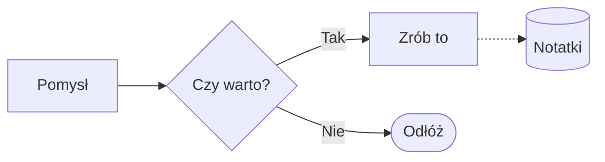
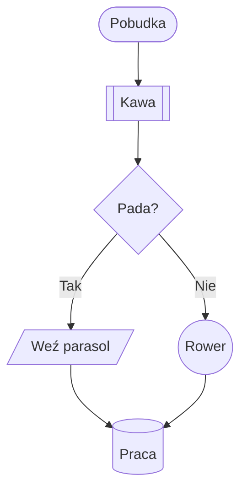
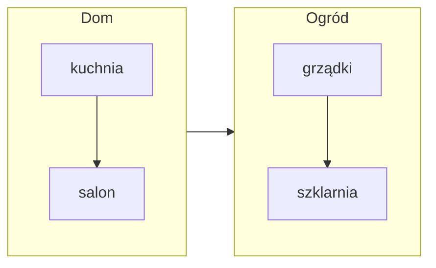
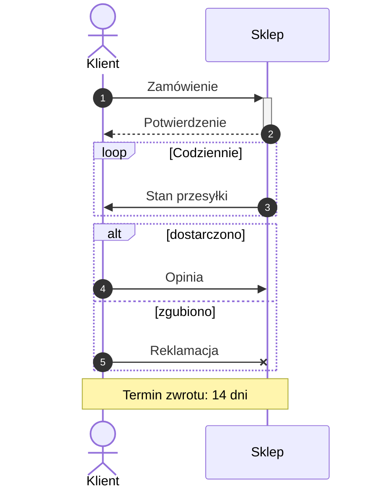
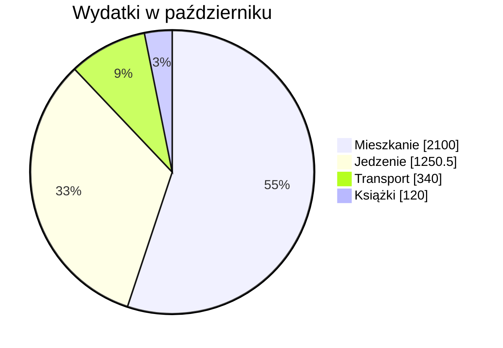
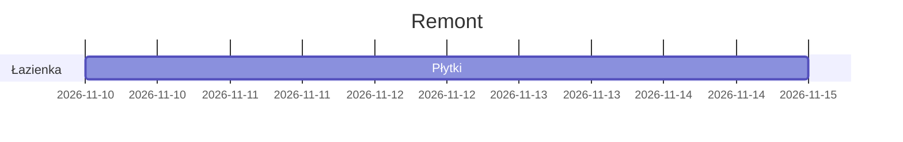

# Diagramy

Schemat blokowy, przebieg rozmowy między ludźmi albo programami czy wykres kołowy zapiszesz w notatce tekstem, w składni [Mermaid](https://mermaid.js.org) — tej samej, którą znają Obsidian, GitHub i GitLab. Brulion od razu rysuje z niego diagram, w kolorach motywu, jasnego albo ciemnego. W pliku zostaje samo źródło, więc notatka dalej jest zwykłym Markdownem.

Brulion rysuje diagramy sam, bez internetu i bez uruchamiania czegokolwiek z notatki. Dlatego diagram z notatki, która przyszła z synchronizacji albo z importu, jest bezpieczny: linki i polecenia `click` są pomijane, a style przyjmują tylko kolory, grubości i przerywane linie.

## Jak wstawić diagram
Wpisz `/Diagram` na początku bloku — powstanie mały schemat do przerobienia. Możesz też napisać blok sam:

Kliknij diagram, żeby zobaczyć i poprawić źródło — pod nim od razu widać zmieniony diagram. Gdy coś się nie zgadza, Brulion pokazuje źródło i pod nim, w którym wierszu jest błąd. Diagram szerszy niż kolumna notatki jest pomniejszony, a gdy byłby za mały do czytania, przeciągniesz go na boki palcem albo myszą.

## Schematy blokowe
Pierwsza linia to `flowchart` (albo `graph`) i kierunek: `TD` — z góry na dół, `LR` — od lewej do prawej, `BT` i `RL` — odwrotnie.

**Kształty węzłów:** `A[prostokąt]`, `A(zaokrąglony)`, `A([stadion])`, `A[[podprogram]]`, `A[(baza danych)]`, `A((koło))`, `A(((podwójne koło)))`, `A>flaga]`, `A{romb}`, `A{{sześciokąt}}`, `A[/równoległobok/]`, `A[\odwrotny\]`, `A[/trapez\]`, `A[\odwrócony trapez/]`. Tekst z nawiasami albo średnikiem weź w cudzysłów: `A["Etap 1 (próbny)"]`; ` ` łamie linię.

**Połączenia:** `-->` strzałka, `---` linia, `-.->` kropkowana, `A ==> B` gruba, `--o` z kółkiem, `--x` z krzyżykiem, `<-->` w obie strony, `~~~` niewidoczne (porządkuje układ). Dłuższa strzałka (`--->`) rozsuwa węzły. Napis na połączeniu: `A -->|tak| B` albo `A -- tak --> B`. Kilka naraz: `A --> B --> C` i `A & B --> C`.

**Grupy** (podgrafy) z tytułem — także jedne w drugich i z własnym kierunkiem:

**Kolory:** `classDef ważne fill:#f96,stroke:#333` i `class A ważne` (albo `A:::ważne`), `style A fill:#bbf`, `linkStyle 0 stroke:red`. Kolory zapisuje się jako `#f96`, `#ff9966`, `rgb(255,153,102)` albo nazwą (`red`, `lightblue`). Węzeł z własnym wypełnieniem dostaje ciemny albo jasny napis, zależnie od tego, co będzie lepiej widać.

## Diagramy sekwencji
Kto do kogo pisze i w jakiej kolejności:

Uczestnicy to `participant` (prostokąt) i `actor` (ludzik), z nazwą po `as`; uczestnik, którego nie zapowiesz, pojawi się przy pierwszej wiadomości. Strzałki: `->>` zwykła, `-->>` kropkowana, `->` i `-->` bez grotu, `-x` z krzyżykiem, `-)` otwarta, `<<->>` w obie strony. `+` i `-` po strzałce (albo `activate` i `deactivate`) zaznaczają, kto jest zajęty. Notatki: `Note left of A`, `Note right of A`, `Note over A,B`. Bloki: `loop`, `alt`/`else`, `opt`, `par`/`and`, `critical`/`option`, `break` i `rect` z kolorem tła; `box` grupuje uczestników, `autonumber` numeruje wiadomości.

## Wykresy kołowe

Każdy wycinek to `"Nazwa" : wartość` (ułamki z kropką). `showData` dopisuje wartości w legendzie. Wartości zero i ujemne są pomijane.

## Czego Brulion jeszcze nie rysuje
Inne rodzaje diagramów Mermaid — `classDiagram`, `stateDiagram`, `erDiagram`, `gantt`, `mindmap`, `timeline`, `gitGraph` i pozostałe — Brulion rozpoznaje, ale pokazuje jako źródło z dopiskiem, że jeszcze ich nie rysuje. Nic się nie gubi: Obsidian i GitHub narysują je z tego samego pliku.

Układ węzłów jest podobny do tego z Obsidiana, ale nie identyczny co do piksela. Bardzo duże diagramy (ponad 1000 węzłów, 3000 połączeń, 100 kB tekstu albo rysunek dłuższy niż 50 000 pikseli) nie są rysowane — Brulion pokazuje wtedy źródło i wyjaśnia dlaczego.

## Eksport
Eksport HTML (strona i jeden plik) zawiera diagram jako obraz SVG, który ciemnieje razem z ciemnym motywem przeglądarki, a pod nim zwinięte źródło. W eksporcie do Markdowna, Obsidiana, Logseqa i Pandoca zostaje źródło (Pandoc z dodatkiem `mermaid-filter` też je narysuje). Skopiowany blok trafia do schowka jako źródło.

Zobacz też [[Wzory matematyczne|Wzory matematyczne]] — tam podobnie piszesz tekstem, a Brulion rysuje wzór.
