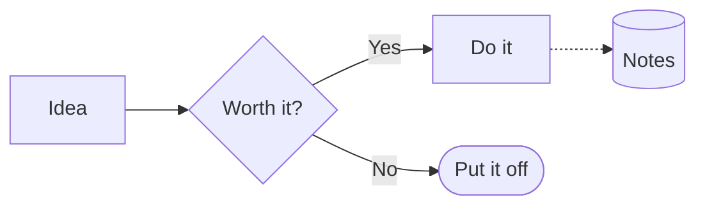
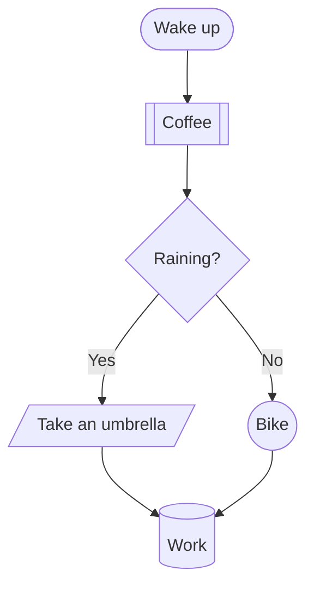
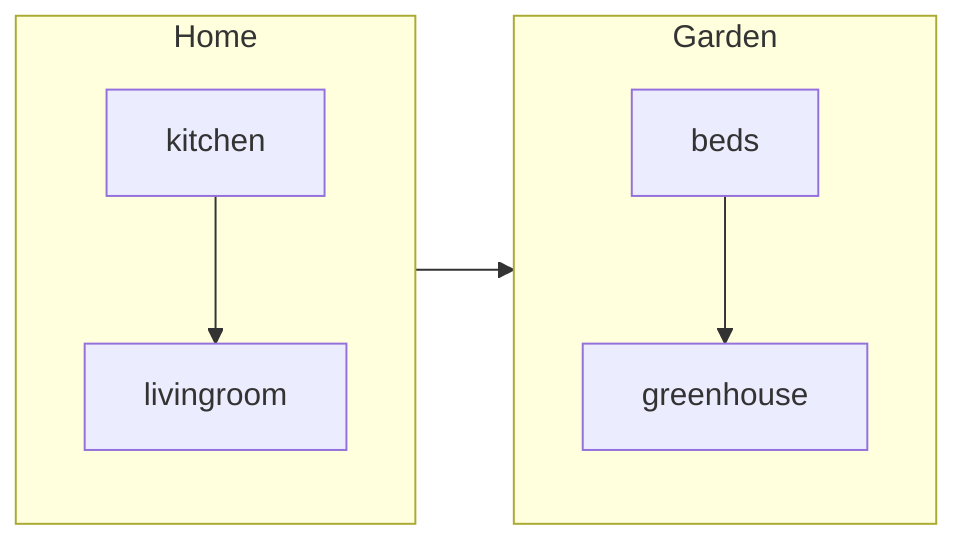
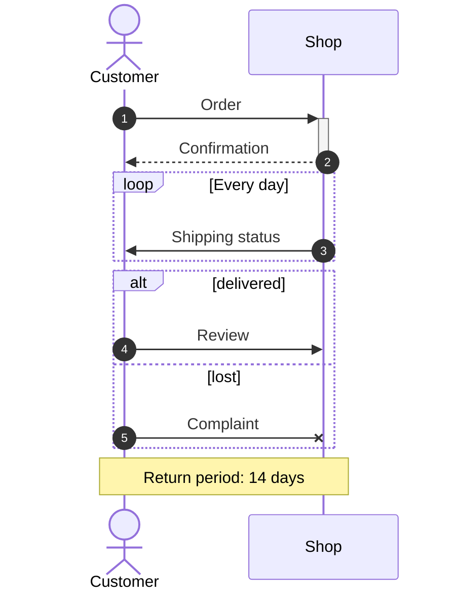
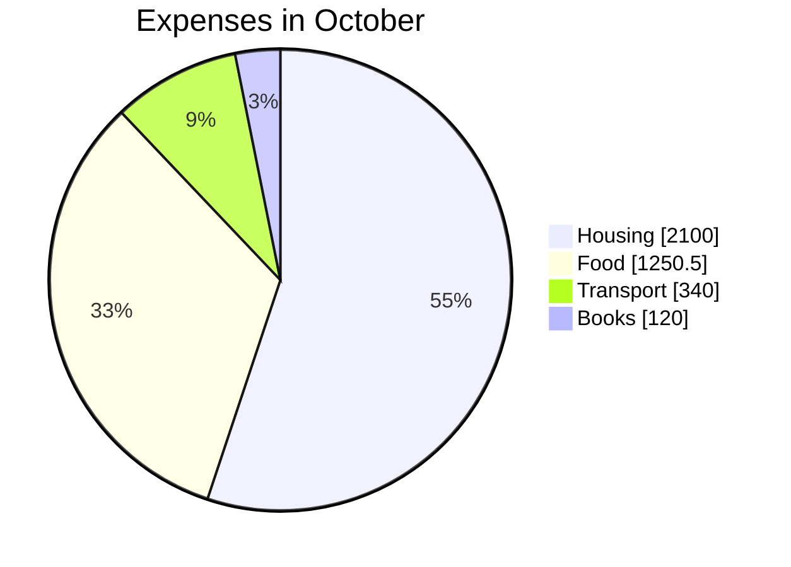
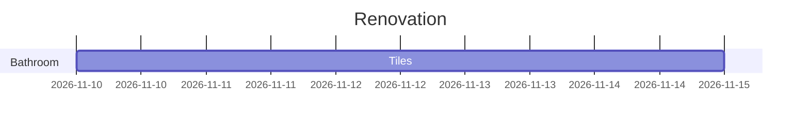

# Diagrams

A flowchart, the course of a conversation between people or programs, or a pie chart can be written in a note as text, in the [Mermaid](https://mermaid.js.org) syntax — the same one Obsidian, GitHub and GitLab know. Brulion draws a diagram from it right away, in the colors of the theme, light or dark. The file keeps only the source, so the note stays plain Markdown.

Brulion draws diagrams by itself, without the internet and without running anything from the note. That is why a diagram from a note that came through sync or an import is safe: links and `click` commands are skipped, and styles accept only colors, line widths and dashed lines.

## How to insert a diagram
Type `/Diagram` at the start of a block — a small chart appears for you to rework. You can also write the block yourself:

Click the diagram to see and correct its source — the changed diagram shows right below it. When something is wrong, Brulion shows the source and, below it, the line with the error. A diagram wider than the note's column is scaled down, and when it would get too small to read, you drag it sideways with your finger or the mouse.

## Flowcharts
The first line is `flowchart` (or `graph`) and the direction: `TD` — top to bottom, `LR` — left to right, `BT` and `RL` — the other way round.

**Node shapes:** `A[rectangle]`, `A(rounded)`, `A([stadium])`, `A[[subroutine]]`, `A[(database)]`, `A((circle))`, `A(((double circle)))`, `A>flag]`, `A{diamond}`, `A{{hexagon}}`, `A[/parallelogram/]`, `A[\reversed\]`, `A[/trapezoid\]`, `A[\inverted trapezoid/]`. Put text with brackets or a semicolon in quotes: `A["Stage 1 (trial)"]`; ` ` breaks a line.

**Links:** `-->` arrow, `---` line, `-.->` dotted, `A ==> B` thick, `--o` with a circle, `--x` with a cross, `<-->` both ways, `~~~` invisible (tidies the layout). A longer arrow (`--->`) moves nodes further apart. Text on a link: `A -->|yes| B` or `A -- yes --> B`. Several at once: `A --> B --> C` and `A & B --> C`.

**Groups** (subgraphs) with a title — also nested and with their own direction:

**Colors:** `classDef important fill:#f96,stroke:#333` and `class A important` (or `A:::important`), `style A fill:#bbf`, `linkStyle 0 stroke:red`. Colors are written as `#f96`, `#ff9966`, `rgb(255,153,102)` or by name (`red`, `lightblue`). A node with its own fill gets dark or light text, whichever will be easier to see.

## Sequence diagrams
Who writes to whom, and in what order:

Participants are `participant` (a rectangle) and `actor` (a stick figure), with a name after `as`; a participant you don't announce appears at its first message. Arrows: `->>` plain, `-->>` dotted, `->` and `-->` without an arrowhead, `-x` with a cross, `-)` open, `<<->>` both ways. `+` and `-` after an arrow (or `activate` and `deactivate`) mark who is busy. Notes: `Note left of A`, `Note right of A`, `Note over A,B`. Blocks: `loop`, `alt`/`else`, `opt`, `par`/`and`, `critical`/`option`, `break` and `rect` with a background color; `box` groups participants, `autonumber` numbers the messages.

## Pie charts

Each slice is `"Name" : value` (decimals with a point). `showData` adds the values to the legend. Zero and negative values are skipped.

## What Brulion does not draw yet
Other kinds of Mermaid diagrams — `classDiagram`, `stateDiagram`, `erDiagram`, `gantt`, `mindmap`, `timeline`, `gitGraph` and the rest — are recognized by Brulion, but shown as source with a note that it doesn't draw them yet. Nothing is lost: Obsidian and GitHub draw them from the same file.

The layout of the nodes is similar to Obsidian's, but not identical to the pixel. Very large diagrams (over 1000 nodes, 3000 links, 100 kB of text or a drawing longer than 50,000 pixels) aren't drawn — Brulion then shows the source and explains why.

## Export
HTML export (a site and a single file) contains a diagram as an SVG picture that darkens together with the browser's dark theme, with the source folded below it. In export to Markdown, Obsidian, Logseq and Pandoc the source stays (Pandoc with the `mermaid-filter` add-on draws it too). A copied block goes to the clipboard as its source.

See also [[Math formulas|Math formulas]] — there, too, you write text and Brulion draws the formula.
