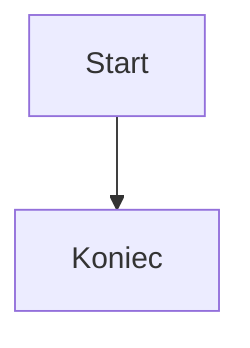

Plan ogrodu na rok 2026. Tekst **pogrubiony**, _kursywa_, podkreślenie, ~~przekreślenie~~, `kod_w_linii()`, H<sub>2</sub>O, m<sup>2</sup>, <kbd>Ctrl</kbd>+<kbd>S</kbd>, ==zaznaczenie==, <span style="color:hsl(0,75%,60%);">czerwony tekst</span> i emoji 🌱.

Znaki specjalne: \<script\>alert(1)\</script\>, \*gwiazdki\*, \_podkreślniki\_, \[nawiasy\], a&b, 100% i \\ukośnik.

\# To nie jest nagłówek

## Nagłówek drugiego poziomu

### Nagłówek trzeci — zażółć gęślą jaźń

#### Czwarty

*   Warzywa
    *   marchew
    *   pietruszka
*   Kwiaty

1.  Pierwszy krok
2.  Drugi krok

5.  Lista od piątki

- [x] Zrobione
- [ ] Do zrobienia

| Roślina | Koszt |
| --- | --- |
| Pomidory | 12,50 zł |
| **Ogórki** \| gruntowe | 8 zł |

Budżet

```python
def podlej(grządka):
    return "podlano: " + grządka

```

```javascript
const a = 1 < 2 && true;
```

```plain
zwykły tekst
  z wcięciem
```



> Cytat: „Kto sieje wiatr, ten zbiera burzę.”

> [!TIP]
> Wskazówka: podlewaj rano.

> [!WARNING]
> Uwaga na **przymrozki**!

Wzór w linii $E=mc^2$ i blokowy:

$$\sum_{i=1}^{n} i = \frac{n(n+1)}{2}$$

Przypis do tekstu<sup><a href="#fnk3m9x2a7pq">[1]</a></sup>.

<details>
    <summary>Szczegóły (zwijane)</summary>
    <p>Ukryta treść.</p>
</details>

---

## Linki

Odnośnik referencyjny: <a class="reference-link" href="#root/iUJGQRAJsClg/bAd83nHSpLcN">Spotkanie 2026-10-14</a>.

Zwykły link wewnętrzny z własnym tekstem: [autor planu](#root/qzx6J0xCO5Kv/IptZENNHqyOT); do klonu przez drugą ścieżkę: [spotkanie w archiwum](#root/fPS5mgaTqSlT/bAd83nHSpLcN).

Do innego poddrzewa: <a class="reference-link" href="#root/6iAVjLby85IN/w4FqDSgxG9FB">Osoba (szablon)</a>, do folderu: <a class="reference-link" href="#root/iUJGQRAJsClg/DhBOAwdGMoQT">Kod</a>, do kodu: <a class="reference-link" href="#root/iUJGQRAJsClg/DhBOAwdGMoQT/bEoJGu6WjWiq">skrypt.js</a>, do duplikatu: <a class="reference-link" href="#root/iUJGQRAJsClg/MEwKAQP8OxLz">Zadania</a>, do dnia: <a class="reference-link" href="#root/agCcQUtcdayz/HULw7G98Q3y5/wmdigWWgoXVU/QvazGtrLKJSj">16 - Piątek</a>.

Do notatki chronionej: <a class="reference-link" href="#root/fPS5mgaTqSlT/SPJH76C4eYMb">Sekretne hasła</a>, do wykluczonej: <a class="reference-link" href="#root/fPS5mgaTqSlT/iV70vT43xnIg">Nie eksportuj</a>, do nieistniejącej: <a class="reference-link" href="#root/Brakuj4cy123">[missing note]</a>.

Zewnętrzny: [example.org](https://example.org/ścieżka?a=1&b=2), mail: [ogrod@example.org](mailto:ogrod@example.org).

Załącznik (plik): <a class="reference-link" href="#root/iUJGQRAJsClg/TL92HoHrdkUW?viewMode=attachments&amp;attachmentId=pnWoNdkwV7b0">lista zakupów.txt</a>.

Podgląd linku: <span class="link-mention" data-url="https://example.org/" data-embed-type="opengraph" data-title="Example Domain"><a href="https://example.org/">Example Domain</a></span> w zdaniu.

<section class="link-embed" data-url="https://example.org/artykul" data-embed-type="opengraph" data-title="Artykuł o ogrodach" data-description="Opis artykułu" data-site-name="Example"><a href="https://example.org/artykul">Artykuł o ogrodach</a></section>

Ikona w linii <span class="tn-icon bx bx-star"></span> w tekście.

## Obrazy i osadzenia

<figure class="image image-style-align-left"><figcaption>Zdjęcie grządki (załącznik)</figcaption></figure>

Obraz z notatki-obrazu w linii: 

<figure class="image"></figure><section class="include-note" data-note-id="ZOVWOPPdRaV5" data-box-size="medium">&nbsp;</section>

1.  <sup><strong><a href="#fnrefk3m9x2a7pq">^</a></strong></sup>
    
    Treść przypisu z _ogonkami_: ąćęłńóśźż.